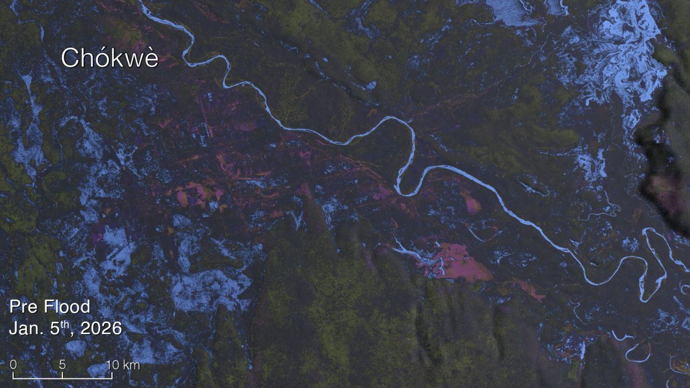
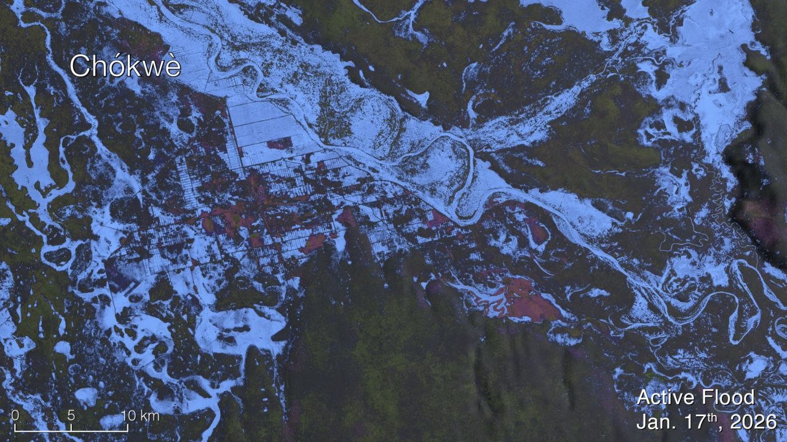
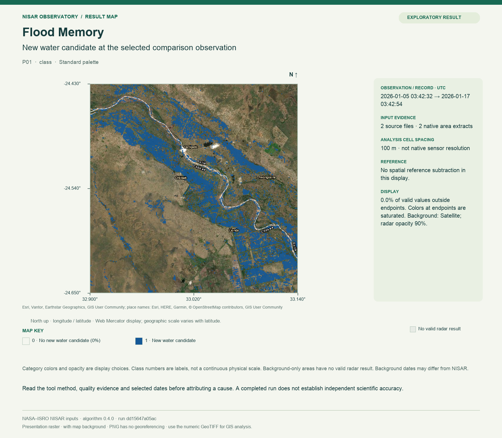

# Chókwè flood, Mozambique

New candidates (**90.47 km²**) and net candidate-area change (**approximately +75.49 km²**) are different: about **14.98 km²** lost the candidate label elsewhere. The latter is not proof of physical drying. These calculations use rounded recorded areas on the same common footprint.

## Comparison assessment

**Qualitative event comparison.** A reproducible two-date water-candidate expansion consistent with NASA’s floodplain imagery; classification accuracy is unmeasured.

| Alignment | Published / reference | This example |
|---|---|---|
| Quantity | Open-water illustration and HH/HV/ratio composite | New threshold-defined water candidates · km² |
| Support | Respect the original extent, dates and masks | Smaller Chókwè rectangle; 593.92 km² common usable support. Do not compare total blue area across the two map extents. |

**What agrees**

- The selected NISAR dates match NASA’s 5 and 17 January 2026 observations.
- New low-return candidates follow the floodplain expansion visible in NASA’s reference views.

**What differs**

- NASA shows wider perspective imagery and a polarimetric composite; our smaller north-up map is a binary change rule.
- Our −17 dB HH rule and 100 m grid are explicit; NASA’s complete classification recipe and exact source identities are not supplied.

**Still unverified**

- No georeferenced independent water mask or field labels: no justified precision, recall or IoU.
- With only two observations, later recovery and flood duration are unobserved.

**Next useful validation:** Independent dated inundation labels on the same footprint, plus later acquisitions to assess recovery.

Protected input checksums and unchanged guided/editable replay test implementation reproducibility; they do not test environmental accuracy.

[Seven-case evidence review and demonstration choice](../../docs/EXAMPLE_EVIDENCE_REVIEW.md).

**Tool:** Flood Memory (P01) · NASA/ASF L-band GCOV.

Two observations of an expanding floodplain

## Question

Where did dark open-water candidates appear between 5 and 17 January 2026?

## Run this example

1. Start the app and open **Examples → Chókwè flood, Mozambique**.
2. The page loads the exact tested rectangle, settings, reference (where needed) and protected local inputs. Review the data readiness status.
3. Read the method and reference caveats, then click **Start example analysis**. No download or analysis starts just by opening a tutorial.
4. Read Main results first, then Explore time, Quality & reliability and Advanced maps. Results are saved normally in Runs.
5. Export numeric GeoTIFFs, result JSON or map images with legends for further inspection. A new exploration does not remove bundled inputs.

## Required observations

All files are NASA/ASF L-band native-grid HDF5 area subsets, not full originals. The area is [32.9, -24.65, 33.14, -24.43] (west, south, east, north).

| Scene start · UTC | Scene end · UTC | Group | NASA granule |
|---|---|---|---|
| 2026-01-05 03:42:32 | 2026-01-05 03:42:53 | 114_A_165_4005_DHDH_X05010 | G4058657013-ASF |
| 2026-01-17 03:42:32 | 2026-01-17 03:42:54 | 114_A_165_4005_DHDH_X05010 | G4059040862-ASF |

## Exact processing settings

| Setting | Value |
|---|---|
| resolution | 100 |
| channel | "HHHH" |
| water_threshold | -17 |
| water_method | "single" |
| min_valid_fraction | 0.5 |
| flood_date | "2026-01-17" |

The opening map is **New water at the comparison date**, using the standard categorical water colors. It highlights the new candidates rather than simply repeating the latest acquisition.

## How the calculation works

The tool masks native GCOV samples, averages calibrated HH power on a 100 m equal-area grid, converts to dB and applies the fixed −17 dB water-candidate rule. It compares exactly the common usable ground between observations. No ground reference is required.

## Read the results

Start with New water at the comparison date. Blue candidates are low radar returns consistent with open water, not confirmed inundation. Explore time shows each acquisition separately. With no later date, no return to dry is observed; an unavailable recovery map is expected.

## Previous results and what to compare

The previous run found 90.47 km² of new candidates on 593.92 km² of common ground. Water-candidate area was 25.16 km² before and 100.65 km² during the event. These are regression targets for this recipe, not measured environmental accuracy.

| Aspect | Published / independent evidence | Our study |
|---|---|---|
| Dates | 5 and 17 January 2026 | Same dates and local GCOV coverage |
| View | Wider NASA perspective image | Smaller north-up Chókwè rectangle |
| Validation | Published illustration | No justified pixel accuracy score |

### Previous Chókwè measurements · identical common ground

| Measurement | Previous documented result |
| --- | --- |
| 5 January candidate water | 25.16 km² |
| 17 January candidate water | 100.65 km² |
| New candidates | 90.47 km² |
| Common usable ground | 593.92 km² |
| Observed later recovery | Not observed; no later date selected |

## Visual comparison

Compare the appearance and location of flood-related water, not identical colors or pixels. NASA shows a wider perspective scene; our result maps newly detected candidates in a smaller north-up rectangle.

### Published reference · NASA · before the flood · 5 January 2026

Published perspective view of the Chókwè region before the event. Compare it with NASA’s 17 January view below, then inspect the app’s smaller north-up change map.

Credit: NASA Scientific Visualization Studio · visualization 5661. [View original publication](https://svs.gsfc.nasa.gov/5661/).

### Published reference · NASA · active flood · 17 January 2026

Blue areas show the published radar visualization of flood conditions. This is a wider perspective scene, not our binary new-water classification or a numerical validation mask.

Credit: NASA Scientific Visualization Studio · visualization 5661. [View original publication](https://svs.gsfc.nasa.gov/5661/).

### Our NISAR result · Our result · new water candidates

GCOV · 5 → 17 January 2026 · 100 m analysis grid. Blue marks newly detected low-return water candidates; the Satellite basemap remains visible where no new-water candidate is mapped. Place names provide geographic context. This is not flood depth; background imagery dates may differ from NISAR.

Credit: NISAR Observatory · user-provided result export.

## Map controls

The active legend and **Radar overlay opacity** slider are directly below the map. Continuous measurements allow Default, Diverging and Rainbow palettes with automatic or custom ranges. Class, observed-date and patch-ID maps show labelled editable colour swatches instead of numerical range controls. Click a swatch to edit its colour or reset the shared category styles. Save the opening view to retain edits with the run. Unavailable maps explain the missing evidence. The result plot has no duplicate miniature color key. Downloaded map PNGs still include the matching legend.

## Limits

NASA publishes a wider perspective visualization, without a numerical reference mask or full classifier recipe. Our smaller north-up rectangle supports qualitative comparison only. Vegetation, roughness, dry fields and shadow can confound the threshold. Changing −17 dB to −18/−16 dB changed new-candidate area to 51.40/116.75 km².

## Sources

- [NISAR reveals flooding around Chókwè, Mozambique](https://svs.gsfc.nasa.gov/5661/): Compare 5 and 17 January 2026 open-water views and HH/HV false-color composites. The Mozambique preset selects a smaller Chókwè study window. This is a NASA visualization, not a peer-reviewed paper or an independent accuracy mask; two dates show change but cannot establish recovery.

## Input storage and reproducibility

`inputs/` contains protected example inputs and their metadata. `input-manifest.json` records checksums, sizes and exact filenames after download. The app checks every required input before enabling this example. Runs and array-cache deletion cannot remove these files. Files can still be removed manually outside the app; missing or damaged files disable the example instead of substituting other data. No credentials are stored here. Downloading once requires Earthdata sign-in; complete examples run locally thereafter.

The comparison reports in `references/` are historical records and can contain old run identifiers or earlier instructions; this tutorial and `example.json` define the current example setup.

## Fresh-subset reproduction check · 19 October 2026

All 2 protected inputs passed checksums and source checks, and the app completed this recipe with **zero remote science bytes**. The numerical replay targets agree with the previously documented experiment. Numeric raster export, map image with legend, and saved display settings were checked. Engineering replay does not establish independent environmental accuracy.

[Read the reproduction check](references/fresh-subset-verification.json). The generated result is available in Runs as `740aa9b6` while that run is retained. Deleting a normal run does not remove the protected example inputs or the tutorial figures.

Colour and category-opacity edits are shared across matching dates of this classification, including playback and PNG exports. Use 0% opacity for a valid background class to reveal the basemap; missing observations stay transparent. Different classifications retain separate styles. Save the opening view to retain these settings.

### Image export area

Use **Download PNG** and choose **PNG area → Full result area** or **Current map view · zoom & surroundings**. The current-view image follows the camera at download time while retaining the active colour range and legend. **Include background** adds the selected basemap; place names follow the main map switch. Reference outlines are omitted from new PNG exports; recorded comparison figures above retain their historical appearance. **Download GeoTIFF** keeps the full saved numeric raster and georeferencing, independent of the PNG area.

## Experiment with editable steps

In the app tutorial, choose **Load editable workflow** to restore this case’s protected inputs, shared settings and opening view as editable processing cards. Choose **Check workflow → Run workflow** to replay it unchanged. Rename and **Save as my tool** before trying a variant. Removing a required block prevents running; optional stages and compatible additions change the experiment. The established tutorial comparison applies to the tested setup. [Block guide and limits](../../docs/WORKFLOWS.md) · [Portable recipe](../../Recipes/P01_Mozambique.json).

## Verification scope · refinement release 0.8.0

**Qualitative NASA comparison.** Same acquisition dates; NASA perspective figures are not a georeferenced flood reference mask. Engineering replay and intact inputs do not establish environmental accuracy. Transfer to a new region or edited workflow requires new evaluation.

The current release uses exact baseline validation, source/grid-aware caches and one shared normalized Gaussian (reflected edges, minimum 30% finite kernel support, no filling missing central cells). P03 clips its numeric domain to the selected geographic rectangle. Published and user-supplied gallery images remain historical illustrations; a fresh run retains its own algorithm and execution fingerprint. See [the refinement record](../../docs/REFINEMENT_0_8.md).

## Guided discovery and controlled experiments · 0.9.0

Where did new water candidates appear?

1. Open this tutorial in **Examples**. Read its hypothesis, alternative explanations and independent-evidence limits.
2. Choose **Explore the recorded result** to inspect previously computed protected maps immediately. This is read-only and starts no analysis or login.
3. Choose **Run it yourself**, then **Start example analysis**, to create your own saved run with the exact inputs and opening scale documented here.
4. Read **What this run found**, the map units and Quality & reliability. Use **Compare acquired observations** only for compatible actual states; acquisition gaps remain unobserved.
5. Choose **Make a controlled experiment** to load the executed recipe as editable steps. Change the single-channel threshold by 1 dB, rerun, and compare candidate area on the same footprint.
6. Run the variant, then choose **Compare with another run**. Compare scientific settings, jointly valid cells and matching maps with shared limits. A changed workflow does not inherit this case’s evaluation.
7. Download the **study report** to keep the selected map, full legend, observed summaries, sources, settings and limitations in a self-contained printable HTML file. Keep the exact recipe JSON and numeric GeoTIFF for further work.

**A responsible next step:** Use independently mapped inundation on the same dates and footprint. Add later observations to investigate a return to dry.

[Full study guide](../../docs/STUDY_GUIDE.md). The `recorded/` folder stores this example’s protected computed result and checksum manifest; `inputs/` stores the protected satellite subsets. Ordinary run/cache cleanup does not remove either.
