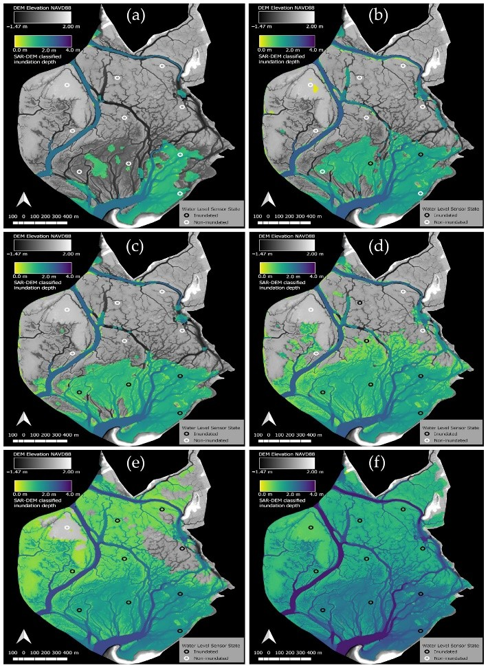
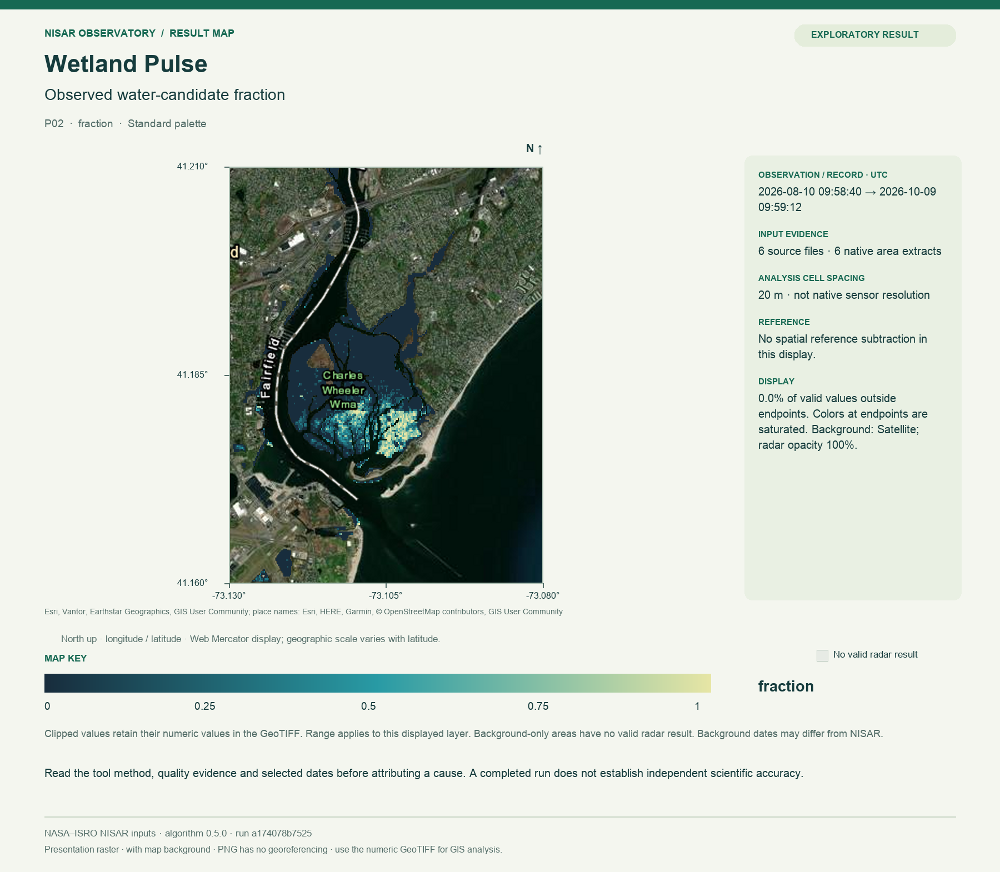
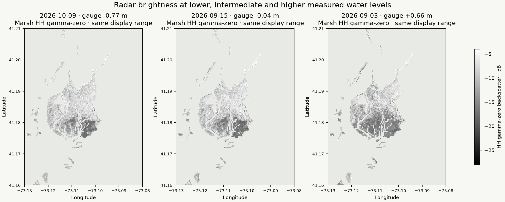

# Wheeler Marsh, Connecticut

## Comparison assessment

**Method adaptation with tide context.** A historical HH/HV wetland rule transferred to six NISAR observations, with descriptive nearby-gauge association; no pixel-level inundation accuracy is established.

| Alignment | Published / reference | This example |
|---|---|---|
| Quantity | Historical inundation extent and SAR–DEM depth classes | Observed water-candidate fraction · 0–1, plus candidate area per date |
| Support | Respect the original extent, dates and masks | Fixed declared marsh domain and usable observation counts. Six discrete snapshots do not measure continuous hydroperiod. |

**What agrees**

- The nominal HH/HV sigma-zero thresholds follow the historical marsh method.
- The archived six-date candidate-area series is more strongly associated with the nearby tide gauge than the earlier HH-only series.

**What differs**

- The papers and reference panels use historical PALSAR dates, field measurements, filtering and tide/DEM modelling; our dates are August–October 2026 NISAR.
- A nearby Bridgeport gauge supplies context rather than contemporaneous labels for each marsh cell.

**Still unverified**

- Spearman 0.829 for six observations is descriptive association, not accuracy or causation; no independent test set is supplied.
- Historical published accuracy, depth and volume results do not transfer to this run.

**Next useful validation:** Contemporaneous in-marsh water-level/inundation measurements, independently sampled labels and more tide states.

Protected input checksums and unchanged guided/editable replay test implementation reproducibility; they do not test environmental accuracy.

[Seven-case evidence review and demonstration choice](../../docs/EXAMPLE_EVIDENCE_REVIEW.md).

**Tool:** Wetland Pulse (P02) · NASA/ASF L-band GCOV.

Tidal wetland pulses through six radar observations

## Question

How often do marsh cells meet a paper-inspired HH/HV inundation rule on six observed dates?

## Run this example

1. Start the app and open **Examples → Wheeler Marsh, Connecticut**.
2. The page loads the exact tested rectangle, settings, reference (where needed) and protected local inputs. Review the data readiness status.
3. Read the method and reference caveats, then click **Start example analysis**. No download or analysis starts just by opening a tutorial.
4. Read Main results first, then Explore time, Quality & reliability and Advanced maps. Results are saved normally in Runs.
5. Export numeric GeoTIFFs, result JSON or map images with legends for further inspection. A new exploration does not remove bundled inputs.

## Required observations

All files are NASA/ASF L-band native-grid HDF5 area subsets, not full originals. The area is [-73.13, 41.16, -73.08, 41.21] (west, south, east, north).

| Scene start · UTC | Scene end · UTC | Group | NASA granule |
|---|---|---|---|
| 2026-08-10 09:58:40 | 2026-08-10 09:59:13 | 133_A_022_4005_DHDH_P05023 | G4277063540-ASF |
| 2026-08-22 09:58:40 | 2026-08-22 09:59:12 | 133_A_022_4005_DHDH_P05023 | G4288404845-ASF |
| 2026-09-03 09:58:39 | 2026-09-03 09:59:12 | 133_A_022_4005_DHDH_P05023 | G4298883436-ASF |
| 2026-09-15 09:58:39 | 2026-09-15 09:59:12 | 133_A_022_4005_DHDH_P05023 | G4314046400-ASF |
| 2026-09-27 09:58:39 | 2026-09-27 09:59:12 | 133_A_022_4005_DHDH_P05023 | G4327549825-ASF |
| 2026-10-09 09:58:40 | 2026-10-09 09:59:12 | 133_A_022_4005_DHDH_P05023 | G4357432044-ASF |

## Exact processing settings

| Setting | Value |
|---|---|
| patch_area_m2 | 30000.0 |
| water_unknown_db | 1.0 |
| compare_polarizations | true |
| spatial_context | Bundled independent spatial context |
| resolution | 20.0 |
| water_method | "hh_hv" |
| water_hh_threshold | -14.0 |
| water_hv_threshold | -23.0 |
| min_valid_fraction | 0.5 |
| channel | "HHHH" |

## How the calculation works

The integrated method multiplies native linear HH and HV power by the delivered gamma-to-sigma factor before averaging to 20 m. A candidate must satisfy HH sigma-zero < −14 dB AND HV sigma-zero < −23 dB. The bundled independent wetland polygons define the marsh domain and named zones. Frequency counts observations; no reference rectangle is needed.

## Read the results

Start with observed water-candidate frequency on a fixed 0–1 scale. One sixth means one of six usable observations, not one sixth of all elapsed time. Explore time shows the six measured snapshots. Named-zone plots compare the supplied habitat zones; their labels are independent inventory information.

## Previous results and what to compare

The integrated previous run mapped 0.1228–0.6784 km² per date. Its nearby-gauge Spearman association was 0.829, versus 0.314 for the previous HH-only method. On 3 September, candidates covered 0.6784 km². These six-date associations are descriptive, not classification accuracy.

| Aspect | Published / independent evidence | Our study |
|---|---|---|
| Sensor | Historical PALSAR in the papers | 2026 NASA NISAR L-band |
| Rule | Joint HH/HV sigma-zero thresholds | Same nominal thresholds; delivered conversion |
| Field evidence | Study sensors and tide models | Nearby measured gauge, no contemporaneous pixel labels |

### Previous six-date method comparison

| Acquisition date | Nearby gauge · m NAVD88 | HH-only candidates · km² | HH/HV candidates · km² |
| --- | --- | --- | --- |
| 2026-08-10 | -0.375 | 0.0900 | 0.2548 |
| 2026-08-22 | 0.562 | 0.2412 | 0.5064 |
| 2026-09-03 | 0.660 | 0.1060 | 0.6784 |
| 2026-09-15 | -0.043 | 0.1260 | 0.3044 |
| 2026-09-27 | -0.186 | 0.0104 | 0.1228 |
| 2026-10-09 | -0.773 | 0.1076 | 0.2460 |

## Visual comparison

This is a method-transfer comparison, not a same-date map match. The historical study estimates inundation and depth from PALSAR plus terrain and field evidence; our NISAR result reports water-candidate frequency. The study’s accuracy cannot be assigned to this app.

### Published reference · USGS study · historical tidal inundation sequence

Six historical PALSAR panels show inundation extent and SAR–DEM classified depth against terrain and water-level sensor states. The green/blue depth scale belongs to that study. These are not our six 2026 NISAR dates.

Credit: USGS · Brian T. Lamb · published Figure 1. [View original publication](https://eros.usgs.gov/doi-remote-sensing-activities/2025/usgs/coastal-inundation-monitoring-nisar).

### Our NISAR result · Our result · observed water-candidate frequency

NISAR GCOV · six dates, 10 August–9 October 2026 · 20 m grid. The 0–1 scale counts the fraction of usable observations meeting the joint HH/HV rule inside the supplied marsh domain. It does not measure depth or continuous time underwater. The Standard palette is shown over the Satellite basemap with place names and 100% radar opacity; background imagery dates may differ from NISAR.

Credit: NISAR Observatory · user-provided P02 export · run a174078b7525.

### Supporting context · Supporting evidence · radar response and nearby tides

The recorded six-date test compares radar measurements and candidate area with acquisition-time Bridgeport gauge levels. The gauge is nearby, not a pixel-level flood label; tide association is descriptive evidence, not classification accuracy.

Credit: NISAR Observatory · documented Wheeler Marsh study.

## Map controls

The active legend and **Radar overlay opacity** slider are directly below the map. Continuous measurements allow Default, Diverging and Rainbow palettes with automatic or custom ranges. Class, observed-date and patch-ID maps show labelled editable colour swatches instead of numerical range controls. Click a swatch to edit its colour or reset the shared category styles. Save the opening view to retain edits with the run. Unavailable maps explain the missing evidence. The result plot has no duplicate miniature color key. Downloaded map PNGs still include the matching legend.

## Limits

The publications use historical PALSAR scenes, different dates, filtering and field/tide modelling. This is a transfer of their HH/HV rule to new NISAR data, not a recreation of the published pixels. The Bridgeport gauge is nearby rather than an in-marsh flood label; tidal lag and vegetation matter. Do not infer depth, volume or continuous hydroperiod. The 9 October gauge record was provisional in the archived receipt; nearby-gauge levels are not marsh water depth. The source report retains tide-screening dates, timing and weather context.

## Sources

- [Radar observations of tidal-marsh inundation](https://doi.org/10.3390/rs17020263): Compares SAR inundation evidence with radiometric modeling and measured water levels at tidal marshes. Explains why vegetation and tide context matter for wetness interpretation.

- [Wheeler Marsh: inundation, depth and tide-gauge methods](https://doi.org/10.3390/rs18081172): Extends the Wheeler study with HH/HV sigma-zero thresholds, a DEM and calibrated synthetic tide gauges. P02 now adapts the joint threshold rule after native conversion, but does not reproduce the filtering, depth, volume or published accuracy.

- [Wheeler Marsh: USGS NISAR validation site](https://eros.usgs.gov/doi-remote-sensing-activities/2025/usgs/coastal-inundation-monitoring-nisar): Explains current water-level sensor deployments and shows historical PALSAR inundation maps. The illustrated 90% accuracy belongs to that earlier study, not this app or our 2026 NISAR test.

- [Bridgeport tide gauge: context for the satellite dates](https://www.tidesandcurrents.noaa.gov/stationhome.html?id=8467150): Check measured water levels at each acquisition time, rather than predictions alone. Levels use a stated vertical datum and do not measure water depth in each marsh pixel; local tidal lag and ponding still matter.

## Input storage and reproducibility

`inputs/` contains protected example inputs and their metadata. `input-manifest.json` records checksums, sizes and exact filenames after download. The app checks every required input before enabling this example. Runs and array-cache deletion cannot remove these files. Files can still be removed manually outside the app; missing or damaged files disable the example instead of substituting other data. No credentials are stored here. Downloading once requires Earthdata sign-in; complete examples run locally thereafter.

The comparison reports in `references/` are historical records and can contain old run identifiers or earlier instructions; this tutorial and `example.json` define the current example setup.

## Fresh-subset reproduction check · 19 October 2026

All 6 protected inputs passed checksums and source checks, and the app completed this recipe with **zero remote science bytes**. The numerical replay targets agree with the previously documented experiment. Numeric raster export, map image with legend, and saved display settings were checked. Engineering replay does not establish independent environmental accuracy.

[Read the reproduction check](references/fresh-subset-verification.json). The generated result is available in Runs as `d15ad56b` while that run is retained. Deleting a normal run does not remove the protected example inputs or the tutorial figures.

Colour and category-opacity edits are shared across matching dates of this classification, including playback and PNG exports. Use 0% opacity for a valid background class to reveal the basemap; missing observations stay transparent. Different classifications retain separate styles. Save the opening view to retain these settings.

### Image export area

Use **Download PNG** and choose **PNG area → Full result area** or **Current map view · zoom & surroundings**. The current-view image follows the camera at download time while retaining the active colour range and legend. **Include background** adds the selected basemap; place names follow the main map switch. Reference outlines are omitted from new PNG exports; recorded comparison figures above retain their historical appearance. **Download GeoTIFF** keeps the full saved numeric raster and georeferencing, independent of the PNG area.

## Experiment with editable steps

In the app tutorial, choose **Load editable workflow** to restore this case’s protected inputs, shared settings and opening view as editable processing cards. Choose **Check workflow → Run workflow** to replay it unchanged. Rename and **Save as my tool** before trying a variant. Removing a required block prevents running; optional stages and compatible additions change the experiment. The established tutorial comparison applies to the tested setup. [Block guide and limits](../../docs/WORKFLOWS.md) · [Portable recipe](../../Recipes/P02_Wheeler_Marsh.json).

## Verification scope · refinement release 0.8.0

**Paper-inspired method adaptation.** New NISAR observations and nearby tide context; the historical PALSAR paper’s accuracy is not inherited. Engineering replay and intact inputs do not establish environmental accuracy. Transfer to a new region or edited workflow requires new evaluation.

The current release uses exact baseline validation, source/grid-aware caches and one shared normalized Gaussian (reflected edges, minimum 30% finite kernel support, no filling missing central cells). P03 clips its numeric domain to the selected geographic rectangle. Published and user-supplied gallery images remain historical illustrations; a fresh run retains its own algorithm and execution fingerprint. See [the refinement record](../../docs/REFINEMENT_0_8.md).

## Guided discovery and controlled experiments · 0.9.0

How often did this wetland meet the water-candidate rule?

1. Open this tutorial in **Examples**. Read its hypothesis, alternative explanations and independent-evidence limits.
2. Choose **Explore the recorded result** to inspect previously computed protected maps immediately. This is read-only and starts no analysis or login.
3. Choose **Run it yourself**, then **Start example analysis**, to create your own saved run with the exact inputs and opening scale documented here.
4. Read **What this run found**, the map units and Quality & reliability. Use **Compare acquired observations** only for compatible actual states; acquisition gaps remain unobserved.
5. Choose **Make a controlled experiment** to load the executed recipe as editable steps. Shift an HH or HV threshold, keep the same six observations, and examine where occupancy changes.
6. Run the variant, then choose **Compare with another run**. Compare scientific settings, jointly valid cells and matching maps with shared limits. A changed workflow does not inherit this case’s evaluation.
7. Download the **study report** to keep the selected map, full legend, observed summaries, sources, settings and limitations in a self-contained printable HTML file. Keep the exact recipe JSON and numeric GeoTIFF for further work.

**A responsible next step:** Compare acquired times with local water-level observations and independent inundation labels. Historical paper accuracy does not transfer to NISAR.

[Full study guide](../../docs/STUDY_GUIDE.md). The `recorded/` folder stores this example’s protected computed result and checksum manifest; `inputs/` stores the protected satellite subsets. Ordinary run/cache cleanup does not remove either.
