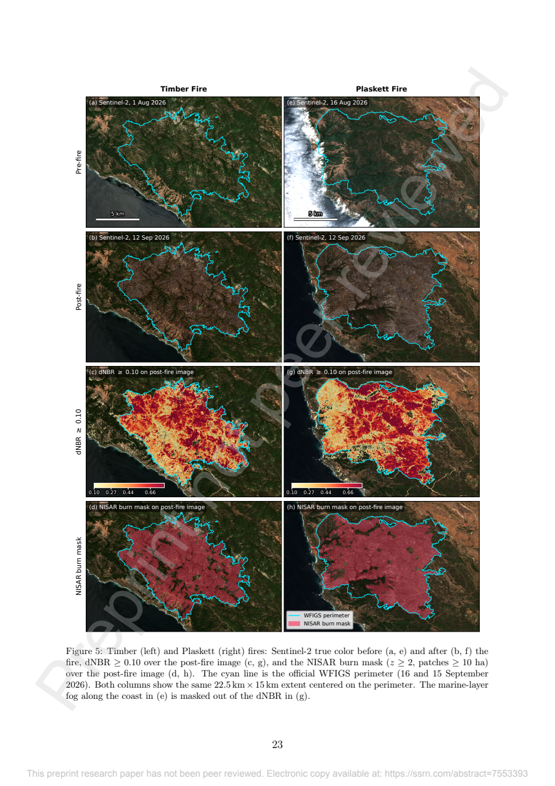
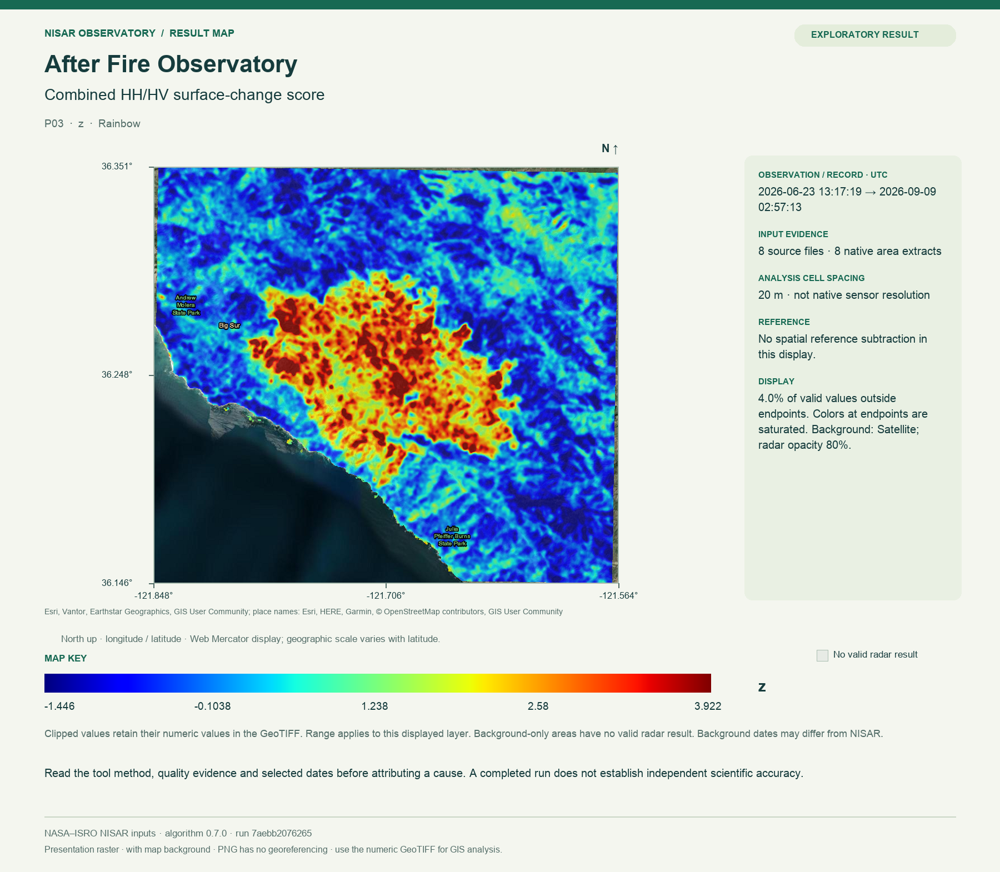
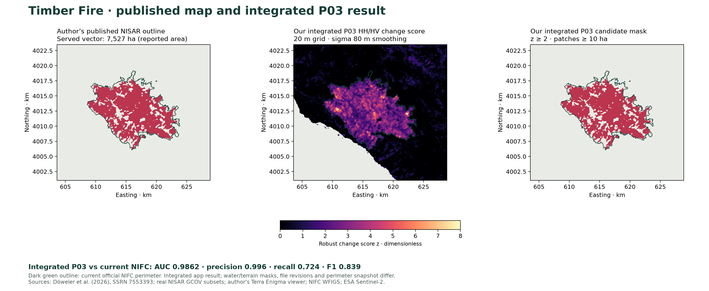

# Timber Fire · After Fire Observatory (P03)

A reproducible **integrated app** comparison using real downloaded NASA/ASF NISAR GCOV subsets, the verified study’s observation dates and fixed processing parameters. This case passed the integration check before being added to Examples. It does not establish accuracy for other fires.

## Start here

1. Run the app and open **Examples → Timber Fire, California**.
2. Opening prepares the exact eight protected files, geographic window, land domain, pre-fire baseline, processing method and opening scale. It does not start a run.
3. Read the tutorial and click **Start example analysis**. **No Earthdata login or new download is required.** The local protected files are verified by SHA-256 before Start is enabled.
4. Read **Main results**, first the combined change score, then candidate changed patches. Check view coverage under **Quality & reliability**. Open **Explore time** only to inspect individual acquired views.
5. Reopen the new run from **Runs**. Export numeric GeoTIFFs, result/provenance JSON or a PNG map with its displayed scale. Clearing the shared array cache or deleting a run does not remove these protected inputs.

**View prepared workspace** loads the same recipe for inspection. Changes there create a different experiment; the tutorial’s Start button always restores the tested recipe. The normal **Timber Fire paper’s area** preset replaces Central Portugal and searches mission launch through today. It loads the tested geographic box and main settings, but does not automatically select the eight dates or bundle the land mask: use this Example for exact reproduction.

## The published evidence

[Döweler, Leuzinger and Bader (2026)](https://papers.ssrn.com/sol3/papers.cfm?abstract_id=7553393), *Sign-agnostic L-band radar change detection maps wildfire burn scars: a first evaluation of NISAR over the 2026 Big Sur fires in California*. The full 52-page manuscript, equations, Table 3, Figures 5–6, Appendix B and limitations were checked. **It is a preprint, not peer reviewed.**

The authors map Timber and Plaskett fires. This Example reproduces **Timber only**, Monterey County, incident **2026-CALPF-002271**. Discovery was 8 August 2026, 20:35 local / 9 August 03:35 UTC. The author’s [interactive viewer](https://d13h0la5zr0sep.cloudfront.net/?project=timber-fire-aug26) provides the published radar outline. That outline and the official perimeter are used **only for evaluation**, never to calculate the radar score or tune its threshold.

*Credit: Döweler, Leuzinger and Bader (2026), Figure 5, SSRN 7553393. Original panel labels and legends remain intact.*

## Exact inputs and area

All eight protected files are **L-band GCOV provisional P05023**, product version **1.0.11**, frequency-A **HH and HV** gamma-zero linear power, native 10 m posting. One revision per acquisition is retained. Native file identities and SHA-256 values are in [the input audit](native-input-verification.json). Combined protected HDF5 size: **488.65 MiB**. No complete originals are bundled.

| Observation · UTC date | Viewing group | Role |
|---|---|---|
| 2026-06-29 | 042 descending | Pre-fire baseline |
| 2026-07-11 | 042 descending | Pre-fire baseline |
| 2026-07-23 | 042 descending | Pre-fire baseline |
| 2026-09-09 | 042 descending | Primary comparison |
| 2026-06-23 | 135 ascending | Pre-fire baseline |
| 2026-07-05 | 135 ascending | Pre-fire baseline |
| 2026-07-17 | 135 ascending | Pre-fire baseline |
| 2026-09-03 | 135 ascending | Primary comparison |

The paper also analyzes intermediate August observations. Those are not needed for its primary map and are not bundled here. Therefore this Example does not reproduce the complete event time series or measure ecological recovery. The documented NISAR data gap also means scheduled late-July/early-August observations were unavailable; dates must not be invented or substituted.

Extraction rectangle, west/south/east/north: **−121.8484, 36.1455, −121.5640, 36.3510**. Grid: **EPSG:32610**, bounds **603600, 4001040, 628860, 4023500 metres**, **1123 × 1263** cells at **20 m**. The rectangle was inferred from the publisher’s rounded viewer bounds and snapped to the Sentinel-2 grid; its 56,733.96 ha matches the stated study-window area, but small positional rounding uncertainty remains.

The independent land domain comes from Sentinel-2 SCL water exclusions for **1 August and 12 September 2026**, simplified to a 30 m vector tolerance. It clips the analysis without supplying any burn labels. Its slight simplification accounts for a small difference from the earlier equation-only benchmark. The official boundary is not part of the processing recipe.

## Tested settings

| Setting | Value | Why it matters |
|---|---|---|
| Method | Combined HH/HV | Both signs and both channels can carry fire-related changes |
| Baseline end | 8 August 2026 | Selects the three documented pre-fire dates per view |
| Baseline count | 3 | Fallback when no end date is set; the date overrides it here |
| Native accepted fraction | 0.5 | Rejects weakly supported target cells before comparison |
| Channel | HH primary + required HV | The processor explicitly reads both; no single-channel fallback |
| Local grid | 20 m UTM 10N | Bounded high-resolution analysis, without the old 384-cell cap |
| Smoothing sigma | 80 m | Reduces speckle; full width at half maximum about 188 m |
| Score threshold | z ≥ 2 | Fixed paper threshold, not a probability |
| Minimum patch | 100,000 m² / 10 ha | At 20 m this is 250 four-connected cells |
| Reference rectangle | None | Spatial normalization uses the entire selected land window |
| Opening display | Diverging, automatic shared range | Automatic 2nd–98th percentile endpoints, approximately −1.446 to 3.922 z for the tested inputs. Values outside endpoints saturate in the display only; numeric measurements are retained. |

Advanced options retain the shared minimum-patch control. **Reference-relative trajectory** remains available as the previous method; it requires an independently justified unaffected reference and supports the shared reference assistant. It is a different analysis and does not produce this paper’s candidate mask. Older saved runs retain their method and inputs.

## Calculation, step by step

1. Screen delivered native valid samples and positive powers, then average linear HH and HV powers onto the local grid. Both channels are required. A missing source stops processing; no selected view is silently omitted.
2. Within each viewing group separately, compute the per-cell median of its declared pre-fire linear powers. All declared baseline dates must be valid in a contributing cell. Opposite viewing geometries never share a raw-power baseline.
3. For each later observation, calculate **ΔHH = 10 log10(HHpost/HHbaseline)** and the equivalent ΔHV. A brighter return gives a positive change; a darker one gives a negative change.
4. Calculate the unsigned magnitude **Iview = |ΔHH| + |ΔHV|**. Opposite signs reinforce evidence of change rather than cancel. This responds to any scattering change, not exclusively fire.
5. Average magnitudes from the **latest selected valid observation per viewing group**. One view may fill a cell that the other cannot measure; the view-count map records this. The latest dates are asynchronous: 3 and 9 September.
6. Smooth with a normalized Gaussian of sigma 80 m. Missing cells do not contribute to or become filled by smoothing; minimum filter support is 0.3.
7. Over the predefined valid land window, calculate **z = (smoothed I − median I)/(1.4826 × median absolute deviation)**. The integrated run’s median is **1.9986 dB**, scaled MAD **0.3636 dB**; the paper reports 1.99 and 0.36 dB. A window without measurable spread is rejected rather than given an invented score.
8. Keep z ≥ 2 and four-connected patches ≥ 10 ha. The area threshold is applied in square metres on the local metric grid, not as a fixed pixel count across arbitrary resolutions.

## Read the result correctly

The current figure is the user-provided Rainbow-palette export. The numerical historical comparisons below remain unchanged. The tutorial opens with Diverging and an automatic shared range; the supplied figure uses Rainbow and automatic limits −1.446 to 3.922 z. Choose Rainbow in the map controls to match its palette. Display appearance does not change the score or candidate mask.

- **Combined change score:** high values identify unusually strong radar change relative to this selected land window. They are not burn severity, probability, biomass or recovery.
- **Candidate changed patches:** 1 satisfies the saved threshold and area rules; 0 does not. Blank cells lack usable evidence. A candidate needs independent fire evidence before being called burned.
- **Viewing-group count:** the number of latest valid views contributing. More views describe support, not guaranteed accuracy. Their baselines and dates are saved with the result.
- **Explore time:** two actual post-baseline view snapshots, in **dB magnitude**, each compared with its own baseline. They are not the primary fused z score, a synchronized movie or daily observations. A line between chart markers is not an acquisition.
- **Advanced maps:** signed HH/HV changes by view, combined raw and smoothed magnitudes. They help explain why the unsigned result differs from the previous single-channel reference-relative map.
- **Source quality:** accepted, missing and rejected native sample fractions. All eight archived files had zero nonzero input-exception flags in the recorded audit; that does not certify absence of other error.

## Measured comparison

| Measure | Published Timber result | Integrated app P03 |
|---|---:|---:|
| AUC vs official perimeter | 0.984 | 0.9862 |
| Precision | 1.00 | 0.9965 |
| Recall | 0.73 | 0.7244 |
| F1 | 0.84 | 0.8389 |
| Candidate mapped area | 7,527 ha | 7,453.00 ha |
| Official perimeter on common evaluation domain | 10,280 ha | 10,252.84 ha |

**Mask agreement with the author’s served outline:** intersection-over-union **96.43%**, F1 **0.9818**. The served vector reports 7,527 ha; rasterizing it on our grid produces 7,550.28 ha on the common evaluation domain. Attribute area, rasterized geometry area and app candidate area are distinct measurements.

The new result closely matches the earlier independent equation replay: **7,453.00 vs 7,453.56 ha**, F1 **0.83891 vs 0.83894**. The small change follows the documented vector land-domain simplification and fixed baseline support, not threshold tuning. The previous P03’s signed reference-relative outputs had absolute-change AUC about 0.69–0.73. They measured a different quantity and should not be presented as this burn-mask method.

An independent optical calculation uses Sentinel-2 B8A/B12 from the same two paper dates. The reflectance offset was already applied by the source, so it was not subtracted twice. **dNBR ≥ 0.10**, patches ≥ 10 ha, gave **AUC 0.9818 and F1 0.9574**, close to the published optical benchmark. This supports the reference setup; optical dNBR remains a proxy rather than field truth.

Precision describes how many mapped candidates lie inside the operational perimeter; recall describes how much of that perimeter was mapped. The perimeter includes unburned islands, so omitted interior area is not automatically an algorithm error. AUC measures ranking separation across thresholds, not causal attribution. These quantities were calculated against the current NIFC snapshot on common valid radar/optical cells. They are **comparison statistics, not globally certified accuracy**.

## Limits and honest scope

Single-fire, provisional-product case study based on a preprint, not universal validation. Static NISAR water masking is replaced by a simplified Sentinel-2 land polygon, and per-view DEM/LOS layover/shadow masks are absent. One native frame per pass covers the extracted study window rather than the authors’ full mosaics. Grid coordinates were inferred from rounded viewer bounds; product revisions and current official perimeter may differ. Radar change is not burn severity or recovery. Only the final primary comparison dates are bundled; intermediate fire-evolution dates were not downloaded.

In particular, **no DEM/LOS terrain mask is applied**. Native source masks are not terrain masks. The bundled independent land polygon replaces the paper’s static water mask; no optical burn classification or perimeter labels enter the radar scoring. The full study’s original code and rasters were not publicly distributed; its public outline and verified equations support this approximate reproduction. The study-window coordinates were inferred from rounded bounds and the perimeter snapshot differs. Very close agreement does not remove these differences.

Robust spatial normalization changes when the selected area, land masks or proportion changed changes. Do not shrink the window or tune a threshold merely to improve agreement with the known boundary. A new region needs documented event dates, comparable pre-event observations, water/terrain review and independent comparison. Long-term vegetation recovery requires later observations and additional evidence.

## Reproducibility, storage and references

Keep the complete `Examples/P03_Timber_Fire` folder. `inputs/` contains the eight protected native HDF5 files; `input-manifest.json` records exact identities and SHA-256. Missing or damaged files disable Start, without substituting another acquisition. They are outside ordinary `data/subsets/` and the disposable `data/arrays/` cache. The application protects these copies; manual filesystem deletion can still remove them.

`example.json` stores the exact recipe. `verification.json` records the fresh API/browser replay. [Measured comparison JSON](integrated-comparison.json) · [Input quality and checksums](native-input-verification.json) · [Optical/reference comparison](reference-comparison.json). The current official boundary, author outline and land-domain provenance are archived in `references/` for inspection, not used as hidden radar labels.

[Timber Fire: combined HH/HV wildfire-change study](https://papers.ssrn.com/sol3/papers.cfm?abstract_id=7553393) — Full 52-page Döweler, Leuzinger and Bader preprint. Equations define separate per-view linear-power baselines, unsigned HH/HV changes, 80 m smoothing, robust z and 10 ha patches. Not peer reviewed.

[Published Timber Fire radar map](https://d13h0la5zr0sep.cloudfront.net/?project=timber-fire-aug26) — Author’s interactive map and served NISAR burn outline. An external result for comparison, not the input mask or output of this app.

[Official NIFC incident perimeter](https://services3.arcgis.com/T4QMspbfLg3qTGWY/arcgis/rest/services/WFIGS_Interagency_Perimeters_YearToDate/FeatureServer/0) — Unique incident 2026-CALPF-002271. This operational boundary includes unburned islands; the current snapshot differs slightly from the paper’s evaluation boundary.

[Independent Sentinel-2 imagery](https://earth-search.aws.element84.com/v1/collections/sentinel-2-l2a) — Tile 10SFF, 1 August and 12 September 2026. B8A/B12 dNBR provides an independent optical comparison; SCL water classes define the bundled land domain. No optical burn labels are used to calculate radar scores.
