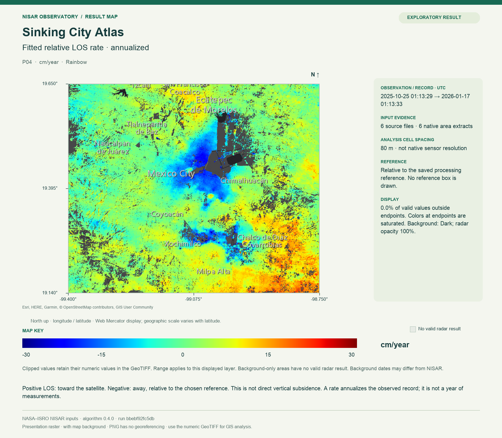

# Mexico City, Mexico

## Comparison assessment

**Qualitative motion-pattern comparison.** The fitted relative LOS pattern is consistent with NASA’s illustration over matching dates; no independent displacement grid establishes geodetic accuracy.

| Alignment | Published / reference | This example |
|---|---|---|
| Quantity | Published LOS velocity map; article discusses subsidence in cm/month | Fitted relative LOS rate · cm/year or cm/month; accumulated LOS · cm |
| Support | Respect the original extent, dates and masks | Selected Mexico City rectangle; six pairs and seven reconstructed epochs across 84 days. Compare regional patterns, not identical numerical pixels. |

**What agrees**

- Six descending-track 113 pairs connect seven dates over 25 October 2025–17 January 2026, matching the NASA comparison period.
- The major relative-motion pattern is visually consistent with the published illustration.

**What differs**

- NASA’s article describes monthly rates; the published figure and our opening map use annual rates. Divide cm/year by 12 for cm per mean month; annualization does not extend the 84-day observation record.
- Our exact reference rectangle, pair-network fitting, quality masks and processing revisions are documented; NASA’s complete numerical processing/reference solution is not supplied.

**Still unverified**

- No independent co-registered velocity grid or GNSS measurements: no justified RMSE or speed-accuracy percentage.
- The reference is data-suitable, not independently proven stationary; one LOS view cannot separate vertical and horizontal motion.

**Next useful validation:** Matched independent geodetic observations with compatible LOS projection, dates and a justified reference.

Protected input checksums and unchanged guided/editable replay test implementation reproducibility; they do not test environmental accuracy.

[Seven-case evidence review and demonstration choice](../../docs/EXAMPLE_EVIDENCE_REVIEW.md).

**Tool:** Sinking City Atlas (P04) · NASA/ASF L-band GUNW.

A six-pair time series of relative ground motion

## Question

Where does a connected six-pair radar record indicate relative line-of-sight motion?

## Run this example

1. Start the app and open **Examples → Mexico City, Mexico**.
2. The page loads the exact tested rectangle, settings, reference (where needed) and protected local inputs. Review the data readiness status.
3. Read the method and reference caveats, then click **Start example analysis**. No download or analysis starts just by opening a tutorial.
4. Read Main results first, then Explore time, Quality & reliability and Advanced maps. Results are saved normally in Runs.
5. Export numeric GeoTIFFs, result JSON or map images with legends for further inspection. A new exploration does not remove bundled inputs.

## Required observations

All files are NASA/ASF L-band native-grid HDF5 area subsets, not full originals. The area is [-99.4, 19.14, -98.75, 19.65] (west, south, east, north).

| Reference acquisition · UTC | Comparison acquisition · UTC | Group | NASA granule |
|---|---|---|---|
| 2025-10-25 01:13:29 | 2025-11-06 01:13:30 | 113_D_079_4000_SH_X05009 | G4058281119-ASF |
| 2025-11-06 01:13:30 | 2025-11-18 01:13:30 | 113_D_079_4000_SH_X05010 | G4058288661-ASF |
| 2025-11-18 01:13:30 | 2025-12-12 01:13:31 | 113_D_079_4000_SH_X05010 | G4058338815-ASF |
| 2025-12-12 01:13:31 | 2025-12-24 01:13:32 | 113_D_079_4000_SH_X05010 | G4058459579-ASF |
| 2025-12-24 01:13:32 | 2026-01-05 01:13:32 | 113_D_079_4000_SH_X05010 | G4058584016-ASF |
| 2026-01-05 01:13:32 | 2026-01-17 01:13:33 | 113_D_079_4000_SH_X05010 | G4058733834-ASF |

## Exact processing settings

| Setting | Value |
|---|---|
| apply_ionosphere | true |
| phase_allow_mixed_revisions | true |
| resolution | 80.0 |
| coherence | 0.3 |
| min_valid_fraction | 0.5 |
| reference_bbox | [-99.28, 19.4, -99.24, 19.44] |
| phase_network | true |

## How the calculation works

Six descending track 113/frame 079 BETA pairs link seven acquisitions. Native masks, coherence ≥0.30 and accepted fraction ≥0.50 screen samples; delivered ionosphere phase is subtracted. The recorded reference rectangle establishes relative zero. A connected phase network reconstructs acquisition changes and a fitted annual LOS rate. Mixing X05009/X05010 revisions is explicitly enabled for this historical example.

## Read the results

Start with LOS rate in cm/year. Negative is away from the satellite, positive toward it. A yearly rate is an extrapolated fitted rate over the observed interval, not a full year of observation. Time exploration shows reconstructed acquired epochs. Horizontal and vertical movement are mixed in one LOS measurement.

## Previous results and what to compare

The historical six-pair study reproduced the spatial subsidence pattern in the NASA illustration. It uses the same reference rectangle and a Rainbow scale of −30 to +30 cm/year. Newly generated runs must be checked against the archived numerical evidence; visual agreement alone does not establish geodetic accuracy.

| Aspect | Published / independent evidence | Our study |
|---|---|---|
| Data | NASA October 2025–January 2026 example | Six archived descending track 113 pairs |
| Measurement | LOS motion rate illustration | Relative fitted LOS cm/year |
| Colors | Published centimetre-rate presentation | Rainbow, fixed −30 to +30 cm/year |

### Recorded Mexico City comparison configuration

| Measurement / display | Value |
| --- | --- |
| Connected GUNW pairs | 6 |
| Acquisition epochs | 7 |
| Record span | 84 days |
| Actual analysis spacing | 80 m |
| Reference rectangle | −99.28, 19.40, −99.24, 19.44 |
| Opening display | Rainbow · −30 to +30 cm/year |

## Visual comparison

Compare the broad spatial pattern and the cm/year legends. The app’s rate depends on its reference, screening and phase-network fit. Agreement in appearance does not certify pixel-level velocity accuracy or a vertical-motion estimate.

### Published reference · NASA/JPL · published Mexico City subsidence

PIA26709 · 25 October 2025–17 January 2026. The original map shows mean line-of-sight velocity in cm/year, with airport, city monument and Chalco Lake labels. Blue identifies strong motion away from the radar. Preserve its own legend when reading it.

Credit: NASA/JPL-Caltech/David Bekaert. [View original publication](https://www.jpl.nasa.gov/images/pia26709-us-indian-spacecraft-captures-mexico-city-subsidence/).

### Our NISAR result · Our result · relative line-of-sight rate

Six descending-track 113 GUNW pairs connect seven epochs across the same 84-day period. Recorded reference rectangle; Rainbow −30 to +30 cm/year. Negative values mean motion away from the radar relative to that reference, not directly measured vertical subsidence. This export uses the Dark basemap with place names, 100% radar opacity and an 80 m analysis grid. The processing reference is retained but its rectangle is not drawn. The rate annualizes the observed period; it is not a full year of measurements.

Credit: NISAR Observatory · user-provided P04 export · run bbebf92fc5db.

## Map controls

The active legend and **Radar overlay opacity** slider are directly below the map. Continuous measurements allow Default, Diverging and Rainbow palettes with automatic or custom ranges. Class, observed-date and patch-ID maps show labelled editable colour swatches instead of numerical range controls. Click a swatch to edit its colour or reset the shared category styles. Save the opening view to retain edits with the run. Unavailable maps explain the missing evidence. The result plot has no duplicate miniature color key. Downloaded map PNGs still include the matching legend.

## Limits

Reference rectangle: west −99.28, south 19.40, east −99.24, north 19.44. It is retained for reproducibility; coherence cannot establish physical stability. NASA’s reference image is an illustration, not an independent numerical validation grid. BETA calibration and unmodelled atmosphere/unwrapping effects remain.

## Sources

- [NASA / JPL · Mexico City subsidence](https://www.jpl.nasa.gov/news/us-indian-space-mission-maps-extreme-subsidence-in-mexico-city/): Published reference evidence and context for this case study.

- [NASA / JPL · Mexico City subsidence](https://www.jpl.nasa.gov/images/pia26709-us-indian-spacecraft-captures-mexico-city-subsidence/): Published reference evidence and context for this case study.

## Input storage and reproducibility

`inputs/` contains protected example inputs and their metadata. `input-manifest.json` records checksums, sizes and exact filenames after download. The app checks every required input before enabling this example. Runs and array-cache deletion cannot remove these files. Files can still be removed manually outside the app; missing or damaged files disable the example instead of substituting other data. No credentials are stored here. Downloading once requires Earthdata sign-in; complete examples run locally thereafter.

The comparison reports in `references/` are historical records and can contain old run identifiers or earlier instructions; this tutorial and `example.json` define the current example setup.

## Fresh-subset reproduction check · 19 October 2026

All 6 protected inputs passed checksums and source checks, and the app completed this recipe with **zero remote science bytes**. The numerical replay targets agree with the previously documented experiment. Numeric raster export, map image with legend, and saved display settings were checked. Engineering replay does not establish independent environmental accuracy.

[Read the reproduction check](references/fresh-subset-verification.json). The generated result is available in Runs as `e4acc96b` while that run is retained. Deleting a normal run does not remove the protected example inputs or the tutorial figures.

Colour and category-opacity edits are shared across matching dates of this classification, including playback and PNG exports. Use 0% opacity for a valid background class to reveal the basemap; missing observations stay transparent. Different classifications retain separate styles. Save the opening view to retain these settings.

### Image export area

Use **Download PNG** and choose **PNG area → Full result area** or **Current map view · zoom & surroundings**. The current-view image follows the camera at download time while retaining the active colour range and legend. **Include background** adds the selected basemap; place names follow the main map switch. Reference outlines are omitted from new PNG exports; recorded comparison figures above retain their historical appearance. **Download GeoTIFF** keeps the full saved numeric raster and georeferencing, independent of the PNG area.

## Experiment with editable steps

In the app tutorial, choose **Load editable workflow** to restore this case’s protected inputs, shared settings and opening view as editable processing cards. Choose **Check workflow → Run workflow** to replay it unchanged. Rename and **Save as my tool** before trying a variant. Removing a required block prevents running; optional stages and compatible additions change the experiment. The established tutorial comparison applies to the tested setup. [Block guide and limits](../../docs/WORKFLOWS.md) · [Portable recipe](../../Recipes/P04_Mexico_City.json).

## Verification scope · refinement release 0.8.0

**Qualitative NASA comparison.** Relative LOS spatial patterns and rates; no matched independent vertical-displacement validation. A six-pair tree has no closure redundancy. Engineering replay and intact inputs do not establish environmental accuracy. Transfer to a new region or edited workflow requires new evaluation.

The current release uses exact baseline validation, source/grid-aware caches and one shared normalized Gaussian (reflected edges, minimum 30% finite kernel support, no filling missing central cells). P03 clips its numeric domain to the selected geographic rectangle. Published and user-supplied gallery images remain historical illustrations; a fresh run retains its own algorithm and execution fingerprint. See [the refinement record](../../docs/REFINEMENT_0_8.md).

## Guided discovery and controlled experiments · 0.9.0

Where did the ground move relative to the selected reference?

1. Open this tutorial in **Examples**. Read its hypothesis, alternative explanations and independent-evidence limits.
2. Choose **Explore the recorded result** to inspect previously computed protected maps immediately. This is read-only and starts no analysis or login.
3. Choose **Run it yourself**, then **Start example analysis**, to create your own saved run with the exact inputs and opening scale documented here.
4. Read **What this run found**, the map units and Quality & reliability. Use **Compare acquired observations** only for compatible actual states; acquisition gaps remain unobserved.
5. Choose **Make a controlled experiment** to load the executed recipe as editable steps. Compare a second independently justified reference with the original, retaining the same pairs and annualized units.
6. Run the variant, then choose **Compare with another run**. Compare scientific settings, jointly valid cells and matching maps with shared limits. A changed workflow does not inherit this case’s evaluation.
7. Download the **study report** to keep the selected map, full legend, observed summaries, sources, settings and limitations in a self-contained printable HTML file. Keep the exact recipe JSON and numeric GeoTIFF for further work.

**A responsible next step:** Use time-matched GNSS or an independently processed displacement grid, with compatible reference and viewing geometry.

[Full study guide](../../docs/STUDY_GUIDE.md). The `recorded/` folder stores this example’s protected computed result and checksum manifest; `inputs/` stores the protected satellite subsets. Ordinary run/cache cleanup does not remove either.
