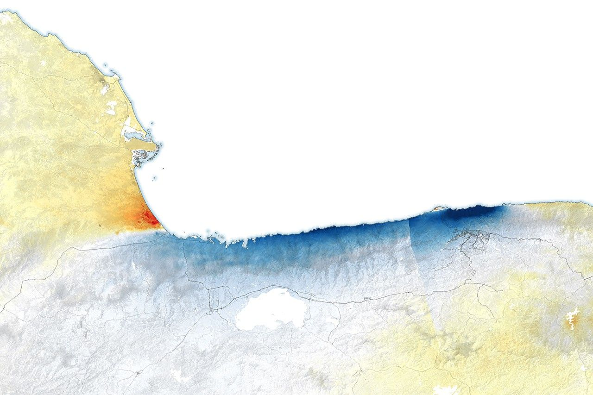
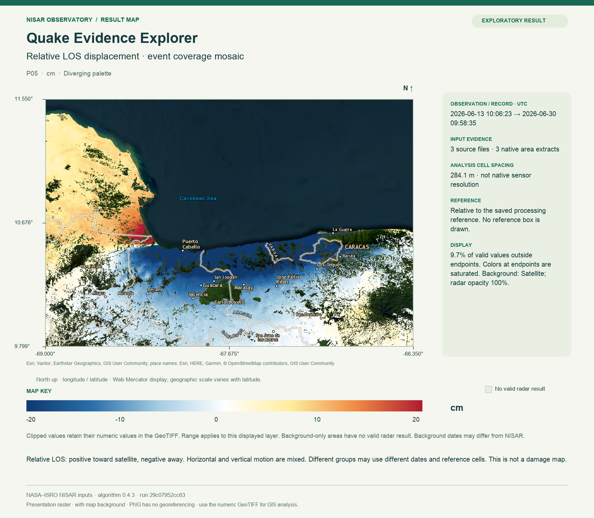

# Venezuela earthquake sequence

## Comparison assessment

**Qualitative event-interval comparison.** An event-bracketing LOS mosaic reproduces broad deformation patterns; overlap checks describe internal consistency, not independent displacement accuracy.

| Alignment | Published / reference | This example |
|---|---|---|
| Quantity | Published InSAR displacement illustration with geological interpretation | Relative event-interval LOS displacement · cm |
| Support | Respect the original extent, dates and masks | Three usable frames and their union, not three identical footprints. Source-index/overlap maps identify seams and different observation support. |

**What agrees**

- The selected intervals match NASA’s June 13–25 and June 18–30 2026 observations around the documented event.
- Three usable frames show broad positive/negative relative LOS patterns across the same northern Venezuelan region.

**What differs**

- NASA interprets geological direction using its geometry and earthquake context; the app reports LOS and does not solve east/west or vertical displacement.
- Our groups can differ in look vector, pair dates and reference origin. One tested frame with no usable coherence is explicitly excluded; the large region is coarsened to about 284 m cells.

**Still unverified**

- No numerical NASA displacement raster or independently stable reference: no justified pixelwise accuracy statistic.
- Reduced overlap spread is internal agreement only; the interval includes other movement and cannot separate the sequence’s individual shocks or building damage.

**Next useful validation:** Matched numerical reference displacement and independently justified per-view references, with explicit geometry and time alignment.

Protected input checksums and unchanged guided/editable replay test implementation reproducibility; they do not test environmental accuracy.

[Seven-case evidence review and demonstration choice](../../docs/EXAMPLE_EVIDENCE_REVIEW.md).

**Tool:** Quake Evidence Explorer (P05) · NASA/ASF L-band GUNW.

Three overlapping radar views across a documented earthquake

## Question

How did the radar line-of-sight distance change across Venezuela’s earthquake sequence?

## Run this example

1. Start the app and open **Examples → Venezuela earthquake sequence**.
2. The page loads the exact tested rectangle, settings, reference (where needed) and protected local inputs. Review the data readiness status.
3. Read the method and reference caveats, then click **Start example analysis**. No download or analysis starts just by opening a tutorial.
4. Read Main results first, then Explore time, Quality & reliability and Advanced maps. Results are saved normally in Runs.
5. Export numeric GeoTIFFs, result JSON or map images with legends for further inspection. A new exploration does not remove bundled inputs.

## Required observations

All files are NASA/ASF L-band native-grid HDF5 area subsets, not full originals. The area is [-69.0, 9.8, -66.35, 11.55] (west, south, east, north).

| Reference acquisition · UTC | Comparison acquisition · UTC | Group | NASA granule |
|---|---|---|---|
| 2026-06-13 10:06:23 | 2026-06-25 10:06:22 | 162_A_006_4000_SH_P05023 | G4276284486-ASF |
| 2026-06-13 10:06:56 | 2026-06-25 10:06:55 | 162_A_007_4000_SH_P05023 | G4276300590-ASF |
| 2026-06-18 09:58:36 | 2026-06-30 09:58:35 | 061_A_007_4000_SH_P05023 | G4251311930-ASF |

## Exact processing settings

| Setting | Value |
|---|---|
| resolution | 80 |
| coherence | 0.3 |
| apply_ionosphere | true |
| min_valid_fraction | 0.5 |
| reference_bbox | [-68.9, 9.85, -66.45, 10.15] |
| event_timestamp | "2026-06-24T22:05:04.053Z" |
| event_date | "2026-06-24" |
| quake_mosaic | true |
| phase_network | false |

## How the calculation works

Three usable GUNW frames cover pairs 13–25 and 18–30 June 2026 around the documented 24 June 22:05:04.053 UTC event. Native masks, coherence ≥0.30 and accepted fraction ≥0.50 screen phase; delivered ionosphere subtraction is enabled. Each group is referenced, preferably using the same accepted cells. Overlaps choose the highest-coherence valid source, without averaging different LOS geometries.

## Read the results

Start with displacement across the earthquake interval in cm, fixed −50 to +50 with Diverging colors. Positive is toward the satellite. Source and overlap maps explain frame selection and disagreement. Playback inspects separate intervals and footprints; it is not cumulative motion or an animation of the earthquake rupture.

## Previous results and what to compare

The revised historical comparison substantially reduced artificial overlap differences after native validity-mask and shared-reference fixes. The prepared three-frame mosaic excludes track 061/frame 006, which had no usable coherent pixels in the tested area. This exclusion is explicit; no selected source is silently omitted.

| Aspect | Published / independent evidence | Our study |
|---|---|---|
| Event | NASA earthquake sequence | USGS timestamp retained explicitly |
| Intervals | 13–25 and 18–30 June | Same documented intervals; three usable frames |
| Display | NASA ±50 cm illustration | Fixed ±50 cm; no geodetic accuracy claim |

### Previous processing comparison · identical overlapping valid cells

| Overlap spread statistic | Earlier processing | Revised processing |
| --- | --- | --- |
| Median · cm | 2.412 | 0.487 |
| 90th percentile · cm | 12.086 | 4.620 |

## Visual comparison

Compare the main deformation pattern, allowing for different map extents, masking and viewing geometry. The app combines event-bracketing coverage with different look vectors; it does not recover separate east–west and vertical motion. Color similarity alone is not a quantitative validation.

### Published reference · NASA · published earthquake ground-change map

NASA Earth Observatory’s published radar displacement visualization for the June 2026 earthquakes. Its image is overlaid on landscape context; our numerical map below uses its own explicit line-of-sight scale.

Credit: NASA Earth Observatory · Lauren Dauphin; NISAR data from Eric Fielding/JPL. [View original publication](https://science.nasa.gov/earth/earth-observatory/where-venezuelas-earthquakes-shifted-the-ground/).

### Our NISAR result · Our result · relative earthquake-interval displacement

Three GUNW frames: 13–25 and 18–30 June 2026. This user-provided export uses the Diverging palette from −20 to +20 cm, Satellite imagery with place names and 100% radar opacity. Blue means motion away from each observation’s radar line of sight and red toward it, relative to the processing reference. In this export 9.7% of valid values fall outside the display endpoints and are shown with saturated colours; numeric GeoTIFF values are retained. Background-only gaps are not evidence of no movement. Horizontal and vertical motion are mixed; this is not a damage map.

Credit: NISAR Observatory · user-provided P05 export · run 29c07952cc63.

## Map controls

The active legend and **Radar overlay opacity** slider are directly below the map. Continuous measurements allow Default, Diverging and Rainbow palettes with automatic or custom ranges. Class, observed-date and patch-ID maps show labelled editable colour swatches instead of numerical range controls. Click a swatch to edit its colour or reset the shared category styles. Save the opening view to retain edits with the run. Unavailable maps explain the missing evidence. The result plot has no duplicate miniature color key. Downloaded map PNGs still include the matching legend.

## Limits

The inland reference [−68.90,9.85,−66.45,10.15] is a recorded engineering choice without independent proof of physical stability. Different viewing geometry and date intervals remain. The radar intervals cannot separate individual shocks. NASA’s illustration does not supply numerical pixels, exact reference or complete processing parameters. The 80 m request is coarsened to approximately 284.10 m to fit this large rectangle within the 900-cell axis limit; the saved result reports its actual spacing. Overlap improvement measures internal consistency, not geophysical accuracy.

## Sources

- [Venezuela earthquake displacement · June 2026](https://science.nasa.gov/earth/earth-observatory/where-venezuelas-earthquakes-shifted-the-ground/): Published centimeter-scale map using June 13–25 and June 18–30 acquisitions. Compare regional patterns and read its geometry and Urgent Response context; no numerical ground-truth raster is supplied.

- [USGS · earthquake event record](https://earthquake.usgs.gov/earthquakes/eventpage/us6000t7zp/executive): Published reference evidence and context for this case study.

## Input storage and reproducibility

`inputs/` contains protected example inputs and their metadata. `input-manifest.json` records checksums, sizes and exact filenames after download. The app checks every required input before enabling this example. Runs and array-cache deletion cannot remove these files. Files can still be removed manually outside the app; missing or damaged files disable the example instead of substituting other data. No credentials are stored here. Downloading once requires Earthdata sign-in; complete examples run locally thereafter.

The comparison reports in `references/` are historical records and can contain old run identifiers or earlier instructions; this tutorial and `example.json` define the current example setup.

## Fresh-subset reproduction check · 19 October 2026

All 3 protected inputs passed checksums and source checks, and the app completed this recipe with **zero remote science bytes**. The numerical replay targets agree with the previously documented experiment. Numeric raster export, map image with legend, and saved display settings were checked. Engineering replay does not establish independent environmental accuracy.

[Read the reproduction check](references/fresh-subset-verification.json). The generated result is available in Runs as `a29f3cec` while that run is retained. Deleting a normal run does not remove the protected example inputs or the tutorial figures.

Colour and category-opacity edits are shared across matching dates of this classification, including playback and PNG exports. Use 0% opacity for a valid background class to reveal the basemap; missing observations stay transparent. Different classifications retain separate styles. Save the opening view to retain these settings.

### Image export area

Use **Download PNG** and choose **PNG area → Full result area** or **Current map view · zoom & surroundings**. The current-view image follows the camera at download time while retaining the active colour range and legend. **Include background** adds the selected basemap; place names follow the main map switch. Reference outlines are omitted from new PNG exports; recorded comparison figures above retain their historical appearance. **Download GeoTIFF** keeps the full saved numeric raster and georeferencing, independent of the PNG area.

## Experiment with editable steps

In the app tutorial, choose **Load editable workflow** to restore this case’s protected inputs, shared settings and opening view as editable processing cards. Choose **Check workflow → Run workflow** to replay it unchanged. Rename and **Save as my tool** before trying a variant. Removing a required block prevents running; optional stages and compatible additions change the experiment. The established tutorial comparison applies to the tested setup. [Block guide and limits](../../docs/WORKFLOWS.md) · [Portable recipe](../../Recipes/P05_Venezuela.json).

## Verification scope · refinement release 0.8.0

**Qualitative NASA comparison.** Event-bracketing LOS coverage compared with NASA; group geometry, dates and reference origins can differ. Engineering replay and intact inputs do not establish environmental accuracy. Transfer to a new region or edited workflow requires new evaluation.

The current release uses exact baseline validation, source/grid-aware caches and one shared normalized Gaussian (reflected edges, minimum 30% finite kernel support, no filling missing central cells). P03 clips its numeric domain to the selected geographic rectangle. Published and user-supplied gallery images remain historical illustrations; a fresh run retains its own algorithm and execution fingerprint. See [the refinement record](../../docs/REFINEMENT_0_8.md).

## Guided discovery and controlled experiments · 0.9.0

What ground-motion evidence brackets the earthquake?

1. Open this tutorial in **Examples**. Read its hypothesis, alternative explanations and independent-evidence limits.
2. Choose **Explore the recorded result** to inspect previously computed protected maps immediately. This is read-only and starts no analysis or login.
3. Choose **Run it yourself**, then **Start example analysis**, to create your own saved run with the exact inputs and opening scale documented here.
4. Read **What this run found**, the map units and Quality & reliability. Use **Compare acquired observations** only for compatible actual states; acquisition gaps remain unobserved.
5. Choose **Make a controlled experiment** to load the executed recipe as editable steps. Change a justified coherence threshold, retain event timing and references, then compare valid coverage and displacement on common cells.
6. Run the variant, then choose **Compare with another run**. Compare scientific settings, jointly valid cells and matching maps with shared limits. A changed workflow does not inherit this case’s evaluation.
7. Download the **study report** to keep the selected map, full legend, observed summaries, sources, settings and limitations in a self-contained printable HTML file. Keep the exact recipe JSON and numeric GeoTIFF for further work.

**A responsible next step:** Inspect single-group results, overlap diagnostics, event timing and independently matched displacement measurements.

[Full study guide](../../docs/STUDY_GUIDE.md). The `recorded/` folder stores this example’s protected computed result and checksum manifest; `inputs/` stores the protected satellite subsets. Ordinary run/cache cleanup does not remove either.
