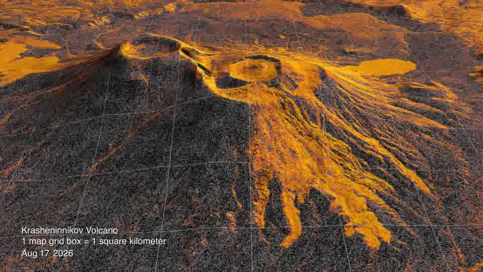
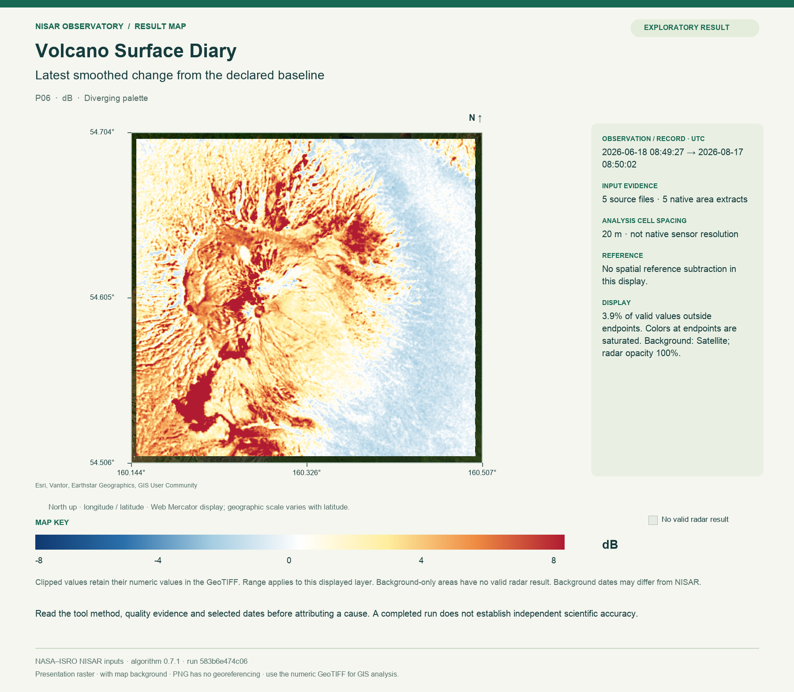
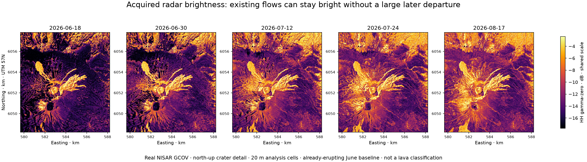

# Krasheninnikov · Volcano Surface Diary

## Comparison assessment

**Qualitative scattering comparison.** The real radar changes are reproducible, but this example does not establish lava detection; seasonal and wetness changes remain mixed with volcanic surface effects.

| Alignment | Published / reference | This example |
|---|---|---|
| Quantity | HH radar brightness and flow morphology in a 3D time-lapse | Signed baseline-relative scattering change · dB and candidate patches |
| Support | Respect the original extent, dates and masks | Five dates, 478.0604 km² shared usable support; the final gap is 24 days. Candidate change area is not lava area. |

**What agrees**

- Five selected late-season dates correspond to NASA’s June–August sequence.
- Acquired HH imagery contains recognizable flow/crater morphology alongside the published frames.

**What differs**

- NASA displays oblique 3D brightness imagery across 17 dates; our north-up change map compares five dates against an already-erupting June baseline.
- Our 20 m grid and 40 m smoothing differ from NASA’s stated display; existing lava can remain bright without showing a new departure.

**Still unverified**

- No independent dated flow polygons: no lava precision, recall, IoU or lava-area estimate.
- Snowmelt, wetness and terrain effects are not independently separated. First radar change is not eruption onset.

**Next useful validation:** Independently georeferenced dated flow boundaries and optical/thermal or snow/wetness evidence.

Protected input checksums and unchanged guided/editable replay test implementation reproducibility; they do not test environmental accuracy.

[Seven-case evidence review and demonstration choice](../../docs/EXAMPLE_EVIDENCE_REVIEW.md).

This reproducible **qualitative surface-scattering example** uses real downloaded NISAR observations and compares them with NASA’s dated volcano visualization. It is **not** a validated lava-boundary reproduction.

## Run in three steps

1. Open **Examples → Krasheninnikov, Kamchatka**. The exact area, five protected inputs, processing settings and opening scale load automatically; opening the tutorial does not start a run.
2. Read the comparison and limitations, then click **Start example analysis**. No Earthdata login or new science download is required. No reference rectangle is used.
3. Start with Main results, then Explore time to inspect acquired HH brightness. Reopen your result from Runs and export numeric GeoTIFF, map-with-legend PNG or provenance JSON.

The five HDF5 inputs occupy **259.52 MiB** in `inputs/`. They are protected from ordinary run deletion and array-cache clearing. Back up the complete folder; manual filesystem deletion can still remove them. Original filenames and SHA-256 checksums are recorded in [the input manifest](input-manifest.json). Ordinary search dates remain mission launch to today; the Example selects only the five observations below.

## Question and observations

What changed in radar scattering around Krasheninnikov between June and August 2026?

| Acquisition · UTC | Track / pass / frame | Original catalog ID |
|---|---|---|
| 2026-06-18 08:49:27 | 060 / descending / 061 | G4240345872-ASF |
| 2026-06-30 08:49:26 | 060 / descending / 061 | G4250844505-ASF |
| 2026-07-12 08:49:29 | 060 / descending / 061 | G4252643155-ASF |
| 2026-07-24 08:49:25 | 060 / descending / 061 | G4260821003-ASF |
| 2026-08-17 08:49:24 | 060 / descending / 061 | G4285465897-ASF |

Window · west, south, east, north: **160.15, 54.51, 160.5, 54.7**. This is a working geographic rectangle, not the exact NASA oblique camera footprint. June 18 already contains lava from an ongoing eruption; the final gap is 24 days, not 12.

## Exact settings

| Setting | Tested value |
|---|---|
| surface method | evolving |
| channel | HHHH |
| resolution | 20 |
| baseline count | 1 |
| baseline end | 2026-06-18 |
| change threshold | 3 |
| smoothing m | 40 |
| patch area m2 | 30000 |
| min valid fraction | 0.5 |
| Opening display | Latest signed departure · Diverging · −8 to +8 dB |

The shared display range for acquired brightness is approximately **−17.72 to −2.36 dB**; it differs from the signed-change range. Changing colors does not alter the numeric result. The app resets a custom range when moving between brightness and brightness change, even though both use dB.

## Calculation

Use the five compatible descending-track HH observations on a 20 m local UTM grid. Screen native samples before averaging linear gamma-zero power, then convert to dB. Clip grid cell centres to the selected geographic rectangle and compare only cells usable on every selected date. Subtract the 18 June observed baseline. Smooth each signed departure with normalized Gaussian sigma 40 m while retaining missing cells. Separately retain positive and negative four-connected patches meeting ±3 dB and at least 30,000 m². Map the latest change, first observed qualifying date and same-sign change on consecutive later observations. No spatial reference rectangle, independent lava boundary, optical snow mask or wetness model is used.

## Read the results

Start with the latest smoothed departure in dB: red is increased radar brightness and blue decreased brightness, not hot and cold lava. Changed patches apply the saved threshold/area rules; repeated evidence describes sampled dates, not continuous activity. Explore time shows acquired HH brightness with one shared automatic scale. Compare those snapshots with NASA’s dated images to recognize the crater and existing flow field. A stable bright flow can show little change, while snowmelt or wetness elsewhere can produce a strong departure. First-change indices have a date key; they do not establish the exact emplacement time.

| Result | What it means |
|---|---|
| Latest smoothed departure · dB | Continuous brightness difference; red means brighter, not hotter. |
| Latest changed patches | Signed departures exceeding ±3 dB in patches ≥3 ha; not lava outlines. |
| Repeated latest change | Same-sign candidate on at least two consecutive later dates; not continuous persistence. |
| Acquired HH frames | Original observed brightness at each date, with a shared range. Existing rough lava can remain visible without a new departure. |
| First observed change / repeat count | Sampled-date key and trailing evidence count, not the exact emplacement time. |
| Quality and advanced maps | Native contribution, common support, unsmoothed differences, dated departures and patch histories. |

## NASA reference and our result

*NASA Scientific Visualization Studio / NASA–JPL-Caltech–ISRO. An actual dated frame from the official animation. Oblique 3D presentation and styling differ from our north-up quantitative map.*

*User-provided P06 export · run 583b6e474c06. Diverging −8 to +8 dB over Satellite imagery, with 100% radar opacity. Colors show smoothed radar-scattering change from the already-erupting 18 June baseline to 17 August 2026, including environmental changes outside the lava field. This is not a lava classification; background imagery dates may differ from NISAR.*

*Distinct measurement context: a zoomed north-up crater view with one shared scale. Much of the bright flow field already exists in the first observation. The processing domain remains the wider study rectangle.*

## Recorded findings

The recorded run has 478.0604 km² of shared usable support; 145.6028 km² of latest brightness-change candidates, including 128.2920 km² repeated on consecutive later acquisitions. These are scattering-change areas, not lava areas. Bright crater and finger-like eastern-flow structures are recognizable in acquired HH images, but much of the existing flow field predates the baseline.

| Signed threshold | Latest candidates · km² | Repeated latest candidates · km² |
|---|---:|---:|
| ±2 dB | 203.73 | 188.71 |
| ±3 dB | 145.60 | 128.29 |
| ±4 dB | 102.35 | 81.59 |

These areas measure rule sensitivity, not uncertainty bounds or lava accuracy. The earlier unsmoothed all-later-dates classification formula maps 66.99 km²; its full tracking step reached the 1,000-object safety cap. Evolving change completes with 690 dated components. A component is not necessarily one physical lava flow.

## Interpretation limits

This is a qualitative surface-scattering case study, not a validated lava-boundary map or an exact reproduction of NASA’s display. The June baseline already contains lava. Snowmelt, wetness and terrain effects contribute broad changes; P06 does not classify them separately or identify temperature, magma, volume or deformation. NASA uses an oblique 3D view and stated 10 m imagery; our north-up analysis uses 20 m cells and 40 m smoothing sigma. Exact source geometry and display processing cannot be certified from NASA’s video. No independent dated lava polygons were used, so precision, recall, IoU and lava-area accuracy are not reported. Missing dates are unobserved, including the 24-day final gap.

The crater setting, older northwest feature and finger-like eastern field are recognizable in the acquired HH imagery. Broad slope changes in the departure maps cannot be attributed to lava alone. This tutorial does not add a snowmelt/wetness separator or claim the full amplitude-plus-coherence method from the literature.

## References and reproducibility

- [NASA’s Krasheninnikov time-lapse and dated frames](https://svs.gsfc.nasa.gov/5675/): Official 17-date HH L-band NISAR visualization, December 2025 to August 2026. Our five observations match its late-season dates; this is a qualitative reference, not a georeferenced lava mask or peer-reviewed validation paper.
- [NASA/JPL explains the spreading lava field](https://www.jpl.nasa.gov/news/us-india-satellite-captures-time-lapse-video-of-volcanic-eruption/): Explains the bright eastern flow field and older northwest flow, radar imagery and 3D presentation. Its full radiometric recipe and exact granule identities are not published.
- [Smithsonian eruption chronology and volcano location](https://volcano.si.edu/volcano.cfm?vn=300190): Independent GVP/KVERT reports provide eruption context. Activity began before our June baseline; this is chronology, not a supplied flow boundary.

General input/method background: [ASF GCOV product guide](https://nisar-docs.asf.alaska.edu/gcov/) and [Poland (2022), amplitude and coherence volcanic-flow maps](https://www.usgs.gov/publications/synthetic-aperture-radar-volcanic-flow-maps-sar-vfms-a-simple-method-rapid). The latter is background, not the method reproduced here.

- [Detailed NASA comparison, sensitivity and interpretation limits](references/COMPARISON.md)
- [Method comparison and 2/3/4 dB sensitivity](references/results/method-comparison.json)
- [Original identities, native quality and SHA-256 audit](references/results/native-input-verification.json)
- [Candidate area at each acquired date · CSV](references/results/dated-candidates.csv)

[Fresh protected-input replay verification](verification.json) records the newly generated app run, exact settings, local-only source reads, numeric raster and PNG/legend checks. The historical [study report](references/COMPARISON.md) preserves the detailed initial comparison; its old run IDs are historical. The recipe in `example.json` defines this current Example.

### Map colours

Measurements offer Default, Diverging and Rainbow palettes with automatic or custom ranges. Category maps show labelled editable colour swatches instead of numerical ranges. Reset restores the shared classification’s defaults; save the opening view to keep edits with the run. PNG exports include the applied colours and key. Numeric GeoTIFFs and processing results stay unchanged. Unavailable maps explain the missing evidence.

Colour and category-opacity edits are shared across matching dates of this classification, including playback and PNG exports. Use 0% opacity for a valid background class to reveal the basemap; missing observations stay transparent. Different classifications retain separate styles. Save the opening view to retain these settings.

### Image export area

Use **Download PNG** and choose **PNG area → Full result area** or **Current map view · zoom & surroundings**. The current-view image follows the camera at download time while retaining the active colour range and legend. **Include background** adds the selected basemap; place names follow the main map switch. Reference outlines are omitted from new PNG exports; recorded comparison figures above retain their historical appearance. **Download GeoTIFF** keeps the full saved numeric raster and georeferencing, independent of the PNG area.

## Experiment with editable steps

In the app tutorial, choose **Load editable workflow** to restore this case’s protected inputs, shared settings and opening view as editable processing cards. Choose **Check workflow → Run workflow** to replay it unchanged. Rename and **Save as my tool** before trying a variant. Removing a required block prevents running; optional stages and compatible additions change the experiment. The established tutorial comparison applies to the tested setup. [Block guide and limits](../../docs/WORKFLOWS.md) · [Portable recipe](../../Recipes/P06_Krasheninnikov.json).

## Verification scope · refinement release 0.8.0

**Qualitative NASA comparison.** Scattering changes beside NASA frames; no independent dated lava map establishes lava classification accuracy. Engineering replay and intact inputs do not establish environmental accuracy. Transfer to a new region or edited workflow requires new evaluation.

The current release uses exact baseline validation, source/grid-aware caches and one shared normalized Gaussian (reflected edges, minimum 30% finite kernel support, no filling missing central cells). P03 clips its numeric domain to the selected geographic rectangle. Published and user-supplied gallery images remain historical illustrations; a fresh run retains its own algorithm and execution fingerprint. See [the refinement record](../../docs/REFINEMENT_0_8.md).

## Guided discovery and controlled experiments · 0.9.0

Where and when did radar scattering depart from the baseline?

1. Open this tutorial in **Examples**. Read its hypothesis, alternative explanations and independent-evidence limits.
2. Choose **Explore the recorded result** to inspect previously computed protected maps immediately. This is read-only and starts no analysis or login.
3. Choose **Run it yourself**, then **Start example analysis**, to create your own saved run with the exact inputs and opening scale documented here.
4. Read **What this run found**, the map units and Quality & reliability. Use **Compare acquired observations** only for compatible actual states; acquisition gaps remain unobserved.
5. Choose **Make a controlled experiment** to load the executed recipe as editable steps. Change the signed-change threshold, keep baseline and smoothing fixed, and compare the latest departure and candidate patches separately.
6. Run the variant, then choose **Compare with another run**. Compare scientific settings, jointly valid cells and matching maps with shared limits. A changed workflow does not inherit this case’s evaluation.
7. Download the **study report** to keep the selected map, full legend, observed summaries, sources, settings and limitations in a self-contained printable HTML file. Keep the exact recipe JSON and numeric GeoTIFF for further work.

**A responsible next step:** Use independently dated lava outlines, thermal or optical observations and snow/weather evidence before attributing candidate patches to lava.

[Full study guide](../../docs/STUDY_GUIDE.md). The `recorded/` folder stores this example’s protected computed result and checksum manifest; `inputs/` stores the protected satellite subsets. Ordinary run/cache cleanup does not remove either.
