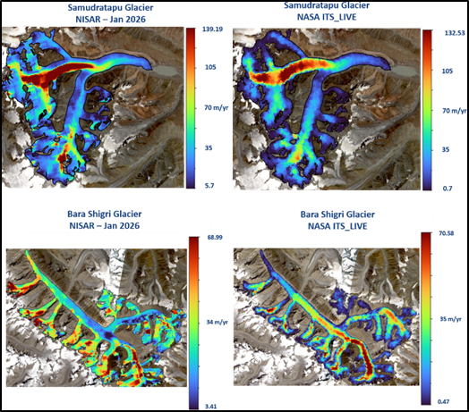
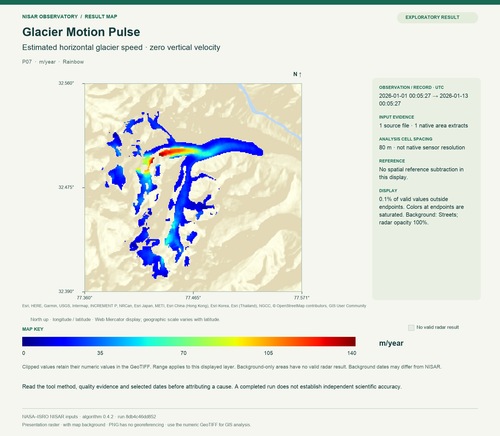

# Samudra Tapu · Glacier Motion Pulse

## Comparison assessment

**Conditional velocity-pattern comparison.** A geometry-aware, zero-vertical-motion speed estimate has a plausible fast-trunk pattern and similar published range; no matched reference establishes speed accuracy.

| Alignment | Published / reference | This example |
|---|---|---|
| Quantity | January NISAR speed and multi-year ITS_LIVE speed maps · m/year | Horizontal speed conditional on zero vertical velocity · m/year |
| Support | Respect the original extent, dates and masks | One 12-day pair; 6,703 valid 80 m cells, 42.8992 km², 53.62% of the historical glacier outline. |

**What agrees**

- The northern fast trunk and slower margins are recognizable in both maps.
- The archived app range is 0.84–144.94 m/year; the IIRS January NISAR range is 5.7–139.19 m/year. Similar extrema alone are not an agreement statistic.

**What differs**

- Our exact pair is January 1–13, 2026; IIRS gives January but not exact pair IDs, matching layer or conversion. Its ITS_LIVE panel is a multi-year reference.
- Our horizontal speed assumes zero vertical motion at a constant 5,000 m ellipsoidal height. The historical 2002 glacier outline and only 53.62% mapped coverage do not define the whole 2026 glacier.

**Still unverified**

- No contemporaneous co-registered independent velocity raster: no justified RMSE or accuracy percentage.
- The 20 m/year vertical-motion sensitivity is a scenario, not an empirical error bar; matching maxima cannot validate the assumed vertical component.

**Next useful validation:** A time-matched independent velocity field with common support and a justified vertical/surface-motion model.

Protected input checksums and unchanged guided/editable replay test implementation reproducibility; they do not test environmental accuracy.

[Seven-case evidence review and demonstration choice](../../docs/EXAMPLE_EVIDENCE_REVIEW.md).

This protected example uses real NISAR L-band GOFF measurements, with explicit geometry assumptions. It does not establish independent speed accuracy.

## Run in three steps

1. Open **Examples → Samudra Tapu, Himalaya**. The exact area, one protected GOFF subset, historical outline, tested settings and opening palette are prepared automatically. Opening does not start processing.
2. Read the tutorial and select **Start example analysis**. No Earthdata sign-in, new download, reference rectangle or geometry preparation is needed.
3. Read Main results, inspect Quality & reliability and Advanced maps, then export the numeric GeoTIFF, presentation PNG with scale or provenance JSON. The new run remains in Runs.

One subset contains **two acquisitions and one 12-day measurement interval**. It occupies **4.59 MiB** in `inputs/`, outside ordinary user downloads and cache. Run deletion and cache clearing do not remove it. Manual filesystem deletion still can; back up this whole case folder. SHA-256 and original identity are recorded in [input-manifest.json](input-manifest.json).

## Question and exact data

Where is the fast glacier trunk visible in the January 1–13, 2026 radar offsets, and what horizontal speed follows from an explicit zero-vertical-motion assumption?

| Item | Value |
|---|---|
| Product / archive | NISAR LSAR GOFF · BETA V1 · frequency A / HH |
| Source granule | G4058734792-ASF |
| Viewing group | 055_A_018_4000_SH_X05010 |
| Reference acquisition | 2026-01-01T00:05:27Z |
| Secondary acquisition | 2026-01-13T00:05:27Z |
| Analysis rectangle · W/S/E/N | 77.36, 32.39, 77.57, 32.56 |
| Historical domain | RGI60-14.15613 · 2 August 2002 |

The preset is named **Samudra Tapu paper's area**. It uses the same rectangle. The Example additionally restores the protected exact source, historical domain and display; selecting the preset alone does not silently load the domain. Ordinary discovery dates remain mission launch through today.

## Tested settings

| Setting | Value |
|---|---|
| resolution | 80 |
| snr | 5 |
| min valid fraction | 0.5 |
| offset solution | horizontal |
| offset rate unit | m/year |
| offset geometry height m | 5000 |
| offset condition limit | 10 |
| offset vertical scenario m year | 20 |
| offset layer | layer3 |
| offset filter | False |
| offset local filter | False |
| offset stable bias | False |
| spatial context | Bundled historical domain; see references/study-domain.geojson |
| Opening display | Estimated horizontal speed · Rainbow · fixed 0–140 m/year |

## Calculation and geometry assumptions

Use one ascending-track 055, frame 018 L-band GOFF pair and its native viewing cubes. Select HH layer 3 (128 × 128 source-sample correlation windows), screen SNR below 5 and missing values, and require both offsets on the same native samples before averaging onto an 80 m EPSG:6933 grid with at least 0.5 accepted native support. Restrict the result to the bundled historical RGI6 glacier domain. Spatial filters and stable-ground correction are disabled. Divide by exactly 12 elapsed days. Trilinearly interpolate delivered LOS east/north, horizontal along-track east/north and incidence-angle cubes at a constant 5,000 m ellipsoidal height without extrapolation. Solve the per-cell 2×2 ENU system with vUp = 0, rejecting invalid vectors and condition numbers above 10. Speed is the norm of the east/north vector, annualized by 365.25. The 20 m/year vertical-motion scenario is a sensitivity diagnostic, not a correction or confidence interval.

```
r = −LOS_E vE − LOS_N vN − LOS_U vUp
a = AT_E vE + AT_N vN
vUp = 0 (assumption)
speed = sqrt(vE² + vN²)
```

Range is positive away from the sensor; native LOS vectors point from target to sensor. The horizontal along-track vector follows flight direction. Native attributes explicitly specify ENU coordinates. The app checks vector units, descriptions, incidence consistency and conditioning before inversion. There is no guessed heading or constant incidence angle. A constant geometry height only chooses a position in the delivered 3D cube: it is not a DEM, slope or vertical-motion correction. Annualizing by 365.25 changes units; it does not create a full year of observations.

## Read the result

Start with estimated horizontal speed: blue represents slower and red faster motion under the stated assumption. Rainbow uses a fixed 0–140 m/year opening range; approximately 0.1% of mapped values saturate above 140 but retain their numeric GeoTIFF values. The median is a spatial summary, not a glacier-wide measured truth or confidence bound. One GOFF subset contains two acquisitions but supplies one interval-average speed map; playback is unavailable with only one interval and no acceleration is inferred. Quality shows conditioning, native support and vertical-motion sensitivity. Advanced maps preserve signed east/north components, true-north bearing and the separate radar diagnostics. Missing cells are not stationary ice. The historical domain clips the result deliberately.

The recorded January estimate maps 6,703 cells (42.8992 km²; 53.62% of the historical glacier outline). Speed spans 0.84–144.94 annualized m/year, median 21.79 and 90th percentile 49.93. The earlier radar-plane norm on those cells reached 101.35 m/year. The fast trunk is more prominent after geometry conversion. This is a qualitative pattern and range comparison, not exact reproduction or validated accuracy.

## Published reference and our result

The published image preserves both Samudra Tapu maps in the upper row (NISAR left, ITS_LIVE right); its lower row concerns Bara Shigri and is not this example. Our separate PNG is the real app result with its legend. Compare the location of the fast trunk and the reported quantities, not identical colors: limits, coverage, dates and assumptions differ. The earlier radar norm and full sensitivity experiments are documented separately.

### Published study · NISAR and ITS_LIVE glacier maps



Upper row: Samudra Tapu NISAR January 2026 (left), ITS_LIVE (right). Lower row: Bara Shigri, a different glacier. Original image retained with its legends; not spatially registered to the app output.

Credit: Malviya, Garg & Thakur · Sudoor Manthan / IIRS Science Portal, 2026 · DOI 10.65456/iirs.2026.10.3.1. [Original publication](https://science.iirs.gov.in/nisar-for-monitoring-glacier-motion/).

### Our result · January 1–13 horizontal-speed estimate



Actual P07 presentation export: layer 3, SNR ≥ 5, zero vertical velocity, 5,000 m geometry height, historical RGI6 domain, no spatial filter or stable-ground subtraction. Rainbow 0–140 m/year; missing cells are transparent. This user-provided export includes the Streets basemap at 100% radar opacity and 80 m analysis spacing. Background-only areas have no valid speed result. The estimate assumes zero vertical velocity; annualized units do not imply a year of observations.

Credit: NISAR Observatory · user-provided P07 export · run 8db4c46dd852.

| Comparison | Published study | Our calculation |
|---|---|---|
| Quantity | Reported NISAR glacier speed; conversion details not provided | Geometry-aware horizontal speed conditional on vUp = 0; radar norm kept separately |
| Dates | January 2026; exact pair IDs unspecified | January 1 00:05:27 → January 13 00:05:27 UTC; exactly 12 days |
| Speed range | NISAR 5.7–139.19; ITS_LIVE 0.7–132.53 m/year | Our horizontal estimate 0.84–144.94; earlier radar norm 0.76–101.35 m/year |
| Spatial pattern | Fast northern trunk and slower margins visible | Northern trunk becomes more prominent after geometry conversion; comparison is qualitative |
| Coverage | Published mask and matching support not supplied | 6,703 valid 80 m cells; 53.62% of historical RGI6 outline |
| Validation | ITS_LIVE described as multiyear/multisensor | No matched independent velocity raster or pixelwise accuracy statistic |

## Recorded results and sensitivity

| Measurement | Recorded value | Interpretation |
|---|---|---|
| Mapped horizontal support | 6,703 cells · 42.8992 km² | 53.62% of 12,502-cell historical glacier domain |
| Horizontal speed · min / median / max | 0.84 / 21.79 / 144.94 m/year | Explicit zero-vertical-motion estimate |
| 90th percentile speed | 49.93 m/year | Spatial percentile, not uncertainty |
| Geometry condition number | Approximately 1.50–1.53 | Stable inversion algebra does not prove physical correctness |
| Geometry height 4,500 / 6,000 m | Maximum 144.99 / 144.83 m/year | Small height sensitivity here; does not validate vUp = 0 |
| Vertical scenario |vUp| = 20 m/year | Horizontal-vector bias 22.45–23.08 m/year | Scenario, not confidence interval or signed scalar-speed error |
| Spatial outlier filter enabled | 6,088 cells; maximum 82.37 m/year | Suppresses part of fast trunk; off in this recipe |
| Remote science reads for example processing | 0 bytes | Protected local subset includes the native viewing geometry |

## Limitations and what would improve validation

Horizontal velocity is conditional on zero vertical velocity; down-slope glacier flow can violate this. Constant geometry height is not a per-pixel DEM, terrain slope or a full 3D solution. A 20 m/year unmodelled vertical component could bias the horizontal vector by about 22.45–23.08 m/year on mapped cells; this scenario is not empirical uncertainty. Only 53.62% of the historical 2002 outline is mapped. GOFF image matching, snow, residual coregistration/timing/geometric effects and BETA calibration can remain. No independently justified stable-terrain correction is applied. The study does not disclose the exact NISAR pair, layer, conversion or ITS_LIVE version/time support. Its ITS_LIVE figure is multiyear rather than a simultaneous January reference. Similar maxima and colors do not establish pixelwise agreement; no RMSE, speed accuracy percentage or ground-truth validation is claimed.

The adjacent ascending interval reaches 125.74 m/year; the longer descending interval contains an approximately 834 m/year outlier. These are separate sensitivity experiments, not merged into this protected recipe. Layer 1/2 SNR-only maxima are much larger, showing that geometry inversion does not repair poor matches. The [18-experiment evidence](references/sensitivity.json) retains these outcomes. Do not tune settings solely to match 139.19 m/year. Next scientific validation needs a documented independent velocity raster, matching time/support, a current glacier boundary and justified registration/terrain-motion treatment.

## Sources

- [NISAR for Monitoring Glacier Motion · IIRS, 2026](https://science.iirs.gov.in/nisar-for-monitoring-glacier-motion/). Malviya, Garg & Thakur, DOI 10.65456/iirs.2026.10.3.1. Reports January 2026 Samudra Tapu NISAR speed of 5.7–139.19 m/year beside a multiyear ITS_LIVE map. Exact pair IDs, matching layer and conversion details are not supplied.
- [GOFF product guide · what the offsets measure](https://nisar-docs.asf.alaska.edu/goff/). Explains the delivered range and along-track offsets, their native posting and unfiltered nature. Image matching and geometric assumptions affect interpretation.
- [Native viewing-geometry cubes · ASF guidance](https://nisar-docs.asf.alaska.edu/metadata/). Documents interpolation of height-dependent metadata. This example uses delivered ENU vectors rather than a guessed heading or incidence angle.
- [NISAR Science Users’ Handbook · glacier-motion geometry](https://nisar.jpl.nasa.gov/documents/26/NISAR_FINAL_9-6-19.pdf). Printed pages 94–95 explain the range/along-track equations and need for a vertical or surface-motion constraint. Our zero-vertical model is simpler than a DEM-based surface-parallel solution.
- [GLIMS / RGI historical glacier outline](https://www.glims.org/maps/ogc_services.html). Source of RGI60-14.15613, dated 2 August 2002. The bundled domain and repair receipt preserve provenance; this is not a January 2026 boundary.

## Bundled evidence and verification

- [All 18 layer, height and filter experiments](references/sensitivity.json): Numeric sensitivity and source-geometry evidence, including the separate descending-view outlier.
- [Historical glacier domain · RGI6](references/study-domain.geojson): Bundled 2002 outline loaded automatically into this example; not a current surveyed margin.
- [Historical boundary repair receipt](references/geometry-repair.json): Records the self-intersection repair and unchanged 12,502-cell domain.
- [Original January app verification](references/prior-app-verification.json): Records the previously tested ordinary-subset run; the new protected-example replay has its own verification receipt.

The protected-example replay and exact metrics are recorded in `verification.json` and `verification-direct.json`. Engineering checks establish reproducibility and file integrity, not scientific accuracy. All measurement and diagnostic maps remain downloadable.

### Image export area

Use **Download PNG** and choose **PNG area → Full result area** or **Current map view · zoom & surroundings**. The current-view image follows the camera at download time while retaining the active colour range and legend. **Include background** adds the selected basemap; place names follow the main map switch. Reference outlines are omitted from new PNG exports; recorded comparison figures above retain their historical appearance. **Download GeoTIFF** keeps the full saved numeric raster and georeferencing, independent of the PNG area.


## Experiment with editable steps

In the app tutorial, choose **Load editable workflow** to restore this case’s protected inputs, shared settings and opening view as editable processing cards. Choose **Check workflow → Run workflow** to replay it unchanged. Rename and **Save as my tool** before trying a variant. Removing a required block prevents running; optional stages and compatible additions change the experiment. The established tutorial comparison applies to the tested setup. [Block guide and limits](../../docs/WORKFLOWS.md) · [Portable recipe](../../Recipes/P07_Samudra_Tapu.json).

## Verification scope · refinement release 0.8.0

**Published velocity-map comparison.** Flow patterns and speed range compared with IIRS; the reference period and zero-vertical-motion assumption prevent a direct accuracy claim. Engineering replay and intact inputs do not establish environmental accuracy. Transfer to a new region or edited workflow requires new evaluation.

The current release uses exact baseline validation, source/grid-aware caches and one shared normalized Gaussian (reflected edges, minimum 30% finite kernel support, no filling missing central cells). P03 clips its numeric domain to the selected geographic rectangle. Published and user-supplied gallery images remain historical illustrations; a fresh run retains its own algorithm and execution fingerprint. See [the refinement record](../../docs/REFINEMENT_0_8.md).

## Guided discovery and controlled experiments · 0.9.0

How fast might the glacier be moving horizontally?

1. Open this tutorial in **Examples**. Read its hypothesis, alternative explanations and independent-evidence limits.
2. Choose **Explore the recorded result** to inspect previously computed protected maps immediately. This is read-only and starts no analysis or login.
3. Choose **Run it yourself**, then **Start example analysis**, to create your own saved run with the exact inputs and opening scale documented here.
4. Read **What this run found**, the map units and Quality & reliability. Use **Compare acquired observations** only for compatible actual states; acquisition gaps remain unobserved.
5. Choose **Make a controlled experiment** to load the executed recipe as editable steps. Vary the geometry-height assumption within a justified range and compare horizontal speed and conditioning on identical inputs.
6. Run the variant, then choose **Compare with another run**. Compare scientific settings, jointly valid cells and matching maps with shared limits. A changed workflow does not inherit this case’s evaluation.
7. Download the **study report** to keep the selected map, full legend, observed summaries, sources, settings and limitations in a self-contained printable HTML file. Keep the exact recipe JSON and numeric GeoTIFF for further work.

**A responsible next step:** Compare a contemporaneous independent velocity raster or field measurements on matched support; a similar colour pattern or maximum is insufficient.

[Full study guide](../../docs/STUDY_GUIDE.md). The `recorded/` folder stores this example’s protected computed result and checksum manifest; `inputs/` stores the protected satellite subsets. Ordinary run/cache cleanup does not remove either.
