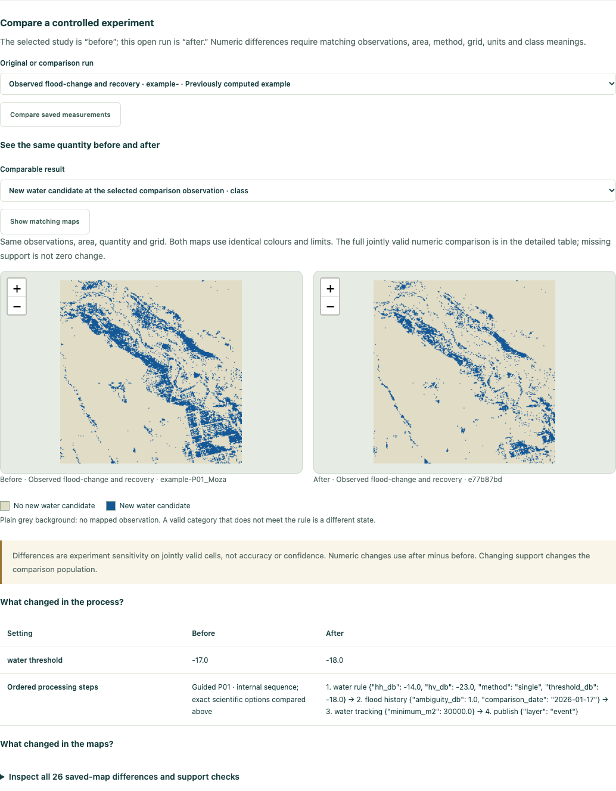

# NISAR Observatory

Map changes on Earth using radar observations from the NASA–ISRO NISAR mission. Explore a documented case, compare real observations and build an editable workflow you can save and share.

Developed by **Carmelo Sammarco** for **Dancing with the SARs**, part of the **2026 NASA Space Apps Challenge**.

<h2 align="center">Watch the introduction</h2>

https://github.com/user-attachments/assets/294cd7ac-1ce3-4a98-8a81-0e54f6ec638d

<p align="center">
  2 min 53 sec ·
  <a href="frontend/assets/media/nisar-observatory-introduction.mp4">Open the MP4</a> ·
  <a href="frontend/assets/media/nisar-observatory-introduction.txt">Read the transcript</a>
</p>

[Run the app](#run-the-app) · [Try Chókwè](#try-chókwè) · [Explore the tabs](#explore-the-tabs) · [Build a workflow](#build-a-workflow) · [Tools and examples](#tools-and-examples) · [Data and exports](#data-and-exports) · [Troubleshooting](#troubleshooting) · [Further reading](#further-reading)

## Run the app

### macOS and Linux

Install **Python 3.12 or newer**. From the project folder on macOS or Linux:

```sh
./setup.sh
./start.sh
```

Open [http://127.0.0.1:8765](http://127.0.0.1:8765). Keep the terminal open while you use the app and press **Ctrl+C** to stop it. After setup on macOS, you can also double-click **Launch NISAR.command**.

<details>
<summary>Windows setup in PowerShell</summary>

```powershell
py -3.12 -m venv .venv
.venv\Scripts\python.exe -m pip install -r requirements-lock.txt
.venv\Scripts\python.exe -m uvicorn backend.app:app --host 127.0.0.1 --port 8765 --no-access-log
```

This release was tested on macOS. Create a new `.venv` on each machine.

</details>

The app runs locally for one user. Open **About → Watch the introduction** for the 2 min 53 sec walkthrough, with captions and a transcript in the app.

## Try Chókwè

1. Open **Examples → Chókwè flood, Mozambique**.
2. Choose **Explore the recorded result** to inspect the new-water candidate map. The observations are from **5 and 17 January 2026**.
3. Choose **Run it yourself** to repeat the calculation with the protected example inputs. Alternatively, open **Make a controlled experiment** from the result to inspect and edit its steps.
4. In **Classify water candidates**, change only **Single-channel threshold · dB** from **−17 to −18**, run the workflow and use **Compare with another run** to compare it with the original.

The app applies the cutoff to HH radar returns on both dates. The stricter setting changes the mapped new-water candidate area from **90.47 to 51.40 km²** on the same **593.92 km²** of usable ground. The experiment measures sensitivity to the cutoff. NASA Scientific Visualization Studio’s Chókwè imagery, visualization **5661**, provides qualitative event context.



### Recorded results and reruns

The seven recorded studies open without Earthdata login. Rerunning also works with local data when the matching protected HDF5 inputs are included. Online basemaps require internet access.

To rerun the examples, use a release ZIP built with `--include-example-inputs` or supply the matching HDF5 subsets. The protected inputs are excluded from the GitHub source checkout by default.

## Explore the tabs

| Tab | What you can do |
|---|---|
| **Explore Earth** | Draw an area, find or import observations, and choose a guided tool or build a workflow. Use **Area & analysis settings** to review the grid, input screening and settings for the selected method. |
| **Tools** | Choose among seven methods. Each card explains the required product, processing and interpretation. **My Tools** contains the editable workflows you save. |
| **Examples** | Open a real case with its source observations, recorded maps and a tutorial explaining how to repeat and interpret the analysis. |
| **Mission Library** | Learn how NISAR acquires radar observations and how to read its L-band products. |
| **Runs** | Reopen a saved result, compare compatible runs, inspect executed steps and export a map or study report. |
| **Connection** | Connect your own Earthdata account for downloads and remote science reads. |
| **About** | Watch the introduction and read about the project and the NASA Space Apps challenge. |


*Explore Earth starts with either a documented example or a study area you choose.*

## Build a workflow

The workspace turns a recipe into an ordered list of editable steps. Start from a documented method, change an individual setting or build a sequence from scratch. The editor checks product compatibility and step order. Save and export the recipe to try the same method on another area with compatible inputs.

1. In **Explore Earth**, draw a study area, choose dates and select **Find NISAR data**. You can also import or select saved inputs. Check acquisition groups to find observations with comparable viewing geometry.
2. Select a guided tool or add compatible processing steps. **Area & analysis settings** contains the shared and product-specific controls. Some motion tools need a reference area for relative measurements.
3. For a guided tool, prepare it and review its data requirements before running. For an editable sequence, choose **Check workflow**, then **Run workflow**. Review the map, its units, coverage and quality evidence. In **Runs**, you can reopen results and inspect the steps that were executed.
4. Save an editable sequence in **My Tools**, or export it as a JSON recipe. A recipe records processing steps and settings. Copy the science inputs separately for an exact repeat.

## Tools and examples

| Tool | Product | Built-in example | What it maps |
|---|---|---|---|
| Flood Memory | GCOV | Chókwè, Mozambique | New dark-water candidates between radar observations |
| Wetland Pulse | GCOV | Wheeler Marsh, Connecticut | How often each cell is flagged as water across the observations |
| After Fire Observatory | GCOV | Timber Fire, California | Changes in HH and HV radar backscatter |
| Sinking City Atlas | GUNW | Mexico City | Ground motion along the radar line of sight, relative to a chosen reference |
| Quake Evidence Explorer | GUNW | Venezuela earthquake sequence | Relative line-of-sight displacement across event-spanning pairs |
| Volcano Surface Diary | GCOV | Krasheninnikov, Kamchatka | Backscatter departures from a baseline and when they first appear |
| Glacier Motion Pulse | GOFF | Samudra Tapu, Himalaya | Radar-direction offsets and an estimate of horizontal speed under a stated vertical-motion assumption |

**Mission Library** explains the satellite, radar measurements and product types. Each example’s tutorial explains its inputs, reference evidence and limitations. Use the run’s quality layers to check where the result has usable observations. Pixels outside that coverage have an unknown result.

## Data and exports

The app processes NASA/ASF **NISAR L-band** products. Catalog search uses public metadata. For new remote science reads and downloads, sign in with your own Earthdata account in **Connection**. The active session is held in memory and clears when you disconnect or stop the app.

| Action | What you get |
|---|---|
| **Save selected area** | A smaller reusable HDF5 area extract. |
| **Download originals** | Complete source files. |
| **Export PNG** | A presentation map with its legend, with an optional basemap. |
| **Export GeoTIFF** | A georeferenced numeric raster for GIS. |
| **Download study report** | A self-contained HTML report with findings, settings, sources and limitations. |

Keep `data/` for your local downloads, saved runs and My Tools. Keep `Examples/` for the tutorials, recorded outputs and protected inputs. **Runs → Array cache** shows the space used by rebuildable arrays and lets you clear them when processing is idle. To back up the workspace, stop the app before copying the two folders.

## Troubleshooting

| If you see… | Check… |
|---|---|
| The page fails to open | Keep the server terminal open and check its output. If port 8765 is in use, an instance may already be running. |
| Catalog or download errors | Check the diagnostics in **Explore Earth**. For downloads, check your Earthdata session in **Connection**. |
| The example cannot run | Check that its original protected HDF5 inputs are present. You can still inspect the recorded result where included. |
| A baseline or reference is missing | Review compatible dates, shared coverage and the selected reference. Fewer inputs or a smaller area can help when the app reports a resource limit. |

<details>
<summary>Developer checks, repository layout and packaging</summary>

| Folder | Role |
|---|---|
| `backend/` | FastAPI service, NISAR data access, processing, job records and exports |
| `frontend/` | Map, tool cards, workflow editor and results interface |
| `Examples/` and `Recipes/` | Case tutorials, recorded results and portable workflow definitions |
| `docs/` | Configuration, screenshots, method documentation and verification evidence |
| `tests/` and `scripts/` | Regression tests, browser replay, verification and packaging |

```sh
.venv/bin/python -B -m pytest -p no:cacheprovider -q
node --test tests/frontend/*.test.cjs
.venv/bin/python -B scripts/verify_release.py
```

Run the release verifier on macOS or Linux with all protected example inputs installed. To build a source ZIP, run `.venv/bin/python -B scripts/package_release.py`. Add `--include-example-inputs` to include the inputs needed for offline reruns.

</details>

## Further reading

- Get started with the [study guide](docs/STUDY_GUIDE.md) and [seven case tutorials](Examples/README.md).
- Find [data and download instructions](docs/INPUTS.md), [workflow guidance](docs/WORKFLOWS.md) and [ready-to-import recipes](Recipes/README.md).
- Review the [verification evidence for all seven examples](docs/VALIDATION.md).

## Attribution

Original application code and documentation are licensed under the [MIT License](LICENSE). NASA–ISRO observations are distributed by NASA/ASF. Publication figures, basemaps and other third-party material retain their own attribution and licensing terms. See the [Third-party notices](THIRD_PARTY_NOTICES.md) and [citation record](CITATION.cff).
