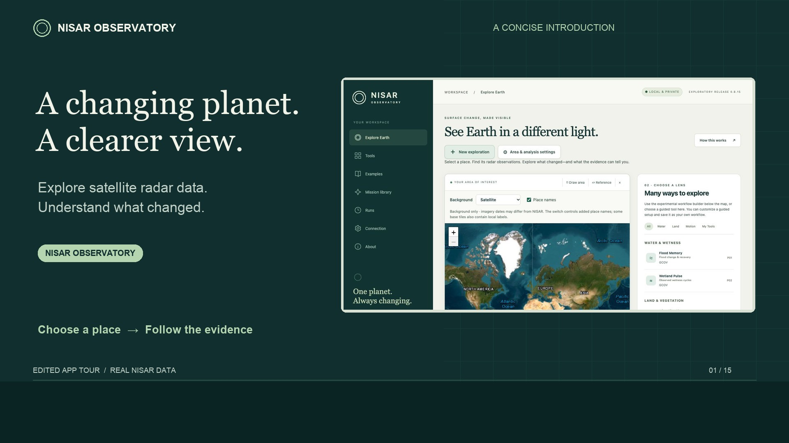
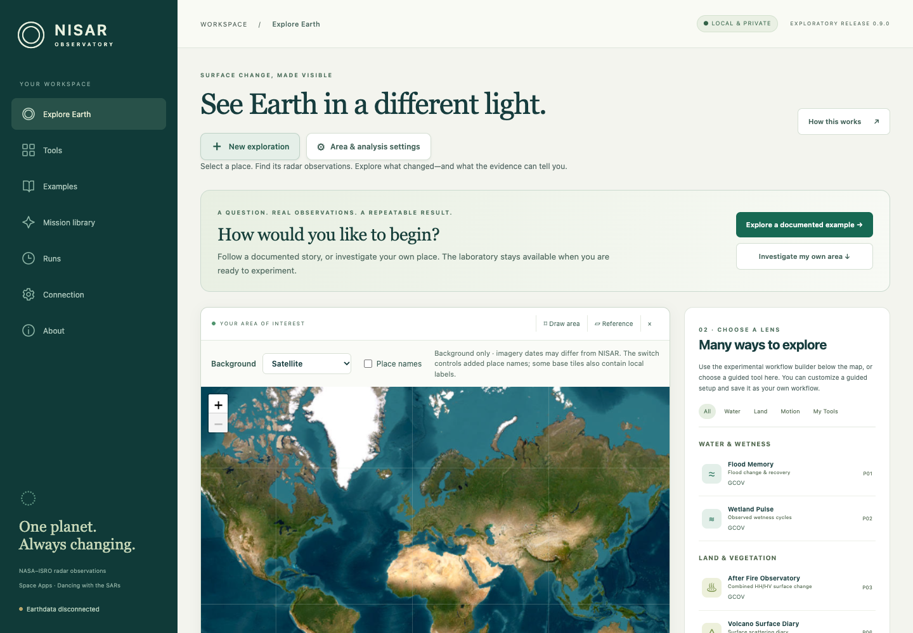
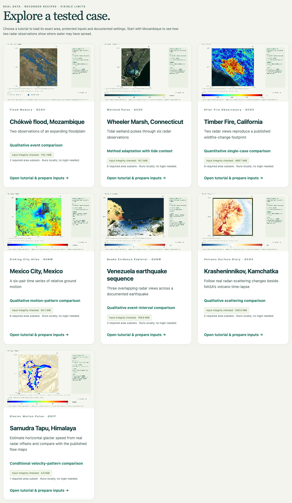
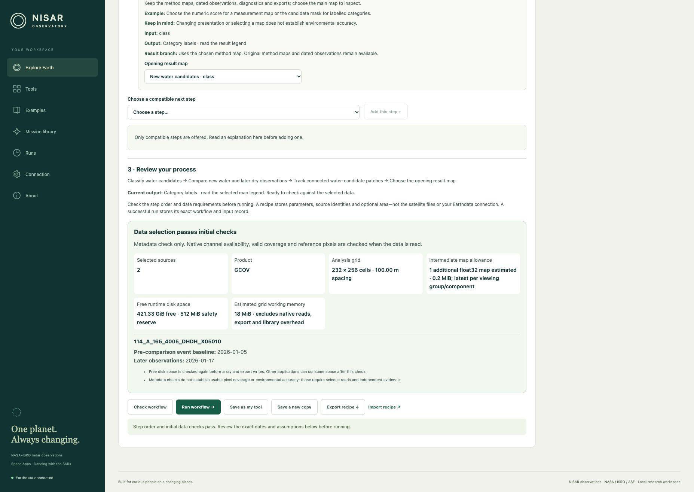
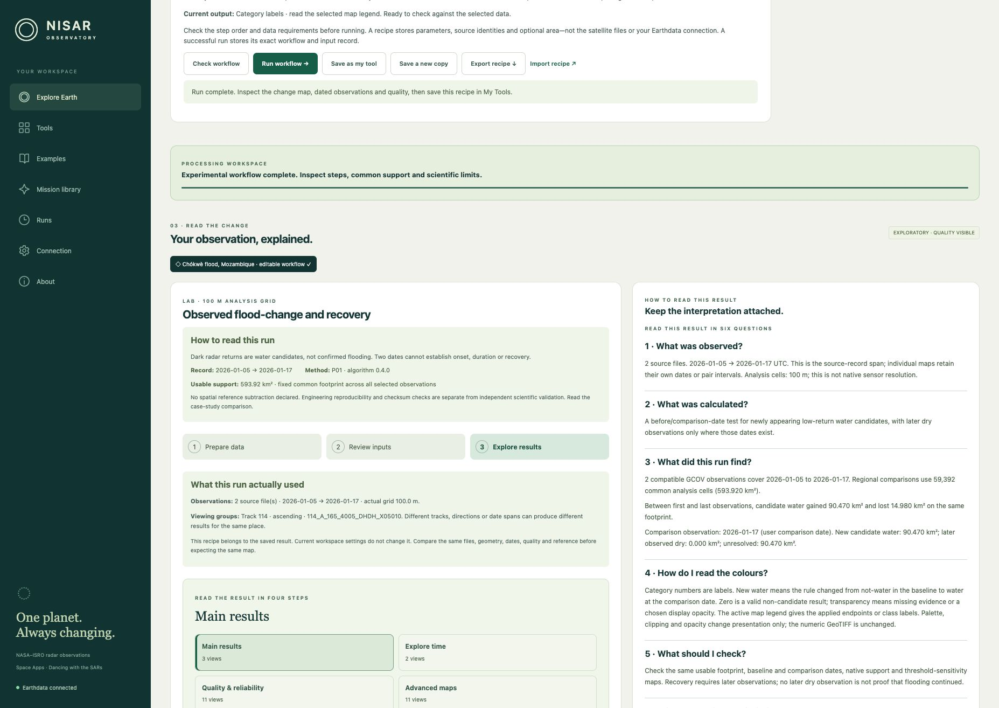
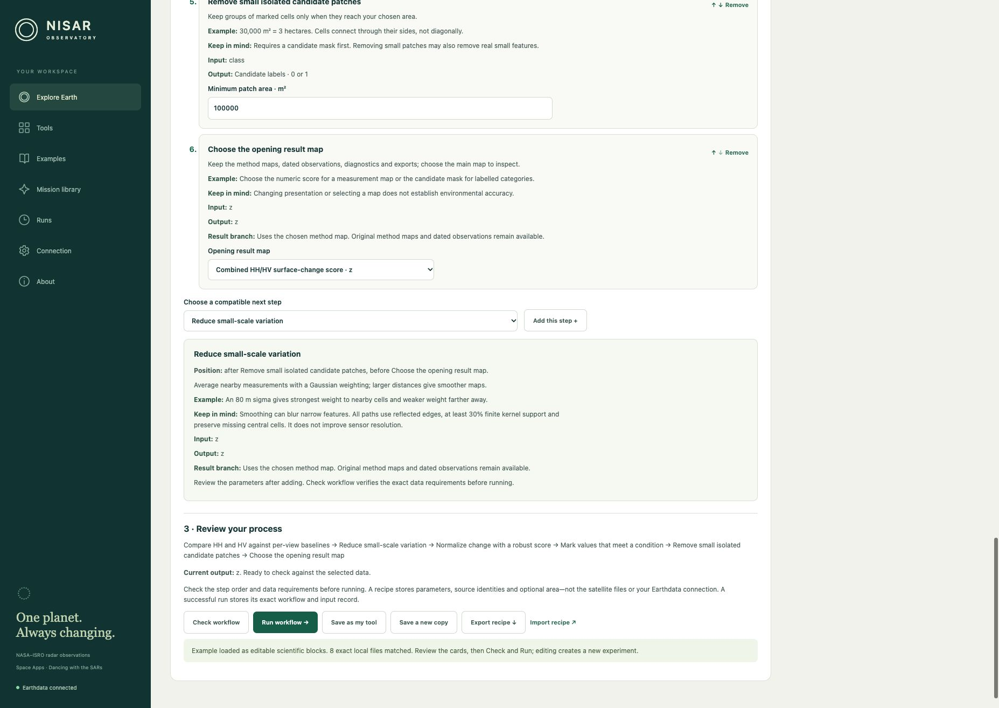
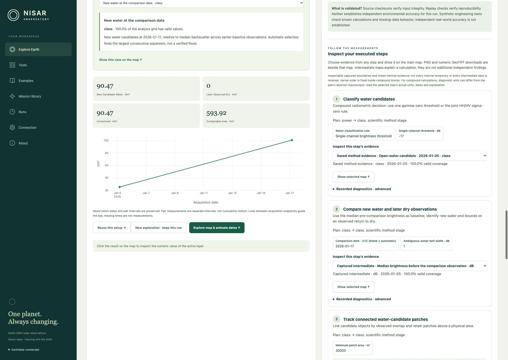
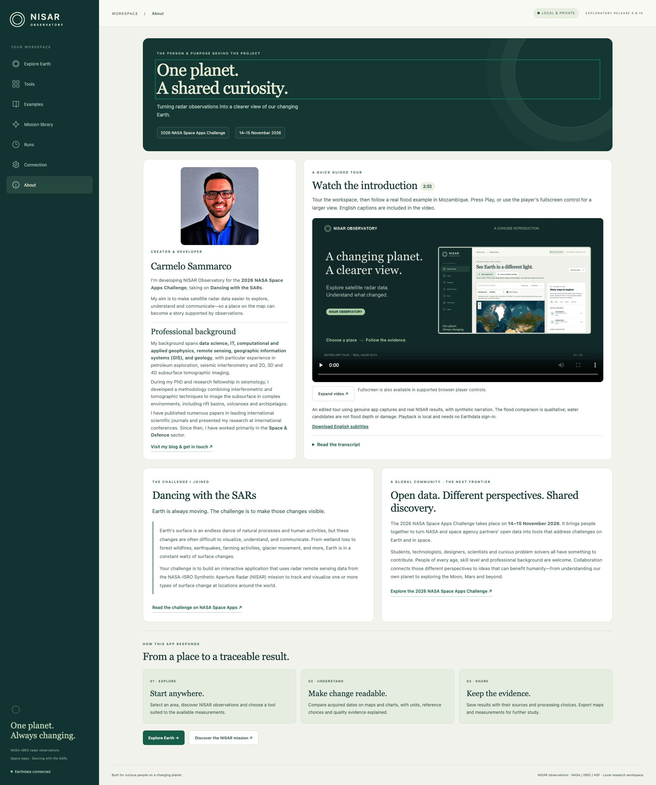

# NISAR Observatory

### Surface change, made visible.

Explore real NASA/ASF **NISAR L-band** observations, build an understandable processing workflow, and keep maps, measurements and the steps needed to repeat it.

Developed by **Carmelo Sammarco** for **Dancing with the SARs · 2026 NASA Space Apps Challenge**.

<div align="center">
  <video controls playsinline preload="none" style="width: 100%; height: auto;" src="frontend/assets/media/nisar-observatory-introduction.mp4" poster="frontend/assets/media/nisar-observatory-introduction.jpg" aria-label="NISAR Observatory introduction">
    <a href="frontend/assets/media/nisar-observatory-introduction.mp4">
      
    </a>
  </video>
  <p><strong><a href="frontend/assets/media/nisar-observatory-introduction.mp4">Open the introduction (MP4)</a></strong> · 2 min 53 sec · <a href="frontend/assets/media/nisar-observatory-introduction.txt">Read the transcript</a></p>
</div>

**7 guided stories · 7 read-only recorded studies · editable workflows · reusable My Tools · offline study reports**

> **Version 0.9.0.** A trusted local, single-user research application. Engineering tests and reproducible examples support the implementation; each environmental interpretation still needs appropriate independent evidence. [Baseline refinement](docs/REFINEMENT_0_8.md) · [Local release evidence and future work](docs/PRODUCTION_READINESS.md).

[Run the app](#run-the-app) · [Examples](#reproduce-a-tested-example) · [Build a workflow](#your-first-analysis) · [Tools](#the-seven-tools) · [Storage](#local-files-storage-and-backups) · [Tests](#development-and-validation)

<a href="docs/screenshots/readme-explore-current.png"></a>

## Run the app

### macOS or Linux

Install **Python 3.12+**, open a terminal in this application folder and run:

```sh
./setup.sh
./start.sh
```

Open **[http://127.0.0.1:8765](http://127.0.0.1:8765)**. Keep the terminal open; press **Control-C** there to stop the server. On a prepared macOS installation, double-click **Launch NISAR.command** instead.

Setup creates `.venv` and installs the pinned `requirements-lock.txt`. To select a different interpreter when creating a missing environment:

```sh
NISAR_PYTHON=/absolute/path/to/python3.12 ./setup.sh
```

If the launch scripts lack execute permission:

```sh
chmod +x setup.sh start.sh 'Launch NISAR.command'
```

There is no frontend build, database setup or API-key file to prepare. Do not copy `.venv` between computers or operating systems; recreate it from the dependency file.

### Windows · manual setup

The shell launchers target macOS/Linux. With Python 3.12 installed, the equivalent PowerShell commands are:

```powershell
py -3.12 -m venv .venv
.venv\Scripts\python.exe -m pip install -r requirements-lock.txt
.venv\Scripts\python.exe -m uvicorn backend.app:app --host 127.0.0.1 --port 8765 --no-access-log
```

This release was reviewed on macOS; Windows and Linux installation/device testing is not claimed. Docker, desktop packaging and public multi-user hosting are not implemented.

### Verify startup

- [Health status](http://127.0.0.1:8765/api/health): `status: "ok"`, application version and connection status.
- [Local API documentation](http://127.0.0.1:8765/api/reference).

Closing the browser does not stop the server. Stopping it clears the in-memory Earthdata session; inputs, workflows and saved results remain on disk. Interrupted analyses are marked **Interrupted** when the next server starts. Inputs and committed outputs are kept; review them and start a new run when ready. A graceful shutdown requests cancellation and waits for the worker to stop before releasing storage ownership.

### Runtime storage and recovery

Release 0.8.1 also aligns editable parameter bounds, follows reconstructed acquisition dates in baseline checks, and accepts the same reference polygons in guided and elementary LOS processing. [Verification record](docs/validation/runtime-hardening.json).

One server owns a runtime folder at a time. Launching another process or multiple Uvicorn workers against the same folder is rejected, preventing conflicting job and file changes. The lock is released by the operating system when the process exits; do not delete `.runtime.lock` to bypass it.

The default runtime folder is `data/`. To use a separate local profile, set an absolute path before launch:

```sh
NISAR_DATA_DIR=/absolute/path/to/my-nisar-data ./start.sh
```

This moves ordinary downloads, subsets, array cache, saved workflows and runs for that profile. The protected examples remain in `Examples/`. Separate profiles are useful for testing; they do not provide multi-user authentication. Keep independent instances on different ports when launching manually.

Job metadata is written through a flushed temporary file and atomic replacement. My Tools and reference-assistant reports also use durable atomic saves with a free-space check. If a tool save cannot be confirmed, reopen My Tools before retrying: a storage failure during the final directory sync can occur after a valid save was committed. At startup, unfinished jobs are recovered once as interrupted; they are never automatically redownloaded or rerun. Invalid job records are skipped and their files are preserved. A notification and `storage_warning_count` in Health identify this condition. Back up the runtime folder before manually repairing a damaged `jobs/<id>/job.json`; do not delete scientific files as a troubleshooting step.

## Keyboard and navigation

When the app first opens in Explore Earth, press **Tab** to reach **Skip to main content**, then Enter to bypass the sidebar. Changing tabs focuses the page heading, updates the browser title and identifies the current section. Tab through the native tool buttons and use Enter or Space to select one; focus stays on the chosen tool. Escape closes the help/setup dialogs and returns to their opener.

Settings and tutorial jump links move keyboard focus to the requested heading. The map supports arrow-key panning and plus/minus zoom; use **Area & analysis settings** to enter an exact rectangle without a mouse. Shared navigation respects the reduced-motion preference. Small-text colours were strengthened across the checked tabs, settings and results. [Keyboard/browser verification](docs/validation/keyboard-navigation.json) records the tested paths and limits; this is not a full accessibility certification.

## Reproduce a tested example

Explore Earth now offers two starting paths: **Explore a documented example** or **Investigate my own area**. Examples start with a plain-language question, the actual observations, a physical hypothesis, alternative explanations and a responsible next step.

Open **Examples**, choose a card and read its tutorial. Opening it prepares the exact area, sources, settings and opening scale without starting processing.

- **Explore the recorded result:** inspect previously computed, read-only maps immediately. This does not start a new analysis or create a run; no Earthdata login is needed.
- **Run it yourself:** jump to the prepared setup, then start a new independent saved analysis.
- **Make a controlled experiment:** load the actual result as editable steps, change one setting and compare with the original.

Results offer linked **acquired-observation maps**, a **saved-run comparison** with common scales and numeric differences, and **Download study report**. The self-contained HTML report includes the selected map and legend, findings, sampled observations, settings, sources and limitations; it opens offline and prints to PDF. [Complete study guide](docs/STUDY_GUIDE.md).

<a href="docs/screenshots/scenario-b/experiment-comparison.png"></a>

*Change one setting, keep the original and compare the evidence. These maps illustrate sensitivity, not classification accuracy.*

- **Start example analysis:** run the recorded guided method.
- **Load editable workflow:** load its calculations as editable cards.
- **View prepared workspace:** inspect its guided setup.

The sidebar **Explore Earth** leaves example mode and starts a clean experiment. Use the tutorial’s prepared-workspace action to retain its case deliberately.

| Example | Tool / product | Inputs | Comparison scope |
|---|---|---:|---|
| [Chókwè, Mozambique](Examples/P01_Mozambique/README.md) | P01 Flood Memory · GCOV | 2 | Same-date qualitative NASA flood visualization; no pixel-accuracy reference mask |
| [Wheeler Marsh, Connecticut](Examples/P02_Wheeler_Marsh/README.md) | P02 Wetland Pulse · GCOV | 6 | Historical paper-inspired HH/HV method applied to new NISAR observations, with tide context |
| [Timber Fire, California](Examples/P03_Timber_Fire/README.md) | P03 After Fire Observatory · GCOV | 8 | Quantitative single-fire comparison with published results and an official boundary |
| [Mexico City](Examples/P04_Mexico_City/README.md) | P04 Sinking City Atlas · GUNW | 6 pairs | Relative LOS network and qualitative NASA comparison; Rainbow ±30 cm/year |
| [Venezuela](Examples/P05_Venezuela/README.md) | P05 Quake Evidence Explorer · GUNW | 3 | Event-bracketing LOS mosaic and qualitative NASA comparison |
| [Krasheninnikov, Kamchatka](Examples/P06_Krasheninnikov/README.md) | P06 Volcano Surface Diary · GCOV | 5 | Radar-scattering changes beside NASA frames; no validated lava classification |
| [Samudra Tapu, Himalaya](Examples/P07_Samudra_Tapu/README.md) | P07 Glacier Motion Pulse · GOFF | 1 pair | Constrained horizontal-speed estimate versus published IIRS maps; Rainbow 0–140 m/year |

<a href="docs/screenshots/readme-examples-current.png"></a>

*The Examples tab opens with the Chókwè flood in Mozambique, followed by six more case studies in the same grid.*

**31 protected HDF5 area inputs, approximately 1.1 GiB**, live in `Examples/<case>/inputs/`. Their manifests record exact NASA identities and SHA-256 checksums. Complete examples run without Earthdata login; basemaps and external links still need internet access. Run deletion and cache clearing do not remove protected inputs.

Missing/damaged inputs disable Start instead of substituting another date. Restore the complete case folder, or connect Earthdata through the running app and prepare the exact subsets:

```sh
.venv/bin/python -B scripts/prepare_examples.py
```

Append a case folder name to prepare only that case. The helper uses the app, downloads area subsets and preserves ordinary downloads. A source-only release excludes these HDF5 files; use the release helper’s `--include-example-inputs` option to distribute complete offline examples.

**“Inputs verified” means file integrity, not scientific accuracy.** Tutorials distinguish published illustrations, historical method adaptations, official boundaries and quantitative comparisons. Edited workflows do not inherit a case’s evaluation.

## Your first analysis

The experimental path is **Area → Data → Ordered steps → Check → Run → Save**.

1. Draw an area or choose a geographic preset. Search dates default to mission launch, **30 July 2025**, through today.
2. Choose **Find NISAR data**, **Use saved data**, or import HDF5 files/an entire subset folder. Discovery and download controls appear before the workflow builder.
3. Select one product: **GCOV**, **GUNW** or **GOFF**. Choose compatible observations and review coverage. New explorations search the Validated L-band collections by default. For older dates choose Provisional or Beta in Area & analysis settings. Each search covers a single release. Search needs no Earthdata login; remote science reads/downloads do. [ASF archive availability](https://nisar-docs.asf.alaska.edu/availability-overview/).
4. Add compatible steps. The workspace starts empty. Each card explains purpose, input/output units, an example and limitations. Guided templates and the seven editable examples remain available.
5. Open **Area & analysis settings** for shared grid, channel and native quality. Only relevant product settings are shown; advanced options remain separate. Parameters owned by workflow cards stay on those cards.
6. Choose **Check workflow**. The readiness panel shows source count, exact baseline/later dates, actual grid, reference requirements, pair-network warnings and estimated grid working memory. It does not download or inspect native science arrays.
7. Choose **Run workflow**. Native quality, channel availability, actual support and reference/geometry requirements are checked from the data. A failed selected source stops processing; no selected coverage is silently omitted.
8. Inspect maps, dates, quality and factual findings. Name the recipe, then **Save as my tool** or **Export recipe**. Saved tools appear under **My Tools** in Explore Earth and in Tools. Import JSON to reopen a shared recipe; satellite files and credentials are separate.

A simple GCOV experiment is **Power to decibels → Subtract an observed baseline → Summary**. It measures scattering change; it does not automatically establish flooding, fire or eruption.

### Understand the modular approach

Elementary operations run sequentially. Scientific blocks configure the established method kernels, including coordinated radiometry or geometry where needed. They are explicitly labelled when compound. One workflow uses one product; this is not an arbitrary cross-product or executable-code editor.

Compatible map smoothing, threshold and patch operations may repeat after a scientific method. They act on the chosen method output and produce a separately labelled experimental map. Original method maps and findings keep their own meaning. Removing optional water tracking skips the computation itself.

A recipe stores instructions; **My Tool** is a named recipe; a **Run** stores the outcome for particular inputs; an **Example** bundles a documented case with protected data. Saving a recipe does not require all inputs to be present. Running does.

[Full workflow guide](docs/WORKFLOWS.md) · [Mozambique walkthrough](docs/WORKFLOW_MOZAMBIQUE.md).

<a href="docs/screenshots/readme-readiness-current.png"></a>

## The seven tools

| Tool | Product | Measurement and main limit |
|---|---|---|
| P01 Flood Memory | GCOV | New dark-water candidates and later dry observations; not flood depth or verified inundation |
| P02 Wetland Pulse | GCOV | Observed water-candidate frequency, with joint HH/HV option; not continuous hydroperiod |
| P03 After Fire Observatory | GCOV | Per-view HH/HV change magnitude, robust score and patches; not burn severity |
| P04 Sinking City Atlas | GUNW | Referenced LOS reconstruction and fitted trend; not direct vertical subsidence |
| P05 Quake Evidence Explorer | GUNW | Event-bracketing LOS coverage; viewing directions, dates and references can differ |
| P06 Volcano Surface Diary | GCOV | Signed departures, latest/repeated change and first observed detection; not automatic lava attribution |
| P07 Glacier Motion Pulse | GOFF | Radar components or geometry-constrained horizontal speed; vertical-motion assumptions matter |

A guided analysis uses **Prepare → Review data/reference where required → Run**. The reference assistant ranks data-suitable candidates and shows coverage, coherence and sensitivity. It cannot certify stable ground. Event mosaics retain each source group’s dates and reference treatment.

[Processing methods](docs/PROCESSING.md) · [Tool catalogue](docs/TOOL_CATALOGUE.md) · [Guided preparation](docs/GUIDED_ANALYSIS.md).

## Read and export results

New results start with **How to read this run**: measurement limits, observed record, method version, support and reference meaning. The selected layer shows its units and valid coverage.

| Result group | Purpose |
|---|---|
| Main results | The primary quantities or candidate classes |
| Explore time | Actual acquisition snapshots, reconstructed acquired dates or labelled pair intervals |
| Quality & reliability | Native screening, coverage and reference/geometry diagnostics |
| Advanced maps | Additional calculations and intermediate results |

Missing results are explained; missing coverage is not zero change. Playback does not invent observations between acquisition dates. An annualized short-record rate is not a year of measurements.

The controls beside the map support **Satellite, Light, Dark, Streets and Plain**, optional place names, radar opacity, and measurement palettes/ranges. Category maps use editable labelled colours and category opacity; matching classes retain their styles across dates and exported maps. Reference windows are processing context and are not drawn on PNG exports.

- **PNG:** presentation map with colour scale and legend; optionally include the selected background. Choose the full result area or current map view. Added place names follow the main map switch. PNGs are not numeric georeferenced rasters.
- **GeoTIFF:** numeric COG with CRS, transform, missing values, band description, units and available class labels. New exports include method/reference/record metadata and an execution fingerprint. Palette and zoom changes do not change numeric data.
- **JSON / available GeoJSON:** measurements, sources, processing settings, executed steps and candidate geometry where produced.

Reopen results from **Runs**. **Reuse this setup** restores their recorded scientific inputs/settings; saving an opening view changes display metadata only.

<a href="docs/screenshots/readme-result-passport-current.png"></a>

## Settings and workspace behavior

**Area & analysis settings** is a dedicated page next to **New exploration**. Shared settings appear first; product controls follow the selected tool/workflow. Advanced correction, context and sensitivity inputs are separated. New exploration resets the workspace while keeping downloads, recipes and results.

All smoothing paths now use the same normalized Gaussian: reflected edges, at least 30% finite kernel support and no filling missing central cells. Count-based baselines require exactly the requested observations plus a later comparison. P03 clips to the geographic rectangle before scoring and area calculation.

A supplied **study-domain polygon** now consistently limits measurement maps and regional summaries, including elementary editable workflows. References and stable-ground patches can remain outside it when needed for relative-zero or bias calculations. Quality, raw-source and intermediate maps can retain wider diagnostic footprints; their explanations and GeoTIFF tags identify that scope. Both glacier offset components use the same study population for spatial screening. A reference outside the study cannot substitute for missing observations inside it. [Spatial support and boundary checks](docs/validation/spatial-support.json).

Optional regional reference checks now name the **physical quantity and units**: measured-pair LOS displacement, a signed radar-component rate, or horizontal speed. Horizontal runs require explicit fields; signed radar rates and speed are never substituted for one another. Compatible unit conversions, matched intervals and unavailable comparisons are recorded, and the result shows the quantity being checked. These checks compare supplied regional medians, not automatically verified truth. [Input formats and limitations](docs/INPUTS.md#regional-reference-observations) · [Updated settings guide](docs/screenshots/regional-reference-settings-0.8.8.png).

Horizontal glacier processing reads only the needed native geometry window and two bracketing height planes. Interpolation uses bounded point batches; no complete height cube is loaded merely because an original is local. Source geometry, units and footprint limits remain explicit. [Geometry verification](docs/validation/geometry-windowing.json).

The default estimated grid-memory budget is **3072 MiB**. Guided analyses, editable workflows and the reference-area assistant use the same resource gate. An over-budget reference assessment is rejected before saving a job or reading inputs; the worker rechecks before its first read. Set `NISAR_MEMORY_BUDGET_MB` before launch to change it. This estimate excludes native reads, exports and library overhead; it is not a guarantee of peak process memory. Existing source/window/grid limits still apply.

Map rendering processes colour interpolation in blocks of at most **65,536 pixels**; GeoTIFF exports write tile windows. The exact global colour percentiles and numeric raster values are preserved. A separate-process 4-million-cell rendering check reduced measured peak RSS from about **531 MiB to 128 MiB** with identical pixels/range. This measures rendering on the recorded machine, not a whole analysis or a guaranteed memory cap. Scientific observation stacks, single-map percentile samples and final images still reside in RAM. [Rendering memory check](docs/validation/render-memory.json).

Shared playback ranges now read dated maps in **256 × 256 windows**, retaining at most 262,144 small-population values. Larger populations use exact float-rank selection over four float32 passes (eight for float64), instead of concatenating all dates in RAM. Percentiles are unchanged; extra reads trade speed for lower working memory. On a separate 32-date synthetic range check, peak RSS fell from about **416 MiB to 53 MiB** with identical limits. This measures range calculation only, excluding GDAL caching, map warping, PNG encoding and scientific processing. All 17 saved-run preview responses still match the former implementation exactly. No numeric rasters, settings or saved results are rewritten. [Range memory check](docs/validation/shared-range-memory.json) · [Saved-run comparisons](docs/validation/saved-shared-ranges.json).

Rapid map or palette changes replace the previous preview request. If another map/PNG is still being rendered, the interface explains the short wait and retries admission for up to one minute; obsolete previews stop retrying. The server runs one expensive preview/PNG calculation at a time, so rapid clicks cannot start many simultaneous render calculations. PNG export uses the same slot and existing colour/legend controls. If you change maps while a PNG is being prepared, its original filename/settings are kept and the current download button is re-enabled when that export finishes. Other APIs remain available; a current native render may still finish after its browser request is cancelled.

The browser preview cache retains at most **24 entries and 32 MiB of estimated encoded-image/metadata storage**, using least-recently-used eviction. An oversized preview can be displayed without being cached. Clearing or replacing a result clears this cache. These are render/cache safeguards, not a limit on the total browser/server memory or a multi-user queue. [Concurrency and browser verification](docs/validation/render-admission.json).

Choose **Cancel** in an active run to stop at the next safe boundary. The current network read or native calculation may finish first. Cancellation is checked between sources, scientific stages, dated calculations and export windows/colour blocks. An unfinished result bundle is discarded; downloaded inputs, existing caches and completed results are kept. Cancellation during a file read is reported as cancellation rather than an unreadable-source error.

## Credentials and privacy

Each person enters their own Earthdata account in **Connection**. Credentials and the active session remain in server memory; recipes and examples do not contain credentials. Disconnect or stop the server to clear the session. Public metadata search is anonymous; remote science reads/downloads require authorized access. Local inputs can be processed offline.

This application instance has shared local storage and one active processing worker. It does not provide isolated concurrent users. Keep it on loopback; Docker/VPS/public multi-user deployment needs separate authentication, credential/storage isolation, durable jobs and resource controls. No public-hosting readiness claim is made.

All implemented science products are **LSAR L-band** through NASA/ASF. NISAR’s S-band has different properties and distribution; it is not processed here. Frequency A/B are subbands, not the distinction between L and S band. Read **Mission library** and [the source review](docs/MISSION_SOURCE_REVIEW.md).

### Shared workflow rules

<a href="docs/screenshots/readme-workflow-insertion-current.png"></a>

The editor, recipe validator and scientific compiler use one versioned rule bundle for step order, product compatibility, measurement units, method branches and minimum source counts. Every block takes its defaults and input limits from its typed parameter model. **Check workflow** still checks the chosen files, dates, memory/disk allowance and reference; valid step order alone does not establish usable pixels or scientific accuracy.

Before adding a step, the preview states where it will be inserted and what it consumes and produces. An added operation may be an internal method stage or a transform of the selected result map. The preview labels the selected-result branch explicitly; original method maps and dated observations remain available. If switching a history branch makes its opening map unavailable, the builder selects an available map and explains the adjustment.

Smoothing accepts positive fractional distances (for example 0.5 m); its actual effect depends on analysis-cell spacing. Remove the step to disable it. Absolute-magnitude thresholds must be nonnegative. Date fields require real `YYYY-MM-DD` calendar dates; event timestamps require an explicit ISO timezone, for example `2026-06-16T12:00:00Z`. Validation also runs in the backend, including for imported recipes.

A manually added **Fit a movement trend** step starts in **cm/day**, matching the typed engine default. Choose Annualized for cm/year. Existing Mexico City example settings explicitly retain annualized units. Two connected pair files can supply three reconstructed acquisition dates: baseline requirements follow that temporal domain. Wetland Pulse continues to require three observation files.

New results record the workflow-rule version and SHA-256 identifier in their run JSON and GeoTIFF tags. This identifies the rule bundle; it is not scientific certification or a replacement for the exact input/parameter record. Older saved results retain their original metadata. The browser disables step additions and running if its rules are missing or incompatible.

### Inspect the executed steps

New **editable-workflow runs** include **Inspect your executed steps** beside the findings. Each numbered card shows the applied settings, relevant input/output units, and maps or diagnostic records from that step. The editor and inspector share parameter labels and hide irrelevant alternatives, such as HH/HV thresholds when the single-channel water rule was used.

1. Open an example and choose **Load editable workflow**. Check its inputs, then **Run workflow**.
2. In the saved result, find **Inspect your executed steps**. Choose a map and click **Show selected map**. It opens on the main map; its actual units, dates, coverage and interpretation remain visible.
3. Use the PNG and numeric GeoTIFF buttons beside the map. **Recorded diagnostics · advanced** exposes stored method evidence; the complete run record and exact recipe remain downloadable.

<a href="docs/screenshots/readme-processing-trace-current.png"></a>

**Captured intermediate** identifies a newly retained kernel-boundary snapshot. **Saved method evidence** links an existing result without duplicating it. Snapshots retain the latest frame per viewing group/component; they do not retain every intermediate date or internal temporary. Compound blocks configure a fixed scientific kernel, so a diagnostic's actual units can differ from the abstract plan I/O. For example, glacier screening snapshots are offsets in metres, an unannualized horizontal-speed snapshot is in m/day, and the final example is in m/year. A tracking step records trajectories/decisions rather than inventing another raster.

Fire evidence includes per-view linear-power baselines and the score threshold before patch filtering. Volcano evidence includes the declared baseline/spread and signed threshold before patch filtering. Earthquake evidence retains the selected input phase in radians. Water-history evidence retains its pre-comparison brightness baseline. Readiness includes an allowance for these additional resident maps; this is still an estimate, not an OS memory quota. New intermediate GeoTIFFs identify their processing stage in band metadata; PNGs keep the intermediate quantity’s own interpretation. If supplied training labels fit a water threshold, the inspector distinguishes that effective threshold from the recipe’s starting value.

Older saved runs retain their original evidence and display; rerun an editable recipe to obtain the inspector. Guided runs still use the existing method presentation; choose **Customize as my workflow** or the example's editable workflow to use the inspector. Additional snapshots explain calculations and do not establish independent scientific accuracy.

## Local files, storage and backups

| Folder | Keep / purpose |
|---|---|
| `backend/`, `frontend/` | Application code and local interface/assets |
| `Examples/` | Seven tutorials, figures, reference evidence and protected inputs; back up the complete folder |
| `Recipes/` | Portable supplied workflow JSON files |
| `data/raw/` | Imported or downloaded complete originals |
| `data/subsets/` | Ordinary area subsets, grouped by product and UTC download time |
| `data/jobs/` | Saved run outputs, settings and job records |
| `data/workflows/` | Personal named My Tools recipes |
| `data/arrays/` | Rebuildable extracted/reprojected science cache |
| `docs/`, `scripts/`, `tests/` | Current guides, checks, receipts and maintenance tools |
| `.venv/` | Computer-specific Python environment; recreate rather than share |

**Runs** shows cache size and provides an explicit clear-cache action. It keeps originals, subsets, saved runs, personal recipes and protected examples. Clearing is blocked while a job is active. Deleting a run does not delete its input data or the shared cache.

The cache now identifies the complete map grid and local source generation. Earlier cache entries are retained but are not reused under the new identity. Clear them yourself if wanted. Optional archive material is not required by the application; current guides do not depend on archive links.

A local Git repository now tracks the source baseline. Runtime data, environments, archives, release bundles and protected HDF5 inputs are ignored; version history is not a substitute for their backup. No remote repository is configured.

For a complete backup, keep the application source, full **Examples** (including `inputs/`), **Recipes** and the required runtime data. A source-only release does not preserve observations or personal workflows. Git does not track the example HDF5 inputs.

### Offline runtime backup and restore

Stop the app first. Create a private backup folder outside the runtime directory, then run:

```sh
mkdir -p backups
.venv/bin/python -B scripts/workspace_backup.py create --runtime "$PWD/data" --output "$PWD/backups/workspace-backup.zip"
.venv/bin/python -B scripts/workspace_backup.py verify backups/workspace-backup.zip
```

Choose a fresh output filename for each snapshot. The snapshot contains ordinary originals, subsets, saved runs and My Tools. Array caches are regenerable and excluded unless `--include-cache` is supplied. Locks, temporary files, environment files and unsupported file types are excluded and listed in the report. Protected examples and application source must be backed up separately. The tool refuses symlinks/hard links and refuses a runtime currently owned by a server. Snapshots can contain your private science results: keep them private; `backups/` is ignored by Git and source packaging.

Verify and restore into a **new** folder, then launch that profile:

```sh
.venv/bin/python -B scripts/workspace_backup.py restore backups/workspace-backup.zip --destination "$PWD/restored-data"
NISAR_DATA_DIR="$PWD/restored-data" ./start.sh
```

Existing folders and backup files cannot be overwritten. Verification checks every member's SHA-256, size and safe path before restoration; it also rejects duplicate members, special files and oversized payloads. Verification/restoration default to **32 GiB uncompressed total**; use `--max-gib 64` (or an appropriate limit) on either command for larger snapshots. Reserve enough space for both the archive and restored data. The source runtime is never modified by restore. A [real restore rehearsal](docs/validation/storage-backup-rehearsal.json) reopened all 15 saved results and the saved My Tool from 1,403 verified runtime files.

Publication holds a runtime lease. If interrupted during publication, `.restore-incomplete` prevents the app from starting on that partial profile. Preserve it for inspection and restore again into a different new folder; do not bypass the marker. Staging files created by a failed restore are removed; source files and backups remain. Earthdata requires a fresh sign-in after restoring.

### Free-space safeguards

The default disk safety reserve is **512 MiB**, configurable before launch using `NISAR_DISK_RESERVE_MB` (a nonnegative integer). Workflow readiness shows free space and the reserve. Downloads/imports recheck space while streaming; native subsets, viewing geometry, caches and result exports check additional write estimates. A shortage stops new work with an explanation and preserves completed files. The app never deletes data automatically to make room. These are conservative checks, not an OS disk reservation: other applications can still fill the drive, and unexpected filesystem failures remain possible. The queue also marks unexpectedly stopped workers failed so they do not leave the app permanently busy.

## Architecture and practical limits

FastAPI serves the local API and static interface. h5py reads bounded geocoded HDF5 windows; NumPy/SciPy perform calculations; rasterio/pyproj handle grids and exports; Shapely supports supplied spatial context; Leaflet/Plotly display maps and charts.

Search uses the selected NASA catalog collection, preserving release families. Discovery failures are shown as unknown availability, distinct from successful zero-result searches. The app reads saved originals/subsets first; otherwise it requests remote blocks for the area. Area extraction keeps native science and quality layers—it is not a NASA-generated universal analysis product.

Current limits include Bounded native windows, one product per workflow and one trusted user per instance.Source availability and NASA maintenance are outside the app’s control.

## Troubleshooting

| Symptom | What to check |
|---|---|
| Page does not open | Start the server; inspect terminal output and the health endpoint |
| Address already in use | An instance may already be running; stop that instance before starting another |
| Catalog unavailable | Read search diagnostics; a failed request does not mean no data exists |
| Login/science access fails | Check the account directly and NASA service status; reconnect through Connection |
| Baseline insufficient | Select all requested baseline dates plus a later comparison; dates are never silently reduced |
| Reference fails | Inspect common support/quality and choose justified ground; do not relax thresholds just to force a map |
| Memory/grid limit | Use fewer sources, a smaller area or coarser cells; native/export overhead is additional |
| Example disabled | Restore its complete inputs/manifests; another acquisition is not substituted |
| Map unavailable | Read its missing-evidence explanation; empty maps are not proof of zero change |
| Old and new workflow differ | Compare exact sources, domain, dates, reference, parameters and versions; engine 1.1.0 unifies smoothing behaviour |

## Development and validation

From this application folder:

```sh
.venv/bin/python -B -m pytest -p no:cacheprovider -q
node --test tests/frontend/*.test.cjs
# Stop the app first: this direct verifier owns the runtime while using its array cache.
.venv/bin/python -B scripts/verify_example_workflows.py
# Optional isolated geometry allocation comparison (macOS/Linux; no downloads).
.venv/bin/python -B scripts/verify_geometry_window_memory.py --output docs/validation/geometry-window-memory.json
# Optional isolated renderer comparison (macOS/Linux; writes a verification receipt).
.venv/bin/python -B scripts/verify_render_memory.py --output docs/validation/render-memory.json
```

Current regression: **765 Python tests and 288 frontend tests passed**; the existing Starlette/httpx test-client deprecation is the only Python warning.

The first two commands test implementation behaviour. The third replays all 31 protected inputs locally and compares **251 numeric maps** between guided and editable workflows, including missing-value masks. It also compares recorded historical case metrics and writes receipts. The shared contract also agrees across Python/browser inspection on **3,528 canonical metadata workflows**, with the same acceptance as the frozen 0.8.2 backend. These are contract checks, not new environmental validation. None of these tests establishes environmental accuracy.

To verify the guided-study journey in a real browser as well, install Playwright in your development tooling and Google Chrome, then run:

```sh
.venv/bin/python -B scripts/verify_scenario_b.py --output /absolute/path/to/verification-evidence
```

If Playwright is installed outside this project, set `NODE_PATH` to that tooling’s `node_modules`. The verifier starts an isolated loopback server, exercises all seven recorded/guided/editable journeys, tests a changed-threshold comparison, downloads an offline report, reopens a saved tool, checks seven tabs at 390 px, and verifies the resulting rasters/previews. It never downloads science data or uses your normal runtime. Failed runs retain their temporary profile for diagnosis.

For the independent API/restart release check, use an isolated temporary runtime (macOS/Linux):

```sh
.venv/bin/python -B scripts/verify_release.py
```

This command starts its own loopback server, runs guided and editable workflows against all 31 protected inputs, checks every saved preview and the opening PNG/scale, saves and exports My Tools, then restarts to verify reopening. It checks 502 original numeric maps and 655 previews. It never uses your live runtime or rewrites tutorial assets; its temporary runtime is removed on success and retained on failure. No Earthdata login or remote satellite download is needed. The older `verify_examples.py` and `verify_example_views.py` are development maintenance helpers: they target the live app and rewrite tutorial verification assets, so they are not the release-check command. After intentional schema/rule changes, refresh the browser fixture with `.venv/bin/python -B scripts/export_workflow_fixture.py`. The frozen pre-refactor acceptance fixture requires an explicit compatibility review, not an automatic refresh. [Current validation record](docs/VALIDATION.md) · [Release changes](docs/REFINEMENT_0_8.md).

To refresh the source manifest without allocating another ZIP, use `.venv/bin/python -B scripts/package_release.py --manifest-only`. Launch/release helpers also stamp local scripts/styles with content hashes to prevent stale UI assets.

For a portable source snapshot:

```sh
.venv/bin/python -B scripts/package_release.py
```

Add `--include-example-inputs` for all 31 protected offline inputs. This working copy includes them, so its seven examples need no satellite download. Recorded computed maps (about 324 MiB) are included by default; a source-only recipient can inspect them but needs the exact HDF5 inputs to rerun. A fresh installation still needs Python 3.12+ and internet access to install the pinned dependencies; the release does not bundle Python or a cross-platform virtual environment. Runtime data, environments, caches, credentials and optional archives are excluded. The archive includes a hashed file manifest. Recipes declaring engine 1.0.0 remain importable; execution records engine 1.1.0. Historical saved numeric results are not rewritten.

## Evidence and demonstration

For a clear first presentation, use **Mozambique → Timber Fire → Mexico City**. Mozambique explains a two-date surface change simply; Timber adds quantitative single-case boundary evidence; Mexico adds relative LOS motion. This is a demonstration recommendation, not a cross-tool accuracy ranking. All seven tutorials now explain what agrees with external evidence, what differs, and what remains unverified.

Completed runs answer the same six questions: what was observed, what was calculated, what this run found, how to read colours, what to check, and what cannot be concluded. New result JSON exports retain the shared interpretation. Old saved values are preserved; modified workflows require new evaluation. Input integrity, reproducibility and independent environmental accuracy are explicitly distinguished.

[Detailed seven-case review](docs/EXAMPLE_EVIDENCE_REVIEW.md) · [Demonstration script](docs/DEMONSTRATION.md). The fresh Timber evaluation uses finite radar support; its archived radar/optical comparison has a slightly different denominator. New held-out transfer evaluations are documented separately below; neither supplies field validation. Earlier packaged release ZIPs retain the version in their filenames; this source update does not silently replace them.

## Documentation

[Study guide](docs/STUDY_GUIDE.md) · [0.9.0 acceptance](docs/SCENARIO_B.md) · [Mission sources](docs/MISSION_SOURCE_REVIEW.md) · [Processing](docs/PROCESSING.md) · [Guided analysis](docs/GUIDED_ANALYSIS.md) · [Editable workflows](docs/WORKFLOWS.md) · [Examples](Examples/README.md) · [Scientific/engineering validation](docs/VALIDATION.md) · [Refinement and remaining work](docs/REFINEMENT_0_8.md).

## Attribution and licensing

Original application code and documentation are licensed under [MIT](LICENSE). [Third-party notices](THIRD_PARTY_NOTICES.md) separate the rights to software, science data, publication figures and media; [CITATION.cff](CITATION.cff) supplies software citation metadata. No public repository has been published by this update.

Satellite measurements originate from NASA–ISRO NISAR and NASA/ASF distribution. Case studies retain their original publication/dataset links and figure credits. Basemap providers are credited on the map and in background exports. Third-party software, imagery and papers retain their own licensing/attribution requirements; do not assume one blanket redistribution licence covers every bundled asset.

### Demonstration and beginner testing

Use the [demonstration guide](docs/DEMONSTRATION.md) for the embedded introduction, longer live walkthrough suggestions and isolated preparation of saved results from protected local inputs. Saved results must be identified as previously computed. Independent beginner sessions remain future work. Earlier approved transfer evaluations were moved outside this project by the owner; they are not runtime dependencies or packaged examples. Lucas Fire transfers the main footprint with substantial background candidates; Thailand has an independent post-event water-state comparison but no valid optical baseline for change accuracy. Primary settings, exclusions and sensitivity results are preserved.

Recipe import accepts bounded JSON files up to 2 MiB, allowing indented exported workflows to reopen; the backend still validates the recipe-content limit. Formatting whitespace does not change the processing instructions.

Pytest creates a separate temporary runtime before importing the backend, so tests do not read or modify your normal downloads, jobs or My Tools. The source package excludes personal runtime data and optional review archives. Earlier validation material moved outside the project is not required by the app. Protected example input inclusion is controlled separately.

Optional candidate-patch tracking has a bounded object count. If this diagnostic exceeds its limit, P01/P02/P06 keep their unchanged core maps and clearly explain why tracking and its GeoJSON are unavailable. No partial object list is exported. Failed baselines and missing recovery are explained without relaxing scientific requirements. See the current [release verification](docs/SCENARIO_B.md) and [study guide](docs/STUDY_GUIDE.md).

<a href="docs/screenshots/about-introduction.png"></a>

The **About** tab includes a local **2 minute 53 second introduction**, with playback controls, fullscreen, English captions and a readable transcript. It tours all tabs and shared settings, then explains a real Mozambique flood example. Playback needs no Earthdata login and pauses when leaving About. The installed video, poster and subtitle files live in `frontend/assets/media/` and are included in source releases. [Video and presentation guide](docs/DEMONSTRATION.md). Earlier video drafts and production intermediates were moved into the optional `ToRemove/` review folder; they are not needed for playback.
