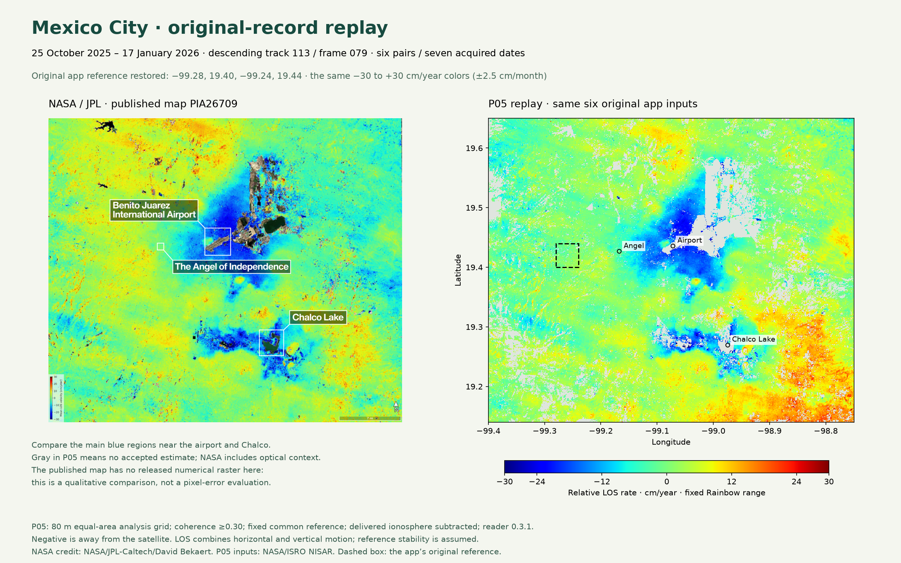

# Mexico City · replay of the original six-file comparison

The six complete originals from the app's earlier comparison were downloaded again and processed through the normal P04 service. Their IDs, names and byte sizes match the archived six-file case. The original app reference, area, scientific settings and display range were restored. The earlier verification artifacts were preserved.

[Comparison figure · PNG](validation/mexico-replay/nasa_p05_comparison.png) · [Printable comparison · PDF](validation/mexico-replay/nasa_p05_comparison.pdf) · [App map and scale](validation/mexico-replay/p05_original_reference_cm_year.png) · [Monthly map and scale](validation/mexico-replay/p05_original_reference_cm_month.png)

## Exact app recipe

| Setting | Replayed value |
|---|---|
| Original files | G4058281119-ASF, G4058288661-ASF, G4058338815-ASF, G4058459579-ASF, G4058584016-ASF, G4058733834-ASF |
| Storage | Six complete HDF5 originals under `data/raw/`; 14,151,581,696 bytes total (13.180 GiB) |
| Geometry | Track 113, descending, frame 079; GUNW frequency A / HH |
| Archive | BETA X05009 and X05010; joining these revisions explicitly enabled for P04 only |
| Acquired dates | 25 October, 6 November, 18 November, 12 December, 24 December 2025; 5 January, 17 January 2026 |
| Pair durations | Five 12-day intervals plus the 24-day November 18–December 12 interval |
| Study bounds · W/S/E/N | −99.40, 19.14, −98.75, 19.65 |
| Original reference · W/S/E/N | **−99.28, 19.40, −99.24, 19.44** |
| Scientific settings | 80 m posting; coherence ≥0.30; native accepted fraction ≥0.50; delivered ionosphere subtraction |
| Analysis grid | EPSG:6933, 769 × 784 cells |
| Common accepted footprint | **510,464 cells / 84.6687%**, matching the archived check |
| Fixed reference | **2,698 common cells**, matching the archived check |
| Opening display | **Rainbow, −30…+30 cm/year**; saved with the result so reopening does not switch to an automatic range |
| Monthly equivalent | Same numerical rate divided by 12; fixed −2.5…+2.5 cm/month |
| New result | `824646edbe874b0eac34ac7ba695d095` in Your runs → Sinking City Atlas |
| Reference assessment | `6cb26edc61ff4e20a8bc1abe5eb058c5`; existing reference explicitly retained |

This replays the original **app comparison recipe**. NASA's exact stable reference, full processing stack and numerical velocity raster have not been supplied, so the result is not claimed to reproduce NASA's analysis pixel for pixel.

## Comparison with NASA's published map

NASA's published image uses the October 25–January 17 period and a mean LOS velocity legend in cm/year. Its article describes blue areas with rates exceeding 2 cm/month in parts of the region. See [NASA/JPL image PIA26709](https://www.jpl.nasa.gov/images/pia26709-us-indian-spacecraft-captures-mexico-city-subsidence/) and [the explanatory article](https://www.jpl.nasa.gov/news/us-indian-space-mission-maps-extreme-subsidence-in-mexico-city/). Image credit: NASA/JPL-Caltech/David Bekaert.

The replay recovers similar broad negative-LOS patterns near the airport and the Chalco region, with lower-magnitude surroundings and some positive patches. Shapes and magnitudes are not identical. The app applies a fixed common support and displays rejected cells as missing; NASA's figure includes optical context in such locations. Positive app values are relative toward-satellite motion, not proof of uplift. This comparison cannot distinguish all effects of reference choice, atmospheric residuals, temporal sampling or differing processing without NASA's underlying numeric product and method details.

Approximately 2 km windows give descriptive summaries of the accepted P04 cells:

| Window near | Accepted / window cells | Median cm/year | Median cm/month |
|---|---:|---:|---:|
| Airport | 285 / 750 | −16.61 | −1.38 |
| Angel of Independence | 682 / 720 | −3.40 | −0.28 |
| Chalco Lake | 103 / 720 | −14.59 | −1.22 |

These are spatial summaries near landmarks, not point measurements, city-wide sinking rates, NASA error estimates or direct vertical motion. In particular, limited accepted support near water/runways must not be reported as the displacement of the lake or runway itself. [Window bounds and spatial percentiles](validation/mexico-replay/landmark_windows.json).

## Independent numerical checks

The exported pair GeoTIFFs were independently accumulated along the six-pair chain, then fitted with SciPy linear regression at 100 sampled shared cells. The source phase/reference/wavelength conversion was also recomputed. No synthetic measurements were used.

| Check | Observed result |
|---|---:|
| Maximum independent annual rate difference | 7.43 × 10⁻⁷ cm/year |
| Maximum reconstructed-date difference | 2.87 × 10⁻⁷ cm |
| Phase-to-mm conversion difference | 0 at exported precision |
| Annual / 12 versus monthly raster | 0 at exported precision |
| First reconstructed acquired date | Exactly zero on accepted support |
| Remote science bytes while processing/checking | 0; all six originals were local |
| Graph redundancy | Zero: no independent closure check |

These reproduce the archived numerical verification results. They establish agreement between implementations, not physical accuracy. The reference remains an assumption, no GNSS/field validation was added, and only delivered ionosphere subtraction was requested. The current native reader is 0.3.1.

[Archive file manifest](validation/mexico-replay/exact-catalog.json) · [Saved replay request/result](validation/mexico-replay/run.json) · [Numerical verification](validation/mexico-replay/verification.json). Rerun locally with `scripts/replay_mexico_original.py`; regenerate the comparison with `scripts/compare_mexico_replay.py`. Both expect the downloaded originals and saved NASA reference image, respectively.

To reuse the case in the app, open the new result and select **Reuse this setup → Continue → Keep this reference → Run P04**. It preserves the same six files and saved opening color range. Choosing a new candidate intentionally changes the spatial zero and therefore produces a different relative map.
