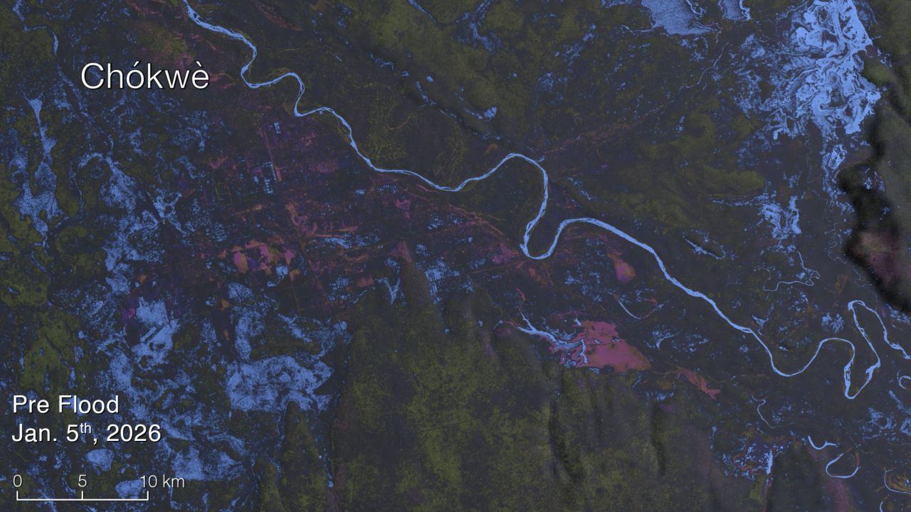
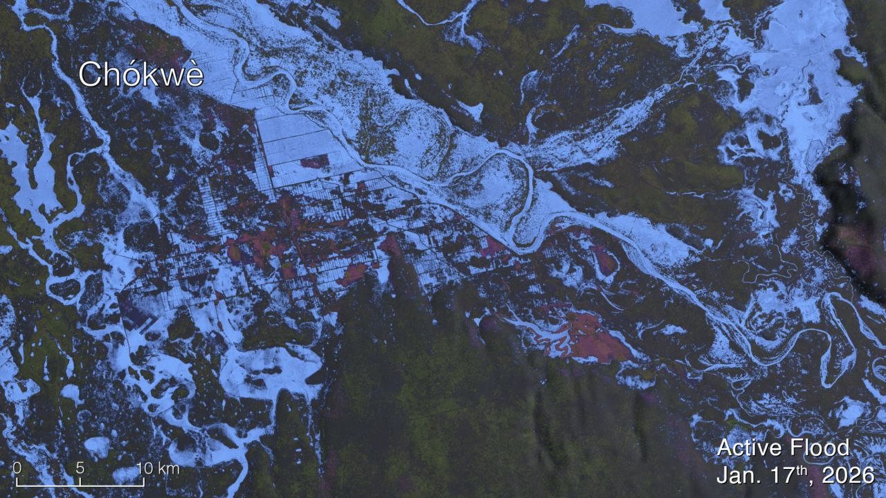
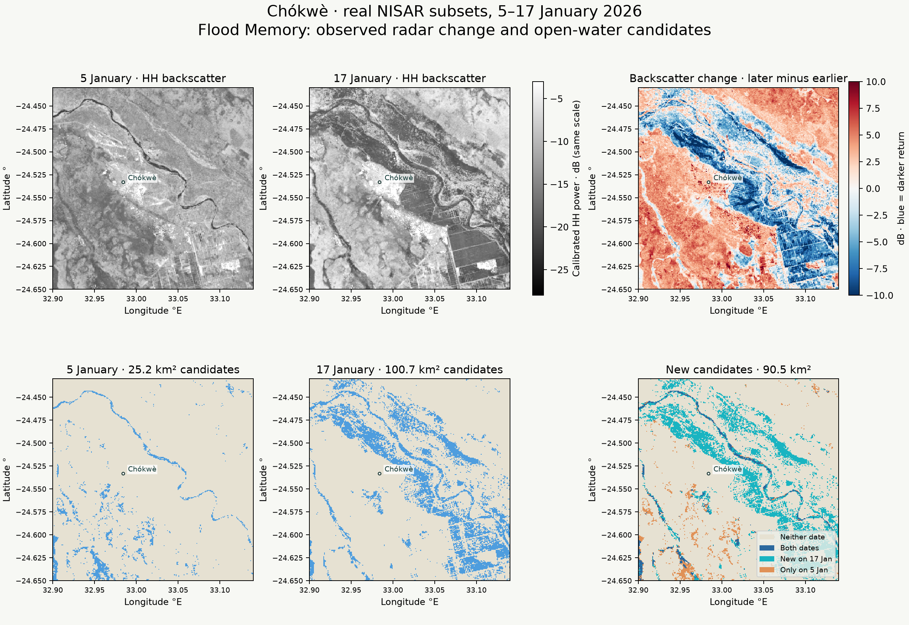
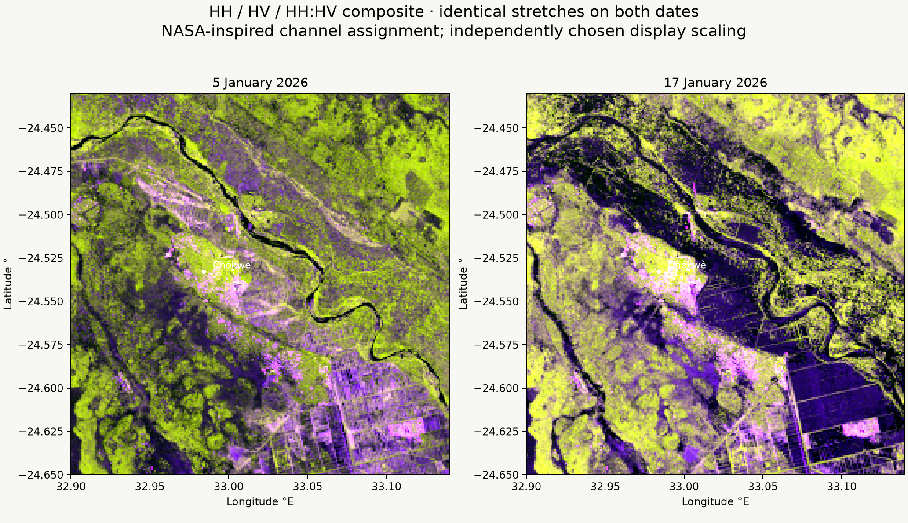

# Chókwè: Flood Memory compared with NASA

## What the two observations show

The two real NISAR area extracts show **90.47 km² of newly detected open-water candidates** between 5 and 17 January 2026. Candidate area changes from **25.16 to 100.65 km²** on the same **593.92 km²** of usable ground. These figures describe the selected Chókwè window, not the entire Mozambique flood.

At −18 dB the new-candidate estimate is **51.40 km²**; at −16 dB it is **116.75 km²**. The current 90.47 km² value is therefore strongly dependent on the classification setting.

This is a working, reproducible **before/during comparison**, not a measured classification accuracy. There is no later acquisition in this run, so recovery is **unobserved**, not zero days. The comparison uses the existing Flood Memory method unchanged; it has not been tuned to imitate the reference image.

## What matches NASA, and what remains unverified

| Question | NASA reference | Our Flood Memory run |
|---|---|---|
| Observations | GCOV, 5 and 17 January 2026 | Matching dates; selected track 114 ascending, frame 165, X05010 |
| Geographic view | Wider perspective illustration around Chókwè | North-up 24 × 24 km window: 32.90–33.14°E, 24.65–24.43°S |
| Display | Open-water highlighting and HH/HV/ratio composite | Candidate-water classes, backscatter change and a separate illustrative composite |
| Water method | Full detection parameters are not supplied on the page | Fixed HH threshold −17 dB after native masking and aggregation |
| Sampling | The illustrated image does not document its rendered analysis grid | Native 10 m samples; 100 m equal-area analysis grid |
| Numerical agreement | No georeferenced reference mask is supplied | No justified precision, recall, IoU or percentage-agreement claim |
| Recovery | The two published comparison dates do not establish recovery | Unavailable in this two-date run |

[Open NASA’s before image](https://svs.gsfc.nasa.gov/vis/a000000/a005600/a005661/Pre_Chokwe.png) · [Open NASA’s during-flood image](https://svs.gsfc.nasa.gov/vis/a000000/a005600/a005661/Post_Chokwe.png)

NASA does not list its exact granule IDs or processing release on the page, so we verified a matching catalog pair for the dates and location, not NASA’s complete internal processing recipe.

**How to compare:** inspect newly inundated fields and river-adjacent floodplain, accounting for the smaller rectangle and different viewpoint. Compare newly appearing water separately from water already present on 5 January. Similar visual change supports plausibility; it cannot establish environmental accuracy. Do not compare total highlighted area across these different map extents.

In our smaller window, the main new dark-water-candidate corridor appears north/east of Chókwè and continues toward fields to the southeast. That is qualitatively consistent with the published floodplain expansion. Our threshold map remains fragmented. Some cells also lose their water-candidate classification; this does not establish physical drying, because roughness, vegetation and mixed-pixel changes can alter backscatter. The regional median HH actually brightens by 1.07 dB while candidate-water area grows, so a single regional brightness statistic cannot summarize this spatially varied change.

NASA SVS 5661 · screenshots of the published January 5 and January 17 images, credited to NASA SVS / Zoey N. Armstrong (Navteca). Wider perspective views; not the exact extent of our smaller north-up window.

## Read the radar measurements before the candidates

Top row: calibrated HH brightness on a fixed scale, followed by its measured change. Bottom row: water candidates on each date and their changes. Beige is neither-date candidate; dark blue is both dates, cyan is new on January 17 and orange is only January 5. Blank cells are missing support. Blue in the continuous change map means a darker later return, not automatically water.

Real saved subsets; a smaller north-up comparison window within the published NASA scene.

## The water threshold materially changes the mapped area

The water threshold controls which dark radar returns are called candidates. The existing default is **−17 dB**; the following scenarios use identical observations, quality screens and geographic support. They are sensitivity tests, not confidence intervals.

| HH threshold · dB | 5 January · km² | 17 January · km² | Newly detected · km² |
|---:|---:|---:|---:|
| -19 | 4.58 | 20.94 | 19.89 |
| -18 | 8.87 | 55.43 | 51.40 |
| -17 | 25.16 | 100.65 | 90.47 |
| -16 | 53.50 | 136.31 | 116.75 |
| -15 | 87.60 | 161.96 | 131.15 |

Smooth dry fields and radar shadow can resemble open water. Flooded vegetation and built-up inundation may brighten rather than darken. A single HH threshold therefore cannot classify every flood setting. We should evaluate representative independent water/dry labels before selecting a locally supported threshold. Matching the look of the NASA image is not an appropriate calibration target by itself.

## Grid spacing changes the candidate area too

At the same −17 dB threshold, changing analysis-cell spacing changes the result substantially. These checks reread only the two saved subsets; no extra satellite measurements were downloaded.

| Requested spacing · m | Actual spacing · m | Retained cell area · km² | New candidates · km² |
|---:|---:|---:|---:|
| 20 | 66.6 | 593.46 | 105.29 |
| 100 | 100.0 | 593.92 | 90.47 |
| 250 | 250.0 | 598.69 | 60.12 |

The 20 m request is bounded to **66.6 m** by the current 384-cell-per-axis GCOV processing limit. The native files still retain 10 m samples. Our 100 m result is a display/analysis grid, not a native-resolution flood mask. Larger cells average bright and dark scattering together before thresholding, so narrow and mixed water features may disappear. The grids also have different alignments and full edge cells, which explains the small differences in total retained area; this is an engineering sensitivity study, not an identical-footprint accuracy benchmark.

The next algorithm evaluation should compare classifying native or finer samples before calculating water fractions in larger cells, versus thresholding averaged power. Both require independent labels; neither should silently replace saved results.

## Use both polarizations to investigate the remaining differences

The diagnostic image below uses the same channel assignment described by NASA: HH in red, HV in green and their power ratio in blue. Here each channel is expressed in dB and stretched using pooled 2nd–98th percentiles across both dates, so a color has the same display meaning on each date. This is an independently scaled illustration, not an exact NASA color reproduction or an extra water-classification result. It is produced for this study; the app’s classifier remains the existing HH-based Flood Memory calculation.

Use it to inspect where scattering behavior differs from the dark-water candidates. A color alone does not verify flooded vegetation or establish land cover.

Study-only diagnostic; independently chosen shared stretches, not NASA’s undocumented exact display scaling.

## What to retain and what to improve next

**Keep now:** the matching two-date acquisition group, native quality screening, explicit before/during dates, fixed common geographic support, dated candidate maps, numerical exports and threshold-sensitivity scenarios. They make this comparison reproducible.

**Improve next, in order:**

1. Obtain an independently produced, date-matched water/flood raster or defensible water/dry labels for this exact rectangle. Evaluate separate training and test areas, rather than adjusting settings until the map looks convincing.
2. Assess threshold and analysis-grid sensitivity together. Small channels and mixed water/land cells can disappear at 100 m. Native 10 m spacing does not mean this run has 10 m output detail.
3. Evaluate HH change and HV/HH evidence alongside simple dark-water thresholding, with explicit rules and independent testing. This could help distinguish some agricultural or vegetation effects; it is not yet a validated flood classifier.
4. Add an earlier multi-date baseline and later compatible observations to distinguish seasonal water and observe recession. Extra acquisitions are proposed, not downloaded in this study.

**Decision:** retain this as a real-data engineering and visual plausibility case for P01. Do not present it as a validated reproduction of NASA’s flood classification.

## Repeat the result from the saved subsets

Select **Mozambique paper’s area** in Explore Earth. The preset chooses the approved rectangle, BETA archive and 17 January comparison date; discovery still defaults to mission launch through today. Choose only the two January 5/17 files in group `114_A_165_4005_DHDH_X05010`, or use the saved subsets, then run Flood Memory.

This run uses HH, resolution 100 m, threshold −17 dB, minimum native valid contribution 0.5, ambiguity half-width 1 dB and comparison date 2026-01-17. The companion HV read is enabled for diagnostic polarization evidence. No reference rectangle or external dataset is required. The native positive-power and valid-subsample mask are screened before averaging; the two dates are compared only on shared valid cells. Area comes from equal-area pixel counts. New water is water on January 17 and not water on the pre-comparison baseline, January 5.

**Saved run:** `7f42726a402e4fc2a8694e8db7b86bf4`. Open Runs in NISAR Observatory and choose the Flood Memory result created for this study. GeoTIFFs, JSON and map images retain the saved run’s numerical results.

The two subsets occupy **118.1 MiB** on disk. Processing and verification read the saved area files locally and transferred **zero remote science bytes**. The area extraction itself required bounded remote HDF5 blocks; transferred bytes exceed saved compressed bytes.

Verification checks file hashes, native grid metadata, recomputed water/date maps, change rasters, equal-area totals and the absence of recovery evidence. All checks passed. Those are engineering checks, not independent geophysical accuracy measurements.

[NASA source](https://svs.gsfc.nasa.gov/5661/) · [GCOV product guide](https://nisar-docs.asf.alaska.edu/gcov/)
