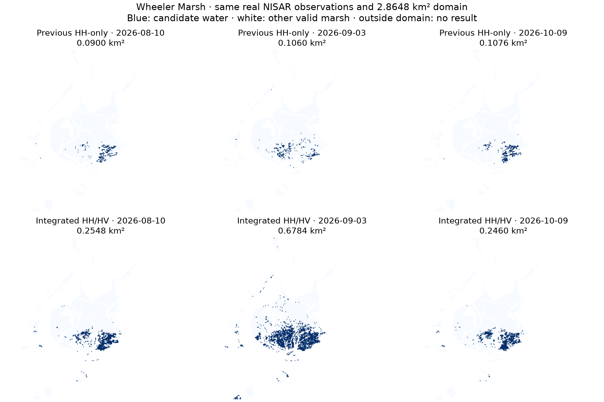

# Wetland Pulse · integrated HH/HV comparison

**18 October 2026 · app 0.4.9 · P02 algorithm 0.5.0**

Wetland Pulse now offers a joint HH/HV sigma-zero water-candidate method inspired by [Lamb et al. (2025), Figure 6](https://doi.org/10.3390/rs17020263). It is available in **Area & analysis settings → GCOV → Water classification method**. It is the new-workspace P02 choice; older saved setups retain their previous single-channel method. Selecting a tool is still an explicit action.

## Use it in the app

1. Select **Wetland Pulse** and an area. For this replay choose **Wheeler Marsh paper's area**.
2. Select at least three compatible GCOV dates with **HHHH**, **HVHV**, the delivered **rtcGammaToSigmaFactor**, and a source quality mask. Files missing a required layer give an explicit error; the method never silently changes to single-channel.
3. In **Area & analysis settings**, choose **HH/HV · sigma-zero (paper-inspired)**. For this experiment use **HH −14 dB**, **HV −23 dB**, **20 m** grid, **0.5** minimum native valid fraction and **±1 dB** latest-state ambiguity band. These thresholds are starting values from a different sensor record, not universal wetland thresholds.
4. For the Wheeler comparison import the tool card's **named wetland zones** GeoJSON under **Advanced options → Spatial context**. Without it the whole rectangle is analyzed, including river/sea water; those results are not comparable to this marsh-only record.
5. Run processing. Read **observed wetness occupancy** first, then explore the dated candidate maps. Frequency is the proportion of selected observations classified as candidates, not time spent flooded. Inspect quality and threshold/grid sensitivity before interpreting spatial patterns.
6. Use **Single-channel · gamma-zero (previous method)** with **−17 dB** to reproduce the previous calculation. Its optional polarization contrast does not apply the joint classifier.

No reference rectangle, field labels, external gauge or DEM is needed to run the radar classifier. Optional independent labels can evaluate the fixed rule; they do not fit these thresholds automatically.

## What changed in processing

| Stage | Implemented behavior |
|---|---|
| Radiometry | Multiply native linear gamma-zero HH and HV power by the delivered gamma-to-sigma factor **before** valid-power averaging. Do not multiply separately averaged power and factor. |
| Native quality | Both channels and factor must be finite and positive; reject invalid source-mask values and nonzero delivered input exceptions. Use identical native support for HH and HV, then apply the chosen minimum valid fraction. |
| Classification | A cell is a candidate only when **HH sigma-zero < −14 dB AND HV sigma-zero < −23 dB**, or the user's declared thresholds. A clearly dry channel vetoes the other. |
| Time comparison | Use the same pixels valid in both channels on every date, clipped to the optional domain. Retain occupancy, date frames, gain/loss, patch tracking and named-zone summaries. |
| Ambiguity | Near-boundary status respects the joint rule. It does not remove pixels from hard-threshold occupancy totals. |
| Sensitivity | Shift both thresholds together by −2, −1, 0, +1, +2 dB; this is not an exhaustive two-dimensional calibration. Grid checks average converted powers before reclassification. |
| Brightness context | Existing brightness/change/variability and baseline maps retain original HH gamma-zero values. They are context, distinct from the separately named HH/HV sigma-zero classification inputs. |
| Audit outputs | Latest HH/HV sigma-zero rasters, joint native accepted fractions per date, method/threshold provenance, numerical rasters, JSON and map images with legends. |
| Independent labels | Held-out labels test fixed joint classifications; training labels are reported as unused for fitting. No in-sample accuracy is substituted for a holdout. |

## Real-data replay and previous results

Both calculations use the same six real native area subsets: **GCOV PROVISIONAL · ascending track 133 · frame 022 · P05023**, 10/22 August, 3/15/27 September and 9 October 2026. The extraction rectangle is **−73.13, 41.16, −73.08, 41.21**; the analysis grid is EPSG:6933, 20 m. The NWI emergent-marsh common domain is **2.8648 km²**, not the exact published study polygon. No new downloads were necessary.

| Acquisition · 2026 | Bridgeport measured level · m NAVD88 | Previous HH gamma-zero · km² | Integrated HH/HV sigma-zero · km² |
|---|---:|---:|---:|
| 2026-08-10 | -0.375 | 0.0900 | 0.2548 |
| 2026-08-22 | +0.562 | 0.2412 | 0.5064 |
| 2026-09-03 | +0.660 | 0.1060 | 0.6784 |
| 2026-09-15 | -0.043 | 0.1260 | 0.3044 |
| 2026-09-27 | -0.186 | 0.0104 | 0.1228 |
| 2026-10-09 | -0.773 | 0.1076 | 0.2460 |

The nearby-gauge rank association is **ρ = 0.829**, compared with **0.314** for the previous method. On 3 September the new method maps **0.6784 km²** of candidates instead of **0.1060 km²**. This demonstrates a substantial method-dependent response; it does **not** prove the additional pixels are correctly inundated. Changes combine different radiometry with joint-channel thresholds, so this comparison does not isolate the contribution of each change.

The joint method finds **0.7320 km²** classified as candidates on some but not all dates and **0.0544 km²** on every selected date. First-to-last candidate gain is **0.0592 km²**, loss **0.0680 km²**, net **−0.0088 km²**. These describe the selected record, not annual wetland extent or hydroperiod.

**New saved run:** `7b6de3d3262944169feaf532383861f0`. **Baseline replay:** `74898694f2ee4c84950e556815c581b9`. The earlier run `0abb2d9e13ba4c3f96f908c26743f780` was no longer in the live Runs folder when this test began; its archived evidence remains untouched. The replay's series and metrics match that archive exactly. Its recreation does not imply the old live run was restored.

## What the comparison can establish

Direct HDF5 reads independently converted native power and reprojected the six scenes. Source SHA-256 hashes match the subset manifests. All six dated class rasters, areas, occupancy, latest sigma-zero rasters and named-zone fractions reconcile with independent calculations. The integrated classifications exactly match the earlier separately calculated HH/HV diagnostic. All native inputs in this particular record were valid; missing/invalid-channel behavior is covered separately by synthetic tests.

The software suite passed **302 Python tests** and **137 frontend tests**. These are engineering checks, not environmental accuracy scores. Browser checks cover method switching, appropriate controls, old setup restoration and the saved result. Evidence: [comparison receipt](validation/wheeler-marsh/comparison-hh-hv.json), [per-date CSV](validation/wheeler-marsh/comparison-hh-hv.csv), and the original [source/tide study](P02_WHEELER_MARSH.md). Reproduce the comparison with `scripts/compare_p02_hh_hv.py` after both recorded replay runs exist.

## Limitations and next validation

- The paper used historical **PALSAR**, different dates and sensor/field comparisons. Its reported performance does not transfer to these 2026 NISAR scenes. This is an adaptation of its decision rule, not a full reproduction.
- The app uses valid-power spatial averaging; it does **not** implement Enhanced Lee filtering. The [2026 depth/volume follow-up](https://doi.org/10.3390/rs18081172) also uses elevation and calibrated tidal models absent here. No depth or volume is inferred.
- [NOAA Bridgeport](https://www.tidesandcurrents.noaa.gov/stationhome.html?id=8467150) measures nearby water level, not marsh pixel inundation. Six dates are a small selected sample. October's observed gauge values are preliminary. September 27 has unusually strong winds and a large measured/predicted difference. Local tidal lag is not calibrated.
- The NWI inventory excludes much river/sea water but is not date-matched truth; its original imagery vintage was not established. The rectangle and inventory domain differ from the published marsh polygon.
- L-band scattering depends on vegetation, surface roughness, wind, soil moisture, geometry and noise. Thresholds can miss water beneath vegetation and mistake smooth dry surfaces for water. A correlation increase is not independent accuracy.
- Before claiming validated inundation, acquire contemporaneous independent marsh labels, calibrate thresholds/filtering on separate observations and evaluate on withheld dates/sites. The public [2018 field release](https://doi.org/10.5066/P149ZGMQ) cannot validate 2026 pixel states.

The [ASF GCOV documentation](https://nisar-docs.asf.alaska.edu/gcov/) explains the delivered radiometry and conversion factor. Keep the declared method, thresholds, grid, quality/domain choices and source IDs with exported results.
