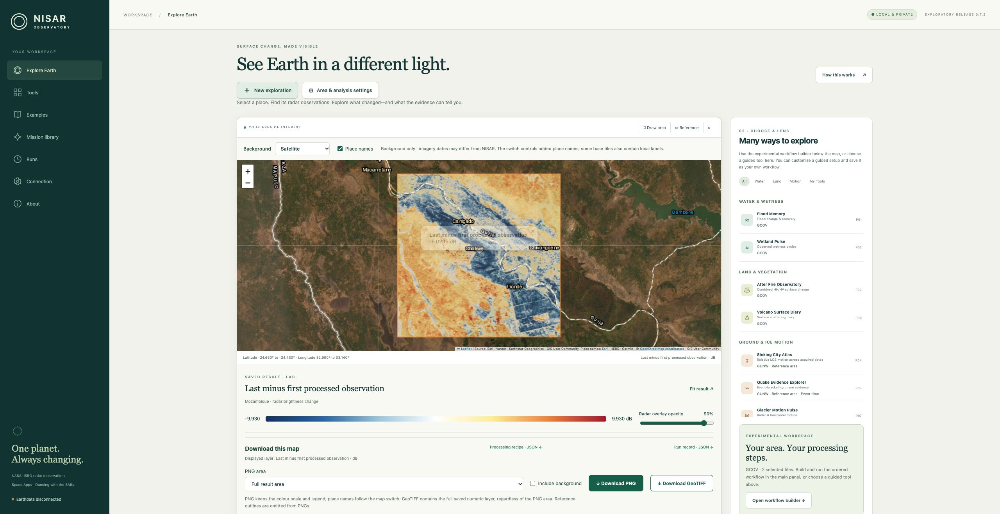

# Repeat the Mozambique experimental workflow

Browser-tested on 22 October 2026. This is a **radar-brightness change experiment**, separate from the protected Flood Memory flood-candidate example. It does not independently validate flood extent.

## Quick replay

1. In **Explore Earth**, choose **My Tools** in “Many ways to explore”.
2. Open **Mozambique · radar brightness change**. The app restores the area, HH channel, 100 m requested grid, three steps and the two matching local inputs. Look for **“2 recorded local sources matched”**. Opening the tool does not process anything.
3. Choose **Run workflow**. The result opens on **Change from first to last date**, with **Diverging** colors and an automatic shared range. Both protected subsets are already local; this test required no Earthdata connection or new download.
4. To open a completed result without processing again, go to **Runs → Open run**. The tested saved replay is run **9beb37fd**. Run IDs are local records, not permanent links if you later delete the run.

A named tool stores the recipe and input identities, not copies of its satellite files. The protected inputs remain in `Examples/P01_Mozambique/inputs/`. If they are missing from the app’s selection, use **Use saved data**, or **Import subset folder** with this folder. Confirm both dates and the acquisition group before running. Importing the [tested recipe](validation/workflows/mozambique-browser-replay/tested-recipe.json) is another way to restore the process; files must be supplied separately.

## Build it yourself from an empty workspace

1. Choose **New exploration**, then **Mozambique paper's area · GCOV** in the area list. The rectangle is west 32.90°, south −24.65°, east 33.14°, north −24.43°. The search dates can remain launch through today; local input selection determines the actual processing dates.
2. Choose **Use saved data**. Verify that exactly these two GCOV area extracts are checked for analysis: **5 January 2026, 03:42 UTC** and **17 January 2026, 03:42 UTC**. Both belong to **ascending track 114, frame 165, DHDH, X05010**. Do not add other regions or replace them with different revisions when checking this replay.
3. In the builder, leave **Input product: GCOV** and **Starting point: Editable ordered steps**. Give it a name and question.
4. In **Area & analysis settings**, select **HH** in Radar channel, **100 m** requested cell spacing and **0.5** minimum accepted fraction. Return with **Back to Explore Earth**. No reference rectangle is needed for this brightness experiment.
5. Select each option from **Choose a compatible next step**, read its preview and choose **Add this step**:

| Order | Step | Setting | Meaning |
|---|---|---|---|
| 1 | Convert radar brightness to decibels (dB) | No parameter | Convert accepted positive radar power using `10 log10(power)`. |
| 2 | Compare with the first observations | Baseline count **1** | Subtract 5 January at each location. The first processed frame is zero; 17 January shows its difference from 5 January. |
| 3 | Summarize the selected observations | **Mean** | Average the two processed frames on ground valid at both dates. |

6. Choose **Check workflow**, then **Run workflow**. A valid recipe is a check on order and parameters; reading the data performs the coverage and quality checks.
7. In **Main results**, choose **Change from first to last date**. Choose **Diverging** under the map’s appearance controls and keep **Automatic · shared across dates**. Select **Save this as the opening view** if you want this map to reopen for that saved run.
8. Choose **Save as my tool** in the builder. It keeps the current map’s layer, palette and range with the matching recipe, as well as area, source identities and settings. Use **Update my saved tool** for later edits, or **Save a new copy** to preserve a variant. Export recipe JSON to share the process without login credentials.

## Which result should I read?

| Result | How to interpret it |
|---|---|
| **Change from first to last date** | The full processed 17 January minus 5 January difference, in dB. Negative values mean lower HH backscatter; positive values mean higher backscatter. A −3 dB difference is roughly half the power; +3 dB is roughly twice. |
| **Mean of processed observations** | Includes the baseline frame (zero). With these two dates, this mean is **half the full change**, not a second estimate of the final change. Summary cards describe this declared overview even when you switch maps. |
| **Explore time** | Two discrete snapshots. 5 January is zero by construction; 17 January is the baseline-relative difference. Next/Previous and playback change observations; they do not reconstruct intermediate days. |
| **Quality & reliability** | Native accepted/rejected contribution fractions and usable observation count. These show data support, not certainty that an environmental event occurred. |
| **Advanced maps** | Latest output after each step, plus the first-date baseline map. The baseline is the actual first observation in dB, not a zero-valued comparison frame. |

Diverging colors make increases and decreases easier to distinguish. Read the legend endpoints: with an asymmetric automatic range, its light midpoint need not be exactly zero. Display clipping does not change numeric GeoTIFF values. PNG exports are presentation maps; GeoTIFF exports keep the measurements and georeferencing.

## Verified outcome

Two browser runs produced **identical values and georeferencing** for the summary, change and both dated rasters:

| Check | Outcome |
|---|---|
| Shared usable ground | 59,392 cells · 593.92 km² |
| Actual analysis spacing | 100 m |
| Spatial median of mean summary | +0.9782047272 dB |
| Spatial median of full first-to-last change | +1.9564094543 dB |
| First processed observation | Zero on usable cells, as expected |
| Remote satellite bytes | Zero for both runs |
| PNG / GeoTIFF download checks | Passed; downloaded GeoTIFF equals the saved file |
| Saved setup replay | Restored both sources, HH, grid, baseline and summary settings, change layer and Diverging palette |

The scene-wide median does not describe every location. Darkening or brightening may have several causes; moisture, vegetation, roughness, cultivation and residual observation effects can contribute. This simple custom experiment does **not** implement Flood Memory’s water-candidate logic or reproduce NASA’s flood map. Use the protected Mozambique Flood Memory tutorial for that separate comparison.

[Full change-map PNG](validation/workflows/mozambique-browser-replay/change-map.png) · [Replay verification](validation/workflows/mozambique-browser-replay/verification.json) · [Portable tested recipe](validation/workflows/mozambique-browser-replay/tested-recipe.json) · [General workflow guide](WORKFLOWS.md)
