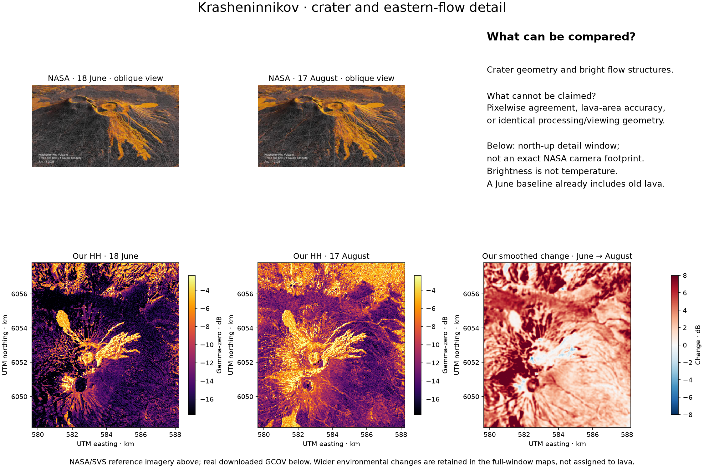
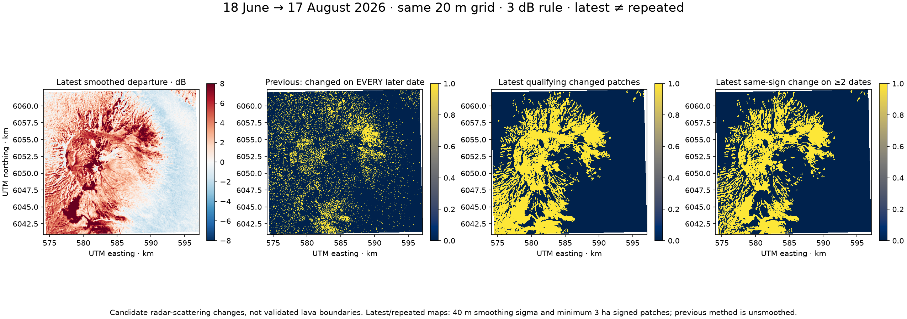
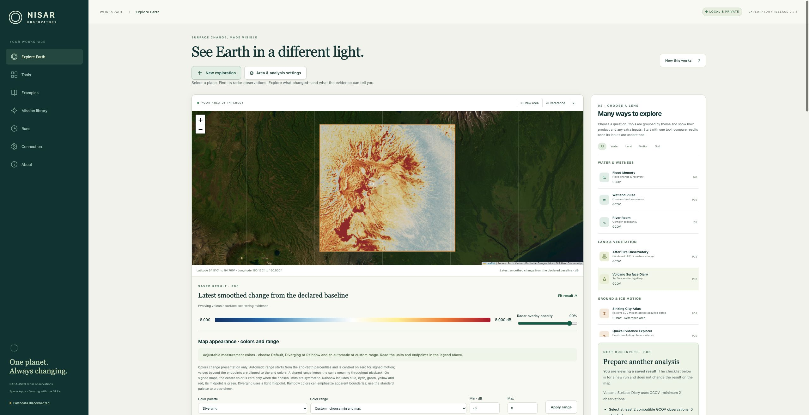

# Krasheninnikov · P06 documented comparison

This study compares **five downloaded NISAR L-band GCOV subsets** with the same dated frames in NASA’s Krasheninnikov visualization. It is a dated qualitative comparison, not a reproduction of a published classification accuracy result. **Accepted as a qualitative Example on 20 October 2026: [open the complete tutorial](../../../Examples/P06_Krasheninnikov/README.md).**

## Reference and scope

[NASA’s Scientific Visualization Studio reference](https://svs.gsfc.nasa.gov/5675/) and the [NASA/JPL article](https://www.jpl.nasa.gov/news/us-india-satellite-captures-time-lapse-video-of-volcanic-eruption/) describe a 17-date HH L-band sequence from 25 December 2025 to 17 August 2026, rendered on 3D terrain. They show an eastern flow field growing from the northern volcano; an older northwest flow was already present at the first observation. The orange colors are visualization styling, not temperature or centimetres of motion. NASA does not publish an accompanying georeferenced lava classification or its complete radiometric/display recipe on these pages.

The [Smithsonian Global Volcanism Program profile and dated KVERT reports](https://volcano.si.edu/volcano.cfm?vn=300190) provide independent volcano location and eruption chronology. Activity began in 2025 and continued through our 2026 comparison period. **18 June is an already-erupting baseline.** A June-to-August difference cannot map all lava emplaced before June, even when that lava is clearly visible in the individual images.

[Poland (2022), SAR volcanic flow maps](https://www.usgs.gov/publications/synthetic-aperture-radar-volcanic-flow-maps-sar-vfms-a-simple-method-rapid), [DOI](https://doi.org/10.1007/s00445-022-01539-7), is relevant method background, using amplitude and coherence with other missions. The primary abstract was reviewed; the full article was not available for verification. P06’s GCOV-only method does **not** implement or claim to reproduce that full technique.

## Study window and exact observations

The corrected preset is **Krasheninnikov NASA area**, west/south/east/north **160.15°, 54.51°, 160.50°, 54.70°**, approximately 23 × 21 km. This is our working window around the volcano and eastern flows, not an exact georeferenced NASA-frame boundary. The previous small starter window was centred east of the volcano. Preset searches retain launch-to-today dates; the comparison below uses exactly these five dates, rather than every search result.

| Acquisition · UTC | Public catalog granule | Viewing group |
|---|---|---|
| 18 June 2026 · 08:49:27 | G4240345872-ASF | 060 descending · frame 061 |
| 30 June 2026 · 08:49:26 | G4250844505-ASF | Same group |
| 12 July 2026 · 08:49:29 | G4252643155-ASF | Same group |
| 24 July 2026 · 08:49:25 | G4260821003-ASF | Same group |
| 17 August 2026 · 08:49:24 | G4285465897-ASF | Same group |

Full group identifier: `060_D_061_4005_DHDH_P05023`. Exact science names and catalog metadata are retained in [selected scenes](sources/selected-scenes.json). Acquisition dates match five NASA frames; NASA does not identify its exact source granules, so identical viewing geometry and processing cannot be certified from the public presentation alone. The five observations cover 60 days, with a 24-day final gap; there is no daily interpolation.

## Processing and fair comparison

1. Save native-area science and quality layers, retaining source provenance and file hashes. No full original is needed for this study.
2. Read HH gamma-zero power locally. Screen native samples before averaging valid linear power to a common **20 m UTM zone 57N** grid, then convert to dB. The rotated metric envelope is clipped by cell centres to the selected geographic rectangle in both method runs. Cell spacing is not resolving power; this is coarser than NASA’s stated 10 m imagery.
3. Use 18 June as the single observed baseline. Subtract this baseline from each later date on cells valid on all five dates.
4. For the new Evolving change method, smooth signed departures using a normalized Gaussian, **sigma 40 m** (about 94 m FWHM), preserving missing cells. Retain separate positive/negative patches above **±3 dB**, minimum **30,000 m² / 3 ha**, with four-neighbour connectivity. These fixed engineering settings were chosen before viewing the results; they are not locally calibrated lava thresholds.
5. Separate latest changed patches, first acquired qualifying change and same-sign change on at least two consecutive post-baseline observations ending at the latest date. Earlier transient candidates remain in dated evidence. Repetition describes sampled dates, not continuous persistence.
6. Rerun the previous unsmoothed all-later-dates rule on the **same 20 m grid and same files/baseline**. Its strict intersection can discard newly growing patches. Differences reflect the documented smoothing/filtering and temporal-rule changes, not an independent accuracy gain.
7. Test ±2/±3/±4 dB sensitivity on the same data. Sensitivity is not an uncertainty interval or accuracy score.

Original acquired brightness is retained under **Explore time**. Signed departures, candidate classification and supporting quality maps answer different questions. The first-observed date is a sampled observation, not the exact eruption or emplacement time. Areas use approximate local UTM map-cell areas.

## Comparison products

The completed evaluation saved:

- [Native input identity and quality verification](results/native-input-verification.json), including checksums, product version, native spacing, flags, stored size and network bytes during local analysis.
- [Exact tested settings](results/tested-options.json) and [dated candidate areas](results/dated-candidates.csv).
- [Previous/new method metrics and threshold sensitivity](results/method-comparison.json).
- [Five matching NASA frames versus our GCOV HH maps](../../../Examples/P06_Krasheninnikov/references/figures/nasa-vs-gcov-five-dates.png).
- [Previous versus evolving change maps](../../../Examples/P06_Krasheninnikov/references/figures/processing-comparison.png).
- Numeric GeoTIFF, preview PNG, result JSON and patch GeoJSON under `results/evolving` and `results/previous`.

Top-row reference images are sampled from NASA’s annotated video with each visible acquisition-date label checked. [Media provenance and credits](sources/media-provenance.json) retain the official source; the full downloaded video and contact sheet allow inspection. **Video frames are rendered presentation frames, not extra satellite observations.** Our north-up maps use a single pooled 2nd–98th percentile dB brightness scale across all dates (exact limits saved in `results/brightness-display.json`). NASA’s oblique camera and styling differ, so the panels cannot be pixelwise overlaid or scored as a georeferenced validation.

## Completed findings · 20 October 2026

**The real-data workflow works. The result supports a qualitative image comparison, not a validated lava-boundary reproduction.** All five subset hashes match their manifests, product version is 1.0.11, native samples are 10 m, and no nonzero input-data-exception pixels were found in the saved windows. The delivered sample masks still screen the few invalid cells; valid samples do not establish environmental attribution. Stored inputs total **259.52 MiB**. The evaluation and app run read **zero remote science bytes**.

The double-cone/crater setting, older bright northwest feature and bright finger-like eastern field are recognizable in our acquired HH images. Most of this field is already bright on 18 June. June-to-August departures do not trace that entire existing field: strong increases also appear on broad surrounding slopes and southern/western terrain. That broader pattern is inconsistent with treating the thresholded result as a lava-only map. Snowmelt, wetness and terrain scattering are plausible confounders, but their individual contributions have not been independently measured here. The 3D camera, radiometric/display recipe and exact original source geometries used by NASA cannot be certified from its public video.

Our record samples the later part of the eruption. It does not reproduce the initial crater filling and overflow visible earlier in NASA’s full December-to-August sequence. No temperature, lava volume or deformation in centimetres is derived from these GCOV measurements.

| Quantity on common selected-area support | Result | Interpretation |
|---|---:|---|
| Shared usable area | 478.06 km² | Approximately 100% of selected-window cell centres; rotated grid corners are excluded |
| Latest candidate change · ±3 dB, 40 m sigma, 3 ha patches | 145.60 km² | Brightness change, not lava area |
| Latest same-sign change on ≥2 consecutive later dates | 128.29 km² | Repeat evidence at acquired dates; not continuous persistence |
| Previous all-later-dates classification formula | 66.99 km² | Stricter temporal intersection on unsmoothed values; not an accuracy benchmark |
| New-method dated candidate objects | 690 | Overlap-linked components, not 690 physical lava flows |

| Signed threshold · fixed smoothing and patch area | Latest candidates · km² | Repeated latest candidates · km² |
|---|---:|---:|
| ±2 dB | 203.73 | 188.71 |
| ±3 dB | 145.60 | 128.29 |
| ±4 dB | 102.35 | 81.59 |

The roughly twofold candidate-area difference between 2 and 4 dB shows substantial setting sensitivity. It is not a confidence interval. The larger result from the new method is not evidence of higher lava-mapping accuracy: the smoothing, physical patch filtering and latest-date rule differ from the previous method.

**Previous-method resource limit:** its complete object-tracking step exceeded the existing 1,000-object safety cap on these unsmoothed dates. The application cap was not raised. The comparison raster uses the exact previous numerical classification formula after the same geographic clipping; it is explicitly labelled a formula-only comparison, not a successfully completed legacy tracking run. The new method completes normally with 690 objects.

## What changed in P06 and the shared experience

- Late-growing features are retained. Latest, first observed and repeated evidence now answer separate questions; the previous method remains selectable for historical recipes.
- Native quality is retained and analysis-cell centres outside the selected geographic rectangle are excluded from the rotated UTM envelope.
- The corrected volcano preset supplies geography and the tested settings. Mission-wide search dates remain intact. Initial P06 selection adds an available baseline observation when the four latest files would omit it; preparation explains missing baseline/later data.
- Smoothing reuses P03’s shared helper/control without changing its scientific calculations. Case-specific baseline-end dates are cleared when selecting unrelated area presets.
- First-change dates have explicit index/date keys in the result and PNG; pixel inspection translates date indices to dates or intervals.
- Moving between raw brightness and signed brightness change resets a custom range, even though both use dB. A shared automatic brightness range makes acquired dates comparable. The saved main-map view uses Diverging, −8 to +8 dB; the numeric rasters retain values beyond those endpoints.

## Application verification

Browser-created run **ebdcd1ba** completed with all five local files; its metrics exactly equal the local study. All **42 registered map previews** and their georeferenced float32 rasters were checked. Standalone main-map and first-change PNGs contain legends and provenance; the first-change legend shows acquisition dates. A downloaded numeric GeoTIFF matches its saved file byte for byte. Reopening from Runs restores the signed-change map, Diverging palette and ±8 dB limits. Date exploration resets to a shared brightness scale, approximately −17.72 to −2.36 dB.

[App verification receipt](results/app-verification.json). Engineering regression: **306 Python tests and 165 browser-logic tests passed**. These checks establish software behavior, not lava-classification accuracy. The API checks cover actual local data; the browser walkthrough covers preset selection, five-file selection, settings, preparation, execution, reopening and brightness-date exploration. Existing five protected Examples remain unchanged.

## Recommendation before an Example

Keep the new P06 surface-scattering workflow and the acquired-image comparison. **Do not describe this case as a validated lava-area map or an exact NASA reproduction.** A quantitative volcanic-flow Example needs independently georeferenced dated flow boundaries and stronger separation of seasonal/background changes, potentially using coherence and independent optical/thermal evidence. No extra satellite downloads were made for those future possibilities. The user accepted the present study as a qualitative Example with these interpretation limits retained.

## Reproduce locally

Use the saved download receipt and run `evaluate_p06.py` from the application environment. It verifies all five file hashes, reads only local subsets, runs the evolving method, attempts the previous method with an explicitly labelled formula fallback at its tracking cap, and exports the evidence on the same grid. Run `plot_comparison.py` to regenerate the figures. The source download script is separate and requires an active Connection session; rerunning the evaluation does not require credentials or network science reads. Source files are never modified by processing.
