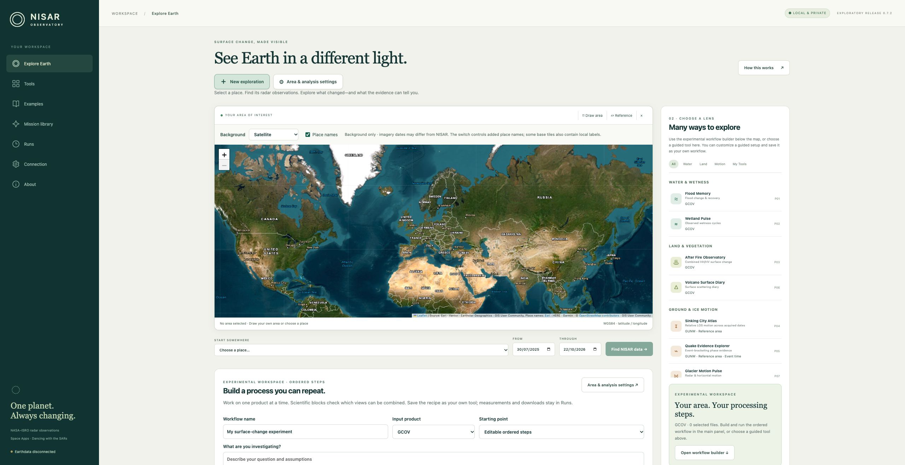

# Final local maintenance review · 22 October 2026

The app is running at http://127.0.0.1:8765 and was left on a clean Explore Earth workspace: no selected area, no checked files and no default steps. No recent browser errors were captured. NASA sign-in and downloads were not retested; this pass used local files and engineering fixtures.

- **438 Python / 222 frontend tests passed.** The existing Starlette/httpx test-client deprecation is the only Python warning.
- All seven protected examples, their 31 HDF5 inputs and editable recipe schemas pass checks; active local Markdown links resolve.
- Navigation reviewed: Explore Earth, Tools, Examples, Mission library, Runs, Connection and About. Shared settings were checked in generic mode and with an editable earthquake workflow.
- Calculation parameters stay in editable cards; relevant source/grid/quality and spatial context stay in shared settings. Duplicate card-owned fields and inapplicable guided preparation prompts are hidden.
- Release packages include the portable Recipes folder and default to version 0.7.2. Tests inspect both source-only and protected-input bundles, their hashes and exclusions using isolated temporary fixtures.
- Offline scientific replay no longer requires historical browser-run files that may have been cleared. Partial or numerically different saved exports still fail verification. No scientific processor was changed.
- Moved 35 unused cache/metadata files and superseded screenshots, totaling **1,178,807 bytes (1.12 MiB)**, into the optional archive. Nothing was permanently deleted. Downloads, subsets, reusable arrays, saved runs, personal recipes, dependencies and scientific evidence were preserved.

[Cleanup inventory](cleanup-2026-10-22.json) · [Protected-input and link checks](integrity-2026-10-22.json) · [Scientific replay evidence](../workflows/seven-examples/).

The optional archive can be deleted independently after review. Removing it will not remove any required application, example or user data.

