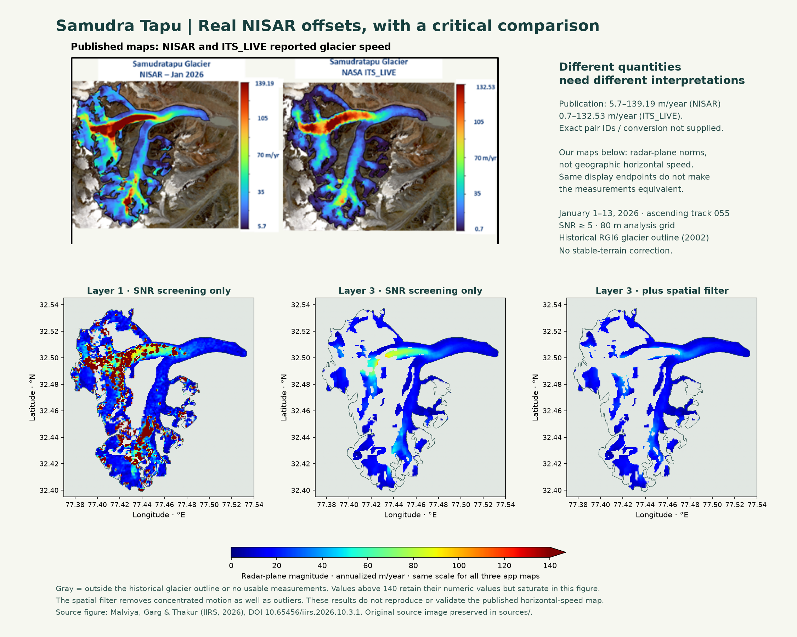
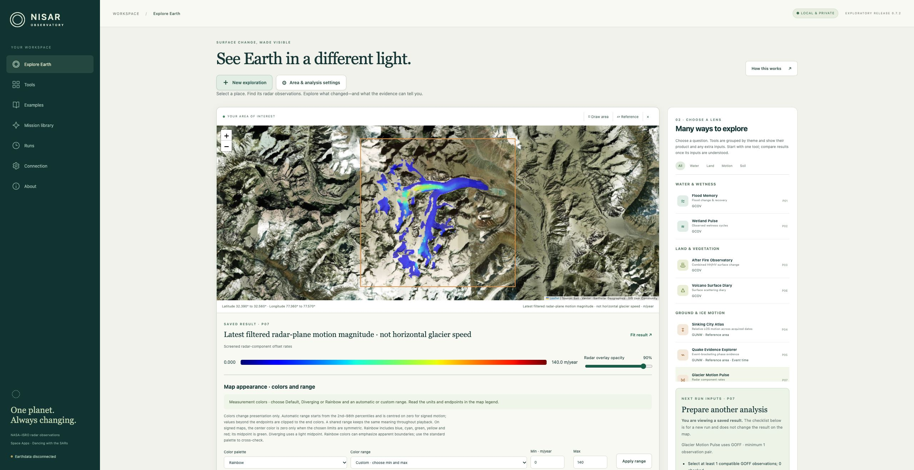

> **Update:** the subsequent [geometry-aware horizontal investigation](geometry/README.md) now adds native viewing cubes and an explicit zero-vertical-velocity solution. This document preserves the earlier radar-only baseline; its figures and statistics are historical comparison evidence.

# Samudra Tapu · P07 real-data investigation

**21 October 2026 · Real NASA NISAR L-band BETA area extracts · Comparison pending scientific validation**

The catalog outage is resolved for the BETA search used here. Three January-ending GOFF area extracts were downloaded through the application and processed locally. P07 now exposes the delivered correlation layer and daily/annualized units, and produces a filtered two-component radar-plane magnitude with explicit joint support. **This is a successful real-data engineering test, not an exact reproduction of the published glacier-speed map.** The later geometry-aware recipe is now available as a protected Example; see the update above.

## 1. What we are comparing

The [IIRS science article by Malviya, Garg & Thakur](https://science.iirs.gov.in/nisar-for-monitoring-glacier-motion/) ([DOI](https://doi.org/10.65456/iirs.2026.10.3.1)) presents Samudra Tapu NISAR and ITS_LIVE maps for January 2026. Its reported ranges are 5.7–139.19 m/year for NISAR and 0.7–132.53 m/year for ITS_LIVE. The ITS_LIVE comparison is a multiyear reference, not a same-date ground survey. The article does not give exact NISAR pair identifiers, radar band, correlation layer, glacier boundary, velocity-conversion equation or the ITS_LIVE map’s exact temporal support. Its Himalayan case is described as requiring no outlier correction.

We verified the complete official article and its figure, rather than treating its ranges as tuning targets. The unchanged [source figure](../../../Examples/P07_Samudra_Tapu/figures/iirs-published-glacier-maps.png) also contains Bara Shigri; our comparison displays only its Samudra Tapu row. The original article’s velocity computation cannot be reconstructed unambiguously from its published description.

Our measurements are signed slant-range/along-track offset rates and their radar-plane norm. They are **not automatically horizontal glacier speed**. A common m/year label does not make these quantities equivalent. No percentage agreement, velocity accuracy, RMSE or correlation against the article is claimed.

## 2. Data actually downloaded

Research rectangle: **77.36°–77.57° E, 32.39°–32.56° N**, approximately 372.38 km². It contains the entire historical RGI6 Samudra Tapu outline. This is our research window, not a recovered author bounding box.

| Viewing group | Reference → secondary, UTC | Exact duration | Use |
|---|---|---:|---|
| Ascending track 055, frame 018, HH | 20 Dec 2025 00:05:26 → 1 Jan 2026 00:05:27 | 12.000011574 days | Adjacent interval for temporal comparison |
| Ascending track 055, frame 018, HH | 1 Jan 2026 00:05:27 → 13 Jan 2026 00:05:27 | 12 days | January-only candidate for the article comparison |
| Descending track 034, frame 072, HH selected | 24 Nov 2025 13:38:43 → 11 Jan 2026 13:38:45 | 48.000023148 days | Separate view and interval sensitivity; never fused with ascending rates |

Collection: `NISAR_L2_GOFF_BETA_V1`. The same date/area PROVISIONAL search returned zero records; this is distinct from a catalog failure. Four BETA GOFF sources were listed. The remaining ascending Nov 26–Dec 20 pair was not needed or downloaded. Search dates were Dec 1–Feb 28 to include pairs spanning January; the filename-derived reference/secondary timestamps, not the broad catalog sensing envelope, define our rate denominator.

All three extracts are under **data/subsets/** in the UTC download folders recorded in [the source and sensitivity receipt](results/sensitivity.json). Their HDF5 files retain all delivered local geocoded science/quality layers and embedded provenance. The two ascending extracts occupy about 9.2 MB together; the descending extract adds about 4 MB. These are local extracts, not complete NASA products. Original retained/omitted-layer lists and content checksums are in each JSON manifest. Actual transfer exceeds saved file size because reads include HDF5 metadata and storage chunks.

The actual file metadata identifies LSAR and a center frequency of 1.239 GHz: these are L-band measurements. `SH` in a filename is a mode code and is not evidence of S-band.

## 3. Independent glacier boundary

The GLIMS WFS supplied **RGI60-14.15613**, historical area 80.006 km² and outline date field 2 August 2002. Identification is independently corroborated by [Bisset et al. (2020), table of glaciers](https://www.mdpi.com/2072-4292/12/10/1563). The [downloaded regional outlines](sources/rgi-bbox.geojson), [selected outline](sources/samudra-tapu-rgi6.geojson) and [domain version for app import](../../../Examples/P07_Samudra_Tapu/references/study-domain.geojson) are retained.

The original WFS polygon has a self-intersection at 77.4062° E, 32.4254° N. The app-import domain was repaired using Shapely make_valid, retaining polygon components; the source geometry and [repair receipt](sources/geometry-repair.json) are preserved. Both versions rasterize to exactly the same 12,502 cells on this grid (zero changed cells).

This old outline is a reproducible sampling boundary, **not a validated 2026 ice margin**. Retreat, a changing lake, seasonal snow and outline errors affect the comparison. Its current outline uncertainty is not quantified. At our 80 m equal-area grid, 12,502 cell centers fall inside it, or 80.0128 km²; the small difference from the inventory’s vector area is expected rasterization.

## 4. Processing and changes to P07

1. Select one track/pass/frame/mode group and a delivered layer. Both components use that same layer and its SNR. A missing layer stops the read rather than falling back silently.
2. Keep finite native offsets with explicit metre units and SNR ≥ 5. Apply quality screening **before** analysis-grid averaging, requiring at least 50% valid native support per output cell. Posting is 80 m; matching support can be much larger.
3. Compare layer 1, 2 and 3. The inspected ascending source metadata reports correlation-window sizes of 32×32, 64×64 and 128×128 source-image samples respectively. These are not map metres or independent 80 m measurements. Source sample spacing and correlation support determine effective resolution.
4. Test the global median/MAD outlier screen on and off. Its offset cutoff is max(1 m, 8 × 1.4826 × spatial MAD). No local filter or stable-terrain correction was applied in this investigation.
5. Divide offsets by each pair’s exact elapsed days. Optional m/year multiplies these rates by 365.25; it does not observe a full year or change their geometry.
6. Form the filtered radar-plane norm only where **both** components survive their configured filtering. Their cutoffs and any explicitly requested stable-ground biases are assessed separately. Keep the SNR-only norm and other raw components as advanced diagnostics.
7. Keep ascending and descending groups in separate runs. Summaries across dates use common valid support; missing data are not zero motion. Norms are positively biased by noise.

New source metadata and selected layer survive caching. P07 result version is 0.4.1; the reader provenance version is 0.3.2. Existing saved results retain their original numeric files and recipes. No new geographic-velocity inversion or automatic stable-ground assumption was introduced.

The general tool card documents this method. The research preset is now **Samudra Tapu paper's area**, using BETA, 80 m, layer 3, SNR 5, annualized m/year and no spatial outlier filtering. It is an exploratory starting setup, not a universal recommendation for every glacier. Date searches still default to mission launch through today. For an exact January replay, choose the saved 1–13 January ascending pair explicitly.

## 5. What the tests show

The table below uses the historical glacier outline and the **1–13 January ascending pair**. Each row has its own valid support, so the rows are sensitivity experiments, not a statistical performance ranking. “Magnitude” means radar-plane norm, not published horizontal speed.

| Offset layer | Spatial filter | Joint usable glacier cells | Usable fraction | Median magnitude, annualized m/year | 98th percentile | Maximum |
|---|---|---:|---:|---:|---:|---:|
| 1 | Off | 11,540 | 92.31% | 22.69 | 1,528.89 | 4,463.37 |
| 1 | On | 8,540 | 68.31% | 17.44 | 59.80 | 84.08 |
| 2 | Off | 9,373 | 74.97% | 17.40 | 86.02 | 1,651.57 |
| 2 | On | 8,122 | 64.97% | 15.72 | 39.53 | 53.26 |
| 3 | Off | 6,703 | 53.62% | 15.79 | 73.48 | 101.35 |
| 3 | On | 6,000 | 47.99% | 14.93 | 36.48 | 49.15 |

Layer 1 contains extreme, spatially noisy values. Layer 3 shows a more coherent faster central trunk, resembling the broad location of faster flow in the publication, but has extensive gaps. The global filter truncates that central feature. This is why a visually smoother filtered map is not necessarily the scientifically better map. The [saved browser run](browser-run.json), ID **827f80ba**, reproduces the layer-3 January-only norm exactly using the repaired outline as its study domain: 6,703 mapped magnitude cells, median 15.7881, maximum 101.3534 annualized m/year, with **zero remote science bytes**. It reopens with Rainbow and a custom 0–140 m/year range for visual comparison. The selected signed component has 6,726 valid cells; its statistics are explicitly distinguished from the norm. [Exported app map with legend](figures/p07-samudra-app-map.png).

The 101.35 versus 139.19 maxima are **not** a 27% speed error estimate: the pair, geometry, mask and quantities have not been matched.

The descending 48-day layer-3 SNR-only norm retains only 39.37% of the historical glacier area, with median 11.21 and maximum 667.27 annualized m/year. It is not an independent confirmation of the ascending rate or an exact candidate for a January-only pair. Different views, windows, snow conditions, time averaging and matching failures can all contribute. All 18 interval/layer/filter rows are in [sensitivity.json](results/sensitivity.json).

## 6. What is still required for quantitative validation

- Establish the study’s exact NISAR products, band, pair dates and correlation layer, or explicitly define an independent replication rather than the same experiment.
- Recover and retain appropriate per-pixel viewing geometry from the original GOFF metadata. Our current area extractor intentionally omits the multidimensional radar-geometry cubes; the retained offsets are still usable as radar measurements. Do not guess a constant incidence angle or heading.
- Implement a justified geometry-aware comparison: project an independently dated east/north velocity field into radar components, or invert radar measurements under an explicit vertical/surface-motion constraint with conditioning and uncertainty checks. Two radar components do not determine three motion components without an assumption.
- Obtain a versioned, temporally documented ITS_LIVE raster and compare on matched physical support. We reviewed its published map but **did not download or numerically validate against an ITS_LIVE raster** in this investigation.
- Check a suitable independently stable terrain region for residual bias, account for terrain distortion and snow/decorrelation, and investigate uncertainty. A low SNR threshold or filter-off display alone does not establish reliability.

**Decision:** keep the improved general P07 processor available, with this investigation clearly labelled. Do not present Samudra Tapu as a quantitatively reproduced or validated Example yet.

## 7. Reproducibility and files

- [Evaluation script](evaluate.py): replays both groups separately with three layers and two filtering settings using local subsets only.
- [Comparison figure script](make_comparison.py): preserves the publication source image, masks our results using the historical RGI outline, and uses the same 0–140 display endpoints for the three app maps. Values above the display maximum remain in numeric rasters.
- [Saved browser request](study-request.json), [real-run receipt](browser-run.json) and [map/export checks](browser-map-checks.json).
- [Sensitivity receipt](results/sensitivity.json): exact sources, checksums, interval durations, valid support and measured statistics.
- `results/*/result.json` and corresponding GeoTIFFs: independent exported processing experiments.
- Historical catalog-failure records in this folder are preserved as dated evidence; they do not describe current BETA availability.

### Scientific and data references

- [IIRS glacier-motion article and comparison maps](https://science.iirs.gov.in/nisar-for-monitoring-glacier-motion/).
- [ASF GOFF product guide](https://nisar-docs.asf.alaska.edu/goff/): native product posting and unfiltered delivered offsets.
- [ITS_LIVE Version 2 dataset DOI](https://doi.org/10.5067/JQ6337239C96) and [ITS_LIVE methods paper](https://doi.org/10.5194/tc-19-3517-2025).
- [GLIMS glacier data](https://www.glims.org/glacierdata/) and [GLIMS OGC services](https://www.glims.org/geoserver/ows?service=WFS&version=1.0.0&request=GetCapabilities).
- [Independent identification of Samudra Tapu’s RGI6 inventory number](https://www.mdpi.com/2072-4292/12/10/1563).

## Engineering checks for this revision

352 Python tests and 179 frontend tests passed. Known-value tests cover exact-interval division, 365.25 annualization, a 3–4–5 radar norm, companion-component outlier exclusion, separate stable biases, missing-layer failure and cache separation. Browser testing confirmed the full preset window, layer/unit settings, repaired-domain processing, saved Rainbow scale, 13 map previews, PNG export and reopening from Runs. A shared map-fit race discovered on reopening was fixed by fitting the visible map without a competing zoom animation; the saved run now centers automatically. Single-pair charts show the measured date interval instead of millisecond ticks. Signed component summary labels distinguish them from the positive norm map.

The server was restarted to activate the processing changes, which cleared the RAM-only Earthdata connection. All study inputs and this saved result are local, so no login is needed to inspect or rerun them. Sign in again only for further remote access.
