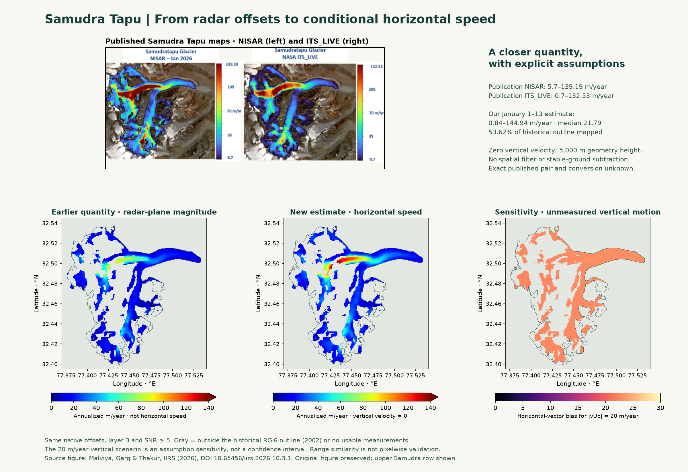

# Samudra Tapu: geometry-aware horizontal glacier motion

Reviewed and rerun on 21 October 2026 · P07 algorithm 0.4.2 · reader 0.3.3

The new calculation makes the quantity more physically comparable with the published glacier-speed maps. On the **1–13 January 2026 ascending pair**, estimated horizontal speed spans **0.84–144.94 annualized m/year**, with median **21.79 m/year**, over **6,703 cells (42.90 km²; 53.62% of the historical glacier outline)**. The previous radar-plane norm on those same cells reached 101.35 m/year. The high-speed trunk is more prominent after the geometry conversion and resembles the location of the fast trunk in the published figure.

This is a conditional estimate, not an exact reproduction or an independent accuracy validation. Similar maxima do not establish agreement at the same pixels. **Samudra Tapu is included as a protected Example.** Open the [complete tutorial](../../../../Examples/P07_Samudra_Tapu/README.md) for the exact pair, historical domain and display recipe. The six earlier examples are unchanged.



## What is being compared?

| Result | Period / meaning | Reported range · m/year | What can be concluded |
|---|---|---|---|
| IIRS NISAR figure | January 2026; exact pair and conversion are not supplied | 5.7–139.19 | A published reference for range and spatial pattern |
| IIRS ITS_LIVE figure | Multiyear, multisensor reference; exact version/time support not supplied | 0.7–132.53 | Useful flow context; not a simultaneous January ground-truth raster |
| Earlier app output | Jan 1–13 radar-plane norm | 0.76–101.35 | A radar-coordinate diagnostic, not horizontal glacier speed |
| New app output | Jan 1–13 horizontal speed, with vertical velocity fixed at zero | 0.84–144.94 | A geometry-aware conditional estimate; same 6,703 valid cells as the norm |

The figure uses **Rainbow and 0–140 m/year** for both app motion maps. Values above 140 saturate in the display but remain numeric in the GeoTIFF. The publication's displayed minima and range differ. Gray areas are outside the historical outline or lack usable measurements; they are not stationary ice. No raster digitization, pixelwise RMSE, correlation or accuracy percentage is claimed from the published image.

## Native data and reproducible settings

- Area: west 77.36°, south 32.39°, east 77.57°, north 32.56°.
- NASA collection: NISAR_L2_GOFF_BETA_V1; LSAR, frequency A, HH. The source mode code does not change the measured band to S-band.
- Main pair: ascending track 055, frame 018, January 1 00:05:27 UTC to January 13 00:05:27 UTC; exactly 12 days.
- Grid: 80 m analysis posting in EPSG:6933. This posting is not a statement of effective sensor or matching-window resolution.
- Layer 3: source matching windows 128 × 128 samples. SNR ≥ 5, native accepted fraction ≥ 0.5. Both offsets must be valid on the same native samples before averaging.
- Global spatial filter off; local filter off; stable-ground bias correction off. These are explicit choices, not a recommendation for every glacier.
- Horizontal solution at a **constant 5,000 m ellipsoidal geometry height**; no extrapolation. Maximum condition number 10. Vertical sensitivity scenario 20 m/year.
- Domain: repaired historical RGI6 outline RGI60-14.15613, dated 2 August 2002. It is not a surveyed January 2026 margin. The earlier repair preserved the 12,502-cell raster domain; see the [repair receipt](../sources/geometry-repair.json).

The complete app request is [january-request.json](january-request.json). Select the Samudra preset, use saved data, keep only the January 1–13 ascending pair, and supply [study-domain.geojson](../../../../Examples/P07_Samudra_Tapu/references/study-domain.geojson) under Advanced options → spatial context to reproduce the masked comparison. The preset supplies the geometry mode/height, layer, rate unit and filtering settings; it does not silently import this historical outline or reduce discovery dates.

## Geometry calculation and signs

The new portable copies contain the **actual delivered** LOS east/north, along-track east/north and incidence-angle cubes, cropped to a buffered area and retaining all 20 delivered heights, −500 to 9,000 m. Five cube fields are interpolated over native height/y/x coordinates. Source attributes explicitly identify ENU vectors: LOS points from target to sensor; the along-track vector is horizontal. There is no guessed heading or constant incidence angle. The source incidence angle varies spatially, approximately 41° here.

With range positive away from the satellite and along-track positive in flight direction, solve:

```
r = −LOS_E vE − LOS_N vN − LOS_U vUp
a =  AT_E vE + AT_N vN
vUp = 0 (assumption)
speed = sqrt(vE² + vN²)
```

The app verifies vector descriptions, dimensions and units, the horizontal vector norm, incidence consistency and conditioning. Invalid, missing, singular or ill-conditioned geometry is blank; it never falls back to a radar norm labelled as geographic speed. The January condition numbers range approximately **1.50–1.53**, with no finite joint offset cell rejected by the condition limit. Good conditioning means the algebra is stable; it does not prove the motion assumptions or offsets are correct.

The two offsets cannot determine all three velocity components. Zero vertical velocity is an explicit simplifying constraint. It is **not** the handbook's DEM-based surface-parallel constraint. Constant geometry height supplies interpolation elevation, not a slope or a per-pixel terrain model. Surface-parallel flow down a steep glacier can have substantial vertical motion.

## Sensitivity and remaining problems

**Height:** changing only geometry height to 4,500 m gives a January maximum of 144.99 m/year; 6,000 m gives 144.83 m/year. Medians are 21.80 and 21.77 m/year. This small sensitivity does not validate zero vertical velocity.

**Vertical motion:** if real vertical velocity differs from zero by 20 m/year, the magnitude of the resulting horizontal-vector bias is approximately **22.45–23.08 m/year**, median 22.69, over mapped January cells. The app calculates this from the inverse geometry matrix and LOS-up magnitude. It is a user-selected scenario, not an empirical uncertainty, speed correction, statistical confidence interval or signed speed error. Direction of the bias matters for the resulting scalar speed.

**Filtering:** applying the existing spatial MAD screen reduces January retained cells to 6,088 and the maximum to 82.37 m/year. It suppresses part of the concentrated trunk as well as outliers. We do not enable it merely to force agreement with a published maximum.

**Correlation layers:** layer 1 and layer 2 retain more glacier cells, but SNR-only maxima exceed 5,200 and 1,800 m/year respectively on this January pair. Geometry conversion does not remove poor matches. No layer is universally best. Layer 3 was the established research starting point before this conversion; the full sensitivity table remains visible rather than hiding inconvenient results.

**Different intervals:** the December 20–January 1 ascending layer-3 estimate reaches 125.74 m/year. The November 24–January 11 descending estimate contains an approximately 834 m/year outlier and covers only 39.37% of the historical outline. These intervals differ in duration, view and support. They are processed separately and are not merged into a 3D inversion or treated as simultaneous validation. Their differences cannot by themselves establish acceleration or seasonal behaviour.

**Residual offsets:** no independent stationary terrain was supplied or certified, so registration bias was not subtracted. Snow matching, coarse coregistration, geometric/timing residuals, BETA calibration and displacement noise can remain after inversion. A credible next validation needs a documented independent velocity raster, common dates/support, current glacier boundaries and either a justified stable-ground correction and terrain constraint or a quantified vertical-motion model.

## Complete sensitivity results

Each row is a separate single-pair calculation, with its own valid support. “p98” is a spatial percentile, not an uncertainty. Differences between layers are not performance rankings. Height changes use the same offsets. Rates are annualized interval averages.

| Experiment | Valid cells | Historical outline mapped | Median m/year | p98 m/year | Maximum m/year |
|---|---:|---:|---:|---:|---:|
| descending-layer3-5000 | 4922 | 39.37% | 15.05 | 82.84 | 834.25 |
| descending-layer3-4500 | 4922 | 39.37% | 15.05 | 82.87 | 834.46 |
| descending-layer3-6000 | 4922 | 39.37% | 15.04 | 82.79 | 833.85 |
| descending-layer1-5000 | 9283 | 74.25% | 73.69 | 1020.90 | 1498.25 |
| descending-layer2-5000 | 7848 | 62.77% | 27.73 | 853.99 | 1505.30 |
| descending-layer3-5000-filtered | 3100 | 24.80% | 12.23 | 23.06 | 31.96 |
| adjacent-layer3-5000 | 6432 | 51.45% | 9.36 | 81.95 | 125.74 |
| adjacent-layer3-4500 | 6432 | 51.45% | 9.36 | 81.98 | 125.78 |
| adjacent-layer3-6000 | 6432 | 51.45% | 9.36 | 81.89 | 125.65 |
| adjacent-layer1-5000 | 11381 | 91.03% | 21.08 | 1899.99 | 5196.97 |
| adjacent-layer2-5000 | 9138 | 73.09% | 13.13 | 109.36 | 2481.57 |
| adjacent-layer3-5000-filtered | 5939 | 47.50% | 8.50 | 49.17 | 65.79 |
| january-layer3-5000 | 6703 | 53.62% | 21.79 | 109.76 | 144.94 |
| january-layer3-4500 | 6703 | 53.62% | 21.80 | 109.80 | 144.99 |
| january-layer3-6000 | 6703 | 53.62% | 21.77 | 109.68 | 144.83 |
| january-layer1-5000 | 11540 | 92.31% | 29.62 | 1815.64 | 5229.59 |
| january-layer2-5000 | 9373 | 74.97% | 23.36 | 127.37 | 1811.79 |
| january-layer3-5000-filtered | 6088 | 48.70% | 20.85 | 58.17 | 82.37 |

Full values, conditioning, vector components, height differences and source geometry descriptions are in [sensitivity.json](../../../../Examples/P07_Samudra_Tapu/references/sensitivity.json). [evaluate.py](evaluate.py) reruns all 18 experiments offline with the saved subsets. [make_comparison.py](make_comparison.py) regenerates the figure. The publication image is preserved separately from all app output.

## Files and download provenance

Three new copies with geometry total approximately **13.74 MB**. Earlier radar-only extracts are preserved. No complete originals were downloaded. The NASA range-transfer receipts are recorded in the preparation jobs; transferred bytes exceed the final files because HDF5 chunks and metadata must be read. These are original native science measurements plus native geometry, not fabricated observations.

- `G4058425992-ASF`: 2025-11-24T13:38:43Z → 2026-01-11T13:38:45Z. Prepared subset `subset-27ba87de239e4e89fc0ecb4e8fc83b12`; SHA-256 `e00d0df26a4736e559f0334b3ca7435c593aa1a4e51a468878f26bc674241684`; `data/subsets/GOFF_2026-10-21_15-39-50_UTC/NISAR_L2_PR_GOFF_006_034_D_072_010_2000_QD_20251124T133843_20251124T133918_20260111T133845_20260111T133920_X05010_N_F_J_001__subset_27ba87de239e.h5`.
- `G4058624134-ASF`: 2025-12-20T00:05:26Z → 2026-01-01T00:05:27Z. Prepared subset `subset-95257831990c70da5741bd8f1d92b84d`; SHA-256 `296ee6aa58968c37977b8f8bb94bd3530ab90f2b40d7af2761c74df7d50b902a`; `data/subsets/GOFF_2026-10-21_15-34-59_UTC/NISAR_L2_PR_GOFF_008_055_A_018_009_4000_SH_20251220T000526_20251220T000601_20260101T000527_20260101T000601_X05010_N_F_J_001__subset_95257831990c.h5`.
- `G4058734792-ASF`: 2026-01-01T00:05:27Z → 2026-01-13T00:05:27Z. Prepared subset `subset-39fb4c0cd7c48a8db6b66f8449008d58`; SHA-256 `6f8950af9a4838b4d66bdd1bd2bc95afb708d9923bab9c456e0f11bc96edb075`; `data/subsets/GOFF_2026-10-21_15-37-05_UTC/NISAR_L2_PR_GOFF_009_055_A_018_010_4000_SH_20260101T000527_20260101T000601_20260113T000527_20260113T000602_X05010_N_F_J_001__subset_39fb4c0cd7c4.h5`.

New copies are selected automatically after geometry preparation. “Use saved data” now prefers a geometry-capable copy over an older, smaller radar-only duplicate of the same source. Both can still be retained on disk safely. Prepared HDF5 files are self-describing and support manual folder import. No Earthdata password or session is stored in these files.

## Scientific sources

- [Malviya, Garg & Thakur (2026): NISAR for Monitoring Glacier Motion](https://science.iirs.gov.in/nisar-for-monitoring-glacier-motion/), DOI [10.65456/iirs.2026.10.3.1](https://doi.org/10.65456/iirs.2026.10.3.1). Source of the published figure and reported ranges; exact pair/layer/conversion is unspecified.
- [ASF GOFF product guide](https://nisar-docs.asf.alaska.edu/goff/): native offset products and their unfiltered nature.
- [ASF metadata cube guidance](https://nisar-docs.asf.alaska.edu/metadata/): three-dimensional interpolation over delivered axes.
- [NISAR Science Users' Handbook (2019)](https://nisar.jpl.nasa.gov/documents/26/NISAR_FINAL_9-6-19.pdf), printed pp. 94–95 (PDF page 54): range/along-track motion geometry and the need for a vertical/surface constraint. [Reviewed page image](sources/handbook-velocity-page54.png).
- [GLIMS web services](https://www.glims.org/maps/ogc_services.html): historical RGI6 outline; source geometry and repair receipts are preserved in the parent investigation.

## App verification

Known-vector tests cover signs, nonorthogonal native vectors, daily/yearly units, missing geometry, condition rejection, interpolation bounds, portable copying/import and preservation of earlier files. **363 Python and 182 frontend tests pass** (one existing Starlette test-client deprecation warning). Browser run **ef0de86a** uses the January pair, matches the offline horizontal raster exactly (maximum absolute difference 0), and reads zero remote science bytes. All 21 previews, 21 numeric GeoTIFFs, 21 stored images and the presentation PNG passed their checks. Its opening view saves Rainbow / 0–140 m/year. Run **cd89d8d9** checks both ascending intervals with 6,278 common cells and separate dated frames; it does not interpret the differing interval medians as confirmed acceleration. See [browser-run.json](browser-run.json) for the receipt. The result remains exploratory scientific evidence.

The saved comparison reopened in the browser with its single main horizontal-speed map, Rainbow palette and 0–140 m/year range. The two-interval playback advanced through the two labelled measurement windows and ended normally. [Verified browser view](browser-final.png) · [Presentation map with legend](p07-horizontal-map.png).
